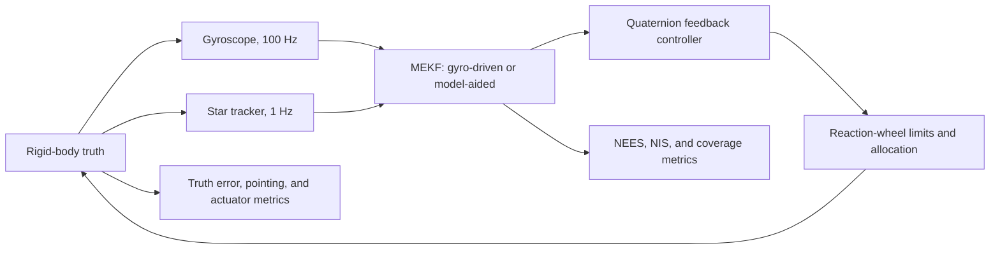

# Robust Spacecraft Attitude Estimation and Control Under Model Uncertainty

**A reproducible simulation study of estimator consistency and closed-loop pointing in the presence of spacecraft model and sensor errors.**

The project couples nonlinear rigid-body truth dynamics, gyroscope and star-tracker models, two multiplicative extended Kalman filters (MEKFs), quaternion feedback, and a reaction-wheel assembly. It asks when estimation error is represented honestly by the filter covariance, and when estimator degradation is large enough to affect spacecraft pointing.

> **Scope:** This is research and learning software. The results characterize the implemented idealized simulation; they do not demonstrate hardware performance, mission compliance, or flight readiness.

## Engineering question and principal result

**Can a filter retain low attitude-estimation error while becoming statistically inconsistent, and does that inconsistency necessarily degrade pointing?** The experiments show two distinct regimes:

1. Under inertia mismatch, the model-aided filter's attitude RMSE stays near 0.094°, while its 15-state mean NEES rises from 18.4 at matched inertia to 44.9 at 10% mismatch and 1,032.2 at 25%. Low attitude error therefore does not imply a credible full-state covariance.
2. In the severe E6 recovery case, pointing RMS is about 99.4° and the commanded torque is saturated for 95% of samples. Scaling estimator noise changes NEES and NIS substantially but leaves pointing essentially unchanged. In this case, control and actuator authority dominate the closed-loop result.

These are scenario findings, not universal thresholds. Full measurement conditions, definitions, and per-case results are in [current simulation evidence](docs/current_evidence.md) and the [32-case campaign summary](docs/campaign_summary.csv).

## Model and implementation

### Truth and sensors

The truth model propagates a scalar-last attitude quaternion and body angular velocity. Its rotational dynamics are

```text
I ω̇ = τ_body + τ_disturbance − ω × (I ω)
q̇   = 1/2 q ⊗ [ω_body, 0]
```

The rigid-body state is integrated with RK4 at the configured simulation step. The nominal E0 configuration uses `dt = 0.01 s` (100 Hz), principal inertias of 100, 80, and 60 kg·m², zero disturbance torque, and an initial body rate of `[0.01, 0.005, 0.002] rad/s`.

The gyro samples at 100 Hz and includes white rate noise, bias, and bias random walk. The star tracker supplies a noisy absolute attitude at 1 Hz; its nominal per-axis noise is 10 arcsec. Configurable star-tracker outliers and outages drive E4 and E5. Sensor noise parameters are interpreted as continuous-time spectral densities where specified; the conversion and frame conventions are recorded in [docs/conventions.md](docs/conventions.md).

### Estimators

Both filters are MEKFs: a unit nominal quaternion is maintained separately from a local three-component attitude error. The quaternion represents the body-to-inertial rotation; the filter uses a right-multiplicative body-frame error consistently in its covariance model, star-tracker innovation, and correction injection. Covariance propagation discretizes the continuous error model with the Van Loan method. Accepted updates use a Joseph covariance update and reset the local attitude error.

| Filter | Error state | Propagation and measurements |
|---|---|---|
| Gyro-driven | `[δθ, δb_g]` (6 states) | Propagates attitude from measured rate minus estimated gyro bias. Inertia does not enter this filter's state propagation. |
| Model-aided | `[δθ, δω, δb_g, δI]` (15 states) | Propagates rate with Euler's rigid-body equation and the applied body torque. Gyro measurements update rate and bias; star-tracker measurements update attitude and the coupled error state. |

The model-aided inertia error has six dimensionless relative coordinates for the symmetric tensor entries `[Ixx, Iyy, Izz, Ixy, Ixz, Iyz]`. Its nominal inertia matrix is constrained to remain positive definite. The E1 mismatch cases perturb the truth's diagonal inertia while the filter starts from the nominal inertia; the filter is allowed to estimate the inertia correction.

The truth uses RK4 integration. Filter nominal attitude and rate propagation use first-order steps at the same simulation cadence; filter covariance uses continuous-to-discrete Van Loan propagation. This is an implementation detail of the study, not a claim of a matched high-order truth and estimator integrator.

### Guidance, control, and actuators

The controller regulates to a desired quaternion and zero body rate using the shortest-path quaternion error. The default quaternion-feedback command is

```text
τ_cmd = −K_q q_error,vector − K_ω (ω̂ − ω_desired)
```

The command is norm-limited. The default actuator is a three-wheel orthogonal array. A pseudoinverse maps body torque to wheel torque; per-wheel torque and momentum constraints are applied separately. Wheel momentum evolves from wheel motor torque, with spacecraft reaction torque opposite in sign. The model omits wheel motor dynamics, friction, thermal effects, and high-fidelity allocation or desaturation logic.



The quaternion frame convention, attitude-error side, sensor covariance units, state definitions, and wheel sign convention are specified in [docs/conventions.md](docs/conventions.md); these conventions are part of the model definition.

## Experiment design

| Campaign | Question / independent variable | Cases |
|---|---|---:|
| E0 | Long nominal reference run | 1 run, 1,000 s |
| E1 | Inertia mismatch and estimator variant | 6 cases: 0%, 10%, 25% mismatch for each filter |
| E2 | Process-noise covariance scale, `Q` | 0.1×, 1×, 10× |
| E3 | Star-tracker measurement covariance scale, `R` | 0.1×, 1×, 10× |
| E4 | 5% star-tracker outlier probability, with and without NIS gating | 0.1, 0.5, 1.0 rad outlier magnitude |
| E5 | Scheduled star-tracker outage beginning at 5 s | 1, 10, 30 tracker updates |
| E6 | Initial condition, torque authority, wheel momentum limit, and noise scaling | 10 closed-loop stress cases |
| E7 | Repeated nominal run | 10-run ensemble |

The regenerated E1–E7 campaign uses ten runs of 100 s per case. E0 is a single 1,000 s run; its RMS values are not directly comparable with the 100 s campaign RMS values because the shorter runs include a larger fraction of the initial transient. Monte Carlo run `i` uses seed `config.seed + 1000 × i`, with the base run indexed from zero. The campaign runner constructs a deterministic set of cases and writes each case's compressed results, a CSV and JSON summary, and plots.

## Current results

### Nominal reference (E0)

The single 1,000 s nominal run produces mean NEES 6.552 (6 DOF), mean NIS 2.954 (3 DOF), attitude-estimation RMSE 0.036°, and true pointing RMS 0.673°. Of its time samples, 96.7% of NEES and 95.1% of NIS values fall inside the respective single-sample 95% chi-square bounds. These fractions are descriptive time-series statistics from one run, not independent-trial confidence statements.

### Inertia mismatch (E1)

Mean values across ten 100 s runs per case:

| Filter | Truth inertia mismatch | NEES (DOF) | NIS (DOF) | Attitude RMSE | Pointing RMS |
|---|---:|---:|---:|---:|---:|
| Gyro-driven | 0% | 5.986 (6) | 2.971 (3) | 0.0944° | 2.122° |
| Gyro-driven | 10% | 5.986 (6) | 2.971 (3) | 0.0944° | 2.350° |
| Gyro-driven | 25% | 5.987 (6) | 2.972 (3) | 0.0944° | 2.700° |
| Model-aided | 0% | 18.391 (15) | 2.977 (3) | 0.0940° | 2.097° |
| Model-aided | 10% | 44.850 (15) | 3.022 (3) | 0.0940° | 2.324° |
| Model-aided | 25% | 1,032.234 (15) | 3.299 (3) | 0.0940° | 2.669° |

The model-aided matched-inertia case is already above the 15-DOF mean-NEES reference. The 25% case is severely inconsistent, despite nearly unchanged attitude RMSE. NEES includes all 15 modeled error states, so it should be read with the separate attitude RMSE, attitude-component coverage, NIS, and pointing metrics. No acceptable mismatch envelope has been established.

### Noise calibration, outliers, and outages (E2–E5)

| Study | Setting | Mean NEES | Mean NIS | Attitude RMSE | Pointing RMS |
|---|---|---:|---:|---:|---:|
| Process noise | `Q = 0.1×` | 45.146 | 11.207 | 0.0946° | 2.122° |
| Process noise | `Q = 1×` | 5.986 | 2.971 | 0.0944° | 2.122° |
| Process noise | `Q = 10×` | 0.873 | 0.438 | 0.0944° | 2.122° |
| Measurement noise | `R = 0.1×` | 8.469 | 4.119 | 0.0944° | 2.122° |
| Measurement noise | `R = 1×` | 5.986 | 2.971 | 0.0944° | 2.122° |
| Measurement noise | `R = 10×` | 4.540 | 1.147 | 0.0946° | 2.122° |
| 0.5 rad outliers, ungated | 5% outlier probability | 1.56 × 10⁶ | 1.39 × 10⁶ | 5.40° | — |
| 0.5 rad outliers, NIS gate enabled | 5% outlier probability | 5.493 | 7.34 × 10⁵ all innovations; 2.942 accepted-only | 0.0945° | 2.124° |
| Star-tracker outage | 30 updates | 6.063 | 2.977 | 0.1185° | 2.131° |

Noise scaling shifts reported NEES/NIS substantially while changing attitude RMSE and pointing very little in these cases. The high coverage under inflated noise does not mean the covariance is calibrated; NEES/NIS fall well below their expected dimensions. For E4, all-innovation NIS includes rejected outlier innovations, so accepted-only NIS is the relevant gated-update diagnostic. The 30-update outage is a tested scenario, not a validated maximum outage duration.

### Closed-loop stress (E6)

The baseline stress case starts 60° from the desired attitude with body rate 0.1 rad/s and runs for 100 s. Across ten runs, it produces 99.403° pointing RMS and 122.33° mean final error. The commanded torque reaches its limit for 95.25% of samples; peak wheel momentum reaches 53.0% of the configured limit. With the corrected MEKF error convention, baseline mean NEES/NIS are 6.013/2.971. Multiplying process noise by ten changes them to 0.876/0.439 while pointing RMS remains 99.403°.

This is evidence that the tested recovery failure is dominated by control and actuator limits. In a zero-initial-rate case, the system reaches the configured 2%-of-initial-error settling criterion after 76.96 s. A 1 N·m·s wheel momentum limit reaches 99.9% utilization and spends 12.31% of samples near the limit. These are scenario comparisons, not controller or actuator acceptance limits.

### Nominal repeatability (E7)

Ten 100 s nominal runs give mean NEES 5.986 (6 DOF), mean NIS 2.971 (3 DOF), attitude RMSE 0.0944° (run-level 95% CI 0.0749°–0.1139°), and pointing RMS 2.122° (run-level 95% CI 2.117°–2.127°). The intervals are Student-t intervals over the ten run summaries. Fractions of time samples inside single-sample chi-square bounds are descriptive: adjacent samples are temporally correlated and are not independent trials.

### Metric interpretation

- **NEES:** `eᵀ P⁻¹ e`; expected value equals the estimated error-state dimension under a consistent Gaussian filter (`6` or `15` DOF here).
- **NIS:** `νᵀ S⁻¹ ν`; the star-tracker attitude innovation has `3` DOF. Reported gated results distinguish all valid innovations from accepted updates.
- **Coverage:** fraction of attitude error components within their estimated `±3σ` bounds. Coverage is reported alongside NEES/NIS because coverage alone cannot establish covariance calibration.
- **Attitude RMSE:** estimation error relative to truth; it is not the same quantity as true spacecraft pointing error.
- **Pointing RMS and actuator metrics:** true attitude-to-target error and torque/wheel usage. These show closed-loop performance and control authority independently of estimator statistics.

Campaign NEES/NIS means pool time samples and runs. The single-sample chi-square checks are useful diagnostics, not a substitute for statistical treatment of temporal correlation, independent campaigns, or mission-level acceptance criteria.

## Reproduce

Requires Python 3.10 or later. From the repository root:

```bash
python -m pip install -e ".[dev]"
pytest -q
```

Run E0 and generate its analysis outputs:

```bash
python scripts/run_experiment.py --config config/nominal.yaml --output reports/nominal.npz
python scripts/analyze_results.py reports/nominal.npz --all --output-dir reports/nominal_analysis
```

Regenerate the E1–E7 10-run, 100 s campaign:

```bash
python scripts/run_research_campaigns.py --campaign all --runs 10 --duration 100 --output-dir reports/research_campaigns
```

The campaign writes compressed per-case `.npz` files, `summary.csv`, `summary.json`, and campaign plots to the selected output directory. Choose a new directory to retain previous outputs. The checked-in [evidence page](docs/current_evidence.md) documents the specific regenerated results summarized above; the tracked [campaign CSV](docs/campaign_summary.csv) contains the 32 case-level records and run-level intervals.

## Repository map

```text
config/                 Nominal, uncertainty, degradation, and stress configurations
docs/                   Conventions and current simulation evidence
reports/                 Historical pilot artifacts
scripts/                 Single-run, campaign, and analysis entry points
src/actuators/           Reaction-wheel model and limits
src/control/             Quaternion feedback controller
src/dynamics/            Quaternion algebra and rigid-body truth model
src/estimation/          Gyro-driven and model-aided MEKFs
src/sensors/             Gyroscope and star-tracker models
tests/unit/               Dynamics, estimator, sensor, actuator, and controller checks
tests/integration/        End-to-end simulation checks
```

Historical reports under `reports/` predate the reaction-wheel sign correction and model-aided covariance updates. They are retained as provenance; use `docs/current_evidence.md` and `docs/campaign_summary.csv` for the current results described here.

## Assumptions and limits of inference

- Rigid-body spacecraft; no flexible modes, fuel slosh, or structural coupling.
- Simplified wheel array, allocation, torque and momentum limits; no high-fidelity actuator dynamics or desaturation system.
- No orbit propagation, environmental disturbance model, or external disturbance estimation; nominal runs use zero disturbance torque.
- One star tracker; no multi-head blending, GNSS, or relative navigation.
- NIS gating is implemented, but full fault detection, isolation, and recovery is not.
- No mission pointing requirement, operational acceptance criteria, independent model validation, hardware-in-the-loop result, or flight data is included.

Conclusions should be limited to the scenarios, model, parameters, and statistical summaries documented in this repository. In particular, the 25% inertia-mismatch result identifies a serious model-aided covariance-consistency limitation; it does not define a validated boundary for a real spacecraft.

## Method references

- F. L. Markley, [“Attitude Error Representations for Kalman Filtering,” *Journal of Guidance, Control, and Dynamics*, 26(2), 311–317 (2003)](https://doi.org/10.2514/2.5048). Background for representing global attitude with a quaternion and local attitude error coordinates.
- C. F. Van Loan, [“Computing Integrals Involving the Matrix Exponential,” *IEEE Transactions on Automatic Control*, 23(3), 395–404 (1978)](https://doi.org/10.1109/TAC.1978.1101743). Background for matrix-exponential methods used in continuous-to-discrete covariance propagation.

These references provide methodological context; they are not independent validation of this repository's implementation or results.

## Dependencies

Runtime dependencies: NumPy, SciPy, Matplotlib, and PyYAML. Development extras include pytest, pytest-cov, Black, Ruff, and mypy. See [pyproject.toml](pyproject.toml) for versions and tool configuration.
