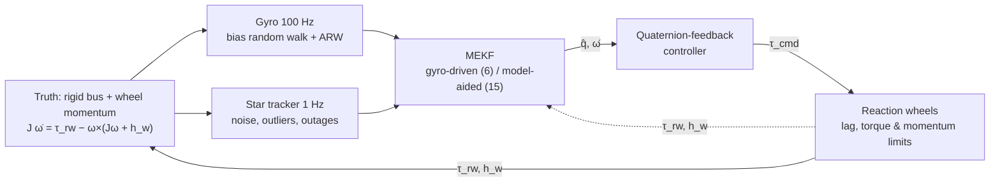

# Robust Spacecraft Attitude Estimation and Control Under Model Uncertainty

[](https://github.com/ISHMAEL555/Robust-Spacecraft-Attitude-Estimation-and-Control-Under-Model-Uncertainty/actions/workflows/tests.yml)


A simulation study of **spacecraft state-estimation errors and their effect on attitude-control and mission performance**. The project uses multiplicative extended Kalman filters (MEKFs) in closed loop with a reaction-wheel attitude controller, then degrades the estimator's knowledge on purpose: inertia mismatch, mistuned noise models, star-tracker outliers and outages. It asks three questions:

1. **Estimation:** does the filter's reported covariance describe its actual error, and when does it stop doing so?
2. **Propagation:** how do those estimation errors reach the controller, and what do they cost in pointing?
3. **Performance:** can the spacecraft still acquire and hold its target with finite wheel torque and momentum?

> **Scope.** These are simulation results for this repository's models. They are not hardware validation, qualification, mission acceptance, or flight-readiness evidence.

## Key results (release 1.0.0)

| | Result | Evidence |
|---|---|---|
| ✅ | Both MEKF variants are **statistically consistent** with matched models: E0 1,000 s NEES/DOF 1.023 [0.928, 1.117], NIS/DOF 1.002 [0.982, 1.022] | [Results §3](docs/current_evidence.md#3-statistical-consistency) |
| ⚠️ | The model-aided filter is **over-confident under 25% inertia mismatch** (NEES/DOF 26 [9, 43]) while its attitude RMSE is unchanged (0.081°). Accuracy is not consistency. | [Results §3.2](docs/current_evidence.md#32-inertia-mismatch-e1) |
| ✅ | The **NIS gate** contains 1 rad star-tracker outliers (NEES/DOF 0.97; without it, attitude RMSE is 12.3°) | [Results §4.1](docs/current_evidence.md#41-star-tracker-outliers-and-nis-gating-e4) |
| ✅ | The covariance **bounds error growth through a 30-sample tracker outage** (peak error 0.153° vs peak 3σ 0.298°) | [Results §4.2](docs/current_evidence.md#42-star-tracker-outages-e5) |
| ✅ | The **E6 pointing benchmark passes**: 60° / 0.1 rad/s acquisition settles at 174.5 s (limit 180 s), 1.01° terminal peak, 49.9% wheel use | [Results §5.1](docs/current_evidence.md#51-e6-project-benchmark-gnc-pb-001002) |
| ⚠️ | A **170° slew with stored wheel momentum is gyroscopic-torque limited**: it needs 0.152 N·m of `ω × h_w` against 0.1 N·m of authority and does not settle in 400 s | [Results §5.3](docs/current_evidence.md#53-large-angle-acquisition-and-wheel-gyroscopic-coupling) |
| ✅ | Innovations are **consistent with white noise** under a calibrated ensemble Ljung–Box test (KS p = 0.457) | [Results §6](docs/current_evidence.md#6-innovation-whiteness) |

Release 1.0.0 followed an engineering review. It fixed a reporting defect in model-aided bias coverage, added the missing wheel gyroscopic coupling to the truth model (which **withdraws** an earlier, physically invalid large-slew result), made the random streams independent, and regenerated all evidence. See the [changelog](CHANGELOG.md).


## What is modeled



| Component | Model |
|---|---|
| Truth dynamics | Rigid bus with wheel gyroscopic coupling, RK4; conserves total angular momentum to ~1e-14 |
| Gyro | Bias random walk plus angle random walk (continuous spectral densities) |
| Star tracker | Right-multiplicative noise; fractional-phase sampling; injected outliers and outages |
| Gyro-driven MEKF | 6 states `[δθ, δb]`; gyro as kinematic input |
| Model-aided MEKF | 15 states `[δθ, δω, δb, δJ]`; Euler's equation with estimated inertia and measured wheel momentum; online inertia estimation |
| Filter numerics | Right-error convention throughout, exact quaternion exponential, Van Loan discretization, Joseph update, exact SO(3) reset, χ² NIS gate |
| Controller | Body-frame quaternion feedback with norm-preserving saturation |
| Reaction wheels | Pseudo-inverse allocation, first-order motor lag, per-wheel torque limit, predictive hard momentum limit |

The equations, timing, and conventions are specified in the [system design description](docs/system_description.md).

## Quick start

Requires Python 3.10 or later.

```powershell
python -m pip install -r requirements.txt
python -m pytest                                    # 156 tests, about 30 s

# One nominal simulation, then figures and a text report
python scripts/run_experiment.py --config config/nominal.yaml --output reports/nominal.npz
python scripts/analyze_results.py reports/nominal.npz --all --output-dir reports/nominal_analysis

# The E6 pointing benchmark (pass/fail report and figure)
python scripts/evaluate_e6_benchmark.py
```

To regenerate all published evidence (about 30 minutes on 16 cores), follow [Results §8](docs/current_evidence.md#8-reproduction).

## Repository layout

| Path | Contents |
|---|---|
| `src/dynamics/` | Quaternion algebra; rigid-body truth model with wheel coupling |
| `src/sensors/` | Gyro and star-tracker models (private random generators) |
| `src/estimation/mekf.py` | Gyro-driven and model-aided MEKF, NEES/NIS |
| `src/control/` | Quaternion-feedback controller and gain design |
| `src/actuators/` | Reaction-wheel assembly |
| `config/` | Scenario files: nominal, model uncertainty, sensor degradation, closed loop, Monte Carlo |
| `scripts/run_experiment.py` | Simulation loop, Monte Carlo, metrics, consistency statistics |
| `scripts/run_research_campaigns.py` | E0–E7 campaign (parallel, resumable, signature-checked) |
| `scripts/verify_*.py`, `evaluate_e6_benchmark.py` | Targeted verification evidence |
| `tests/` | Unit and integration tests |
| `docs/` | Design description, results, traceability, curated evidence and figures |

## Documentation

| Document | Purpose |
|---|---|
| [System design description](docs/system_description.md) | Every model and algorithm, with equations and timing |
| [Frames and conventions](docs/conventions.md) | Quaternion, frame, sign, and state conventions |
| [Results report](docs/current_evidence.md) | All findings, tables, figures, and reproduction commands |
| [Requirements, traceability, and risks](docs/requirements_traceability.md) | Verification matrix with verdicts, and the risk register |
| [E0–E7 campaign design](docs/e0_e7_campaign.md) | Campaign design, statistics, and reproduction |
| [Changelog](CHANGELOG.md) | Release history and impact on results |

## Limitations

- **Model scope:** rigid bus only. No flexible modes, slosh, environmental disturbances, wheel friction, motor electrical or thermal limits, or momentum desaturation.
- **Sensor timing:** measurements are applied at their generation epoch. No latency, jitter, out-of-sequence data, or gyro scale-factor and misalignment errors.
- **Statistics:** ten runs per campaign case and five per robustness slice, with one-factor-at-a-time variations and diagonal inertia mismatch only. This is enough for the large effects reported, not for an operating envelope.
- **Open risks:** model-aided consistency under mismatch (R-01), the rate-process noise is a tuning parameter (R-06), and large slews with stored momentum (R-07). See the [risk register](docs/requirements_traceability.md#3-risk-register).
- The E6 thresholds are **project benchmarks**, not mission requirements.

## Roadmap

The next step closes the main gap between estimation evidence and control evidence: separating the pointing error *caused by* estimation from the control floor.

- **Perfect-knowledge baseline:** rerun each scenario with the controller fed the true state, using the same seeds. The difference isolates the estimation-induced pointing error.
- **Steady-state metrics:** measure absolute and relative pointing error (APE/RPE) after acquisition, where estimation effects are not masked by the acquisition transient. Move the E5 tracker outages into that window.
- **Error decomposition:** report pointing error as control tracking error plus estimation error, including how gyro noise in the rate feedback becomes pointing error, and compare the gyro-driven and model-aided filters on that basis.
- **Mission-level metric:** time inside a stated pointing requirement for each estimation fault.

Until that work is done and verified, the results above characterize estimator consistency and closed-loop acquisition separately.

## License

[MIT](LICENSE) © 2026 Kowluri Ishmael
