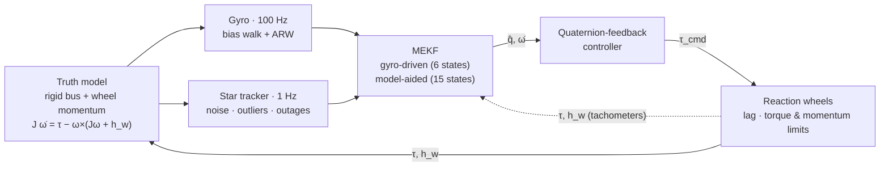

# Robust Spacecraft Attitude Estimation and Control Under Model Uncertainty

[](https://github.com/ISHMAEL555/Robust-Spacecraft-Attitude-Estimation-and-Control-Under-Model-Uncertainty/actions/workflows/tests.yml)


**What happens to a spacecraft's attitude control when its navigation filter is wrong, and would anyone notice?**

This project builds a closed-loop attitude GNC simulation and deliberately breaks its knowledge: wrong inertia, mistuned noise models, corrupted star-tracker data, sensor outages. It then measures three things separately:

1. **Is the estimator honest?** Does its covariance describe its real error (NEES/NIS consistency)?
2. **How do estimation errors reach the controller?** What do they cost in pointing?
3. **Does the mission still work?** Can the spacecraft acquire and hold its target with finite wheel torque and momentum?

Every result comes with a confidence interval over independent Monte Carlo runs, a regeneration script, and a SHA-256 manifest of the exact code that produced it.


---

## Highlights

| | Finding | Number |
|:-:|---|---|
| ✅ | Both MEKFs are **statistically consistent** when their models are right | E0 (1,000 s): NEES/DOF **1.02** [0.93, 1.12], NIS/DOF **1.00** [0.98, 1.02] |
| ⚠️ | **Accurate is not the same as honest.** With 25% inertia error, the model-aided filter's attitude accuracy is unchanged, but its error variance is about 26× what its covariance claims | RMSE 0.081° in both cases; NEES/DOF **26** [9, 43] |
| ✅ | A **χ² innovation gate** fully contains 1-radian star-tracker outliers | RMSE **0.085°** gated vs **12.3°** ungated |
| ✅ | The filter's covariance **correctly bounds error growth** through a 30 s tracker outage | Peak error 0.153° inside peak 3σ 0.298° |
| ✅ | **Pointing benchmark passes:** 60° / 0.1 rad/s acquisition with 0.1 N·m wheels | Settles at **174.5 s** (limit 180 s), 49.9% wheel momentum used |
| ⚠️ | **Large off-axis slews are torque-limited** by the wheels' own stored momentum | Needs **0.152 N·m** of `ω × h_w` against 0.1 N·m available |
| ✅ | Innovations are **white**, using a calibrated test (the textbook test gives 11% false alarms at this sample size) | 12-seed KS p = **0.457** |

> **Scope.** Simulation evidence for this repository's models only. It is not hardware validation, qualification, or flight-readiness evidence. Benchmark thresholds are project-defined, not mission requirements.

---

## Engineering insights

**1. Attitude accuracy hides covariance failure.** Under inertia mismatch the star tracker keeps attitude accurate, so RMSE looks perfect. The error hides in the rate and inertia states, where the actual error variance is about 26× the reported covariance (about 5× in standard deviation). A team watching RMSE alone would ship an estimator whose uncertainty it cannot trust. Breaking NEES down by state group shows exactly where the inconsistency lives.


**2. Leaving out a physical effect can produce a "pass" that isn't real.** An earlier version of this model omitted the wheel gyroscopic term `ω × h_w`, and a 170° slew appeared to settle in 235 s. Checking angular-momentum conservation showed that model violating it by **197%**. With correct physics the slew needs 0.152 N·m against 0.1 N·m of authority and does not settle. The result was withdrawn and recorded as a design risk ([details](docs/current_evidence.md#53-large-angle-acquisition-and-wheel-gyroscopic-coupling)).

**3. Statistical tests need calibrating too.** One run failed the multivariate Ljung–Box whiteness test (p = 0.006). On pure white noise of the same length, that test rejects 11.1% of the time at nominal 5%. Judged against the calibrated null, the 12-seed ensemble is indistinguishable from white noise ([details](docs/current_evidence.md#6-innovation-whiteness)).

**4. Noise mistuning moves the statistics, not the accuracy.** Scaling Q or R by 0.1× or 10× shifts NEES and NIS by up to an order of magnitude while RMSE barely changes. Consistency tests detect a mistuned filter; RMSE and 3σ coverage do not.


---

## System



| Component | Implementation |
|---|---|
| **Truth dynamics** | Rigid bus with wheel gyroscopic coupling, RK4 integration; total angular momentum conserved to about 1e-14 |
| **Gyro-driven MEKF** | 6 error states `[δθ, δb]`; gyro used as the kinematic input |
| **Model-aided MEKF** | 15 error states `[δθ, δω, δb, δJ]`; Euler's equation with online inertia estimation and measured wheel momentum |
| **Filter numerics** | Right-multiplicative error, exact quaternion exponential, Van Loan discretization, Joseph-form update, exact SO(3) reset Jacobian, χ² NIS gate |
| **Sensors** | Gyro bias random walk and angle random walk; star tracker with fractional-phase sampling, injected outliers, scheduled and random outages |
| **Control** | Body-frame quaternion feedback with direction-preserving torque saturation |
| **Actuators** | Pseudo-inverse allocation, first-order motor lag, per-wheel torque limits, predictive hard momentum limits |

Every equation, the timing of each simulation step, and every metric definition are specified in the [system design description](docs/system_description.md).

### Verification of the mathematics

- Every column of both filters' error Jacobians is checked against finite differences, including the six inertia sensitivities, with and without wheel momentum.
- Van Loan discretization is checked against independent Gauss–Legendre quadrature.
- The SO(3) reset Jacobian is checked against finite differences at finite angles.
- Angular-momentum conservation of the truth model is checked under multi-axis wheel torque.

---

## Experiments

33 scenarios × 10 independent seeds, 4.2 million propagation steps:

| Campaign | Question |
|---|---|
| **E0** | Is the nominal filter consistent over a long (1,000 s) run? |
| **E1** | How does 0 / 10 / 25% inertia mismatch affect each filter? |
| **E2 / E3** | How sensitive is consistency to process- and measurement-noise mistuning (0.1×, 10×)? |
| **E4** | Do 0.1–1 rad star-tracker outliers break the filter, with and without the NIS gate? |
| **E5** | How do 1–30 s star-tracker outages affect estimation? |
| **E6** | Closed-loop stress: torque authority, wheel momentum limit, initial conditions, estimator tuning |
| **E7** | Repeatability of the nominal case |

Targeted studies add a rate-process-noise sensitivity sweep, robustness slices, the calibrated whiteness test, and the wheel-coupling comparison. All results, tables, and figures are in the **[results report](docs/current_evidence.md)**.

---

## Quick start

Requires Python 3.10 or later.

```bash
git clone https://github.com/ISHMAEL555/Robust-Spacecraft-Attitude-Estimation-and-Control-Under-Model-Uncertainty.git
cd Robust-Spacecraft-Attitude-Estimation-and-Control-Under-Model-Uncertainty
python -m pip install -r requirements.txt
python -m pytest                       # 156 tests, about 30 s
```

Run a simulation and generate figures:

```bash
python scripts/run_experiment.py --config config/nominal.yaml --output reports/nominal.npz
python scripts/analyze_results.py reports/nominal.npz --all --output-dir reports/nominal_analysis
```

Run the pointing benchmark (pass/fail report and figure):

```bash
python scripts/evaluate_e6_benchmark.py
```

Regenerate all published evidence (about 30 minutes on 16 cores; results do not depend on `--jobs`):

```bash
python scripts/run_research_campaigns.py --campaign all --runs 10 --duration 100 --jobs 8 \
    --output-dir reports/research_campaigns/e0_e7_refresh
```

The full reproduction sequence is in [results §8](docs/current_evidence.md#8-reproduction).

---

## Reproducibility

- **Deterministic and independent randomness:** each run seed is split with `SeedSequence` into separate streams for filter initialization, gyro, and star tracker. No global random state is used, so paired comparisons between scenarios differ only in the factor being tested.
- **Statistics:** confidence intervals use Student-t over independent run-level means. Correlated time samples are never counted as independent trials.
- **Code provenance:** campaign rows carry a source-code fingerprint, so stale results cannot be resumed. The evidence manifest records SHA-256 hashes of every source file, configuration, document, and figure, plus the git commit.
- **CI:** GitHub Actions runs the suite on Python 3.10 and 3.12, verifies the package install, and smoke-tests the simulation.

---

## Repository layout

```
src/
  dynamics/      quaternion algebra; rigid-body truth model with wheel coupling
  estimation/    gyro-driven and model-aided MEKF, NEES/NIS
  sensors/       gyro and star-tracker models
  control/       quaternion-feedback controller and gain design
  actuators/     reaction-wheel assembly
config/          scenario definitions (YAML)
scripts/         simulation runner, campaigns, verification and plotting
tests/           unit and integration tests
docs/            design description, results, traceability, evidence, figures
```

## Documentation

| Document | Contents |
|---|---|
| [System design description](docs/system_description.md) | Every model and algorithm, with equations and timing |
| [Results report](docs/current_evidence.md) | All findings, tables, figures, and reproduction steps |
| [Requirements & risk register](docs/requirements_traceability.md) | Verification matrix (test/analysis/inspection) with verdicts, and open risks |
| [Frames & conventions](docs/conventions.md) | Quaternion, frame, sign, and state conventions |
| [E0–E7 campaign design](docs/e0_e7_campaign.md) | Campaign design and statistical method |
| [Changelog](CHANGELOG.md) | Release history and corrections to earlier results |

---

## Limitations

- **Rigid bus only:** no flexible modes, propellant slosh, environmental disturbance torques, wheel friction, or momentum desaturation.
- **Idealized sensor timing:** no latency, jitter, out-of-sequence measurements, or gyro scale-factor and misalignment errors.
- **Statistics:** 10 runs per campaign case (5 per robustness slice), one factor varied at a time, diagonal inertia mismatch only. This is enough for the large effects reported, not for a certified operating envelope.
- **Open risks:** model-aided consistency under mismatch (R-01); the rate-process noise is a tuning parameter (R-06); large slews with stored momentum (R-07). See the [risk register](docs/requirements_traceability.md#3-risk-register).

## Roadmap

The next step quantifies how much pointing error estimation *causes*, separately from the control floor:

- [ ] **Perfect-knowledge baseline:** rerun each scenario with the controller fed the true state, using the same seeds.
- [ ] **Steady-state pointing metrics:** absolute and relative pointing error (APE/RPE) after acquisition, with tracker outages placed inside that window.
- [ ] **Error decomposition:** pointing error as control tracking error plus estimation error, including how gyro noise in the rate feedback becomes pointing error; gyro-driven vs model-aided filters.
- [ ] **Mission-level metric:** time inside a stated pointing requirement for each estimation fault.

## Citation

```bibtex
@software{kowluri_robust_attitude_2026,
  author  = {Kowluri, Ishmael},
  title   = {Robust Spacecraft Attitude Estimation and Control Under Model Uncertainty},
  year    = {2026},
  version = {1.0.0},
  url     = {https://github.com/ISHMAEL555/Robust-Spacecraft-Attitude-Estimation-and-Control-Under-Model-Uncertainty}
}
```

## License

[MIT](LICENSE) © 2026 Kowluri Ishmael
