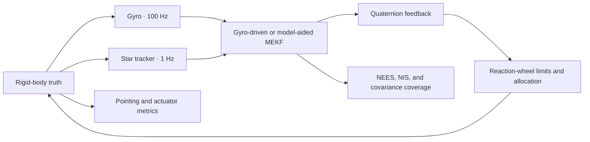
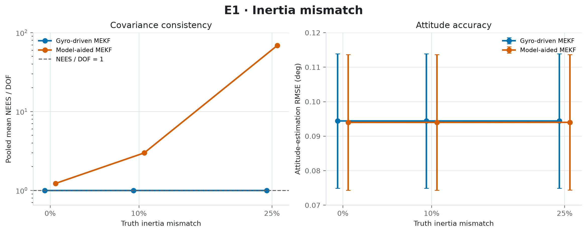
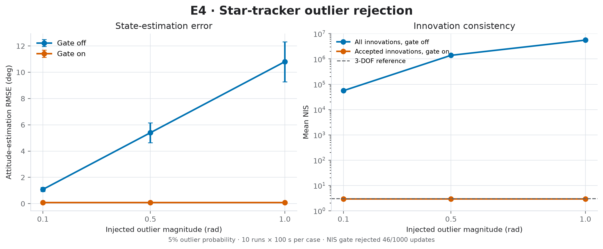
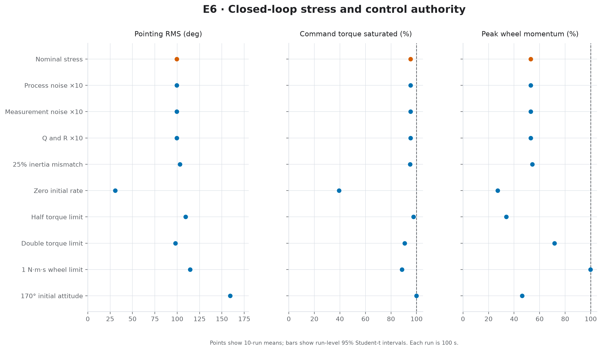

# Robust Spacecraft Attitude Estimation and Control Under Model Uncertainty

**A reproducible simulation study of multiplicative attitude filtering, covariance consistency, and reaction-wheel pointing under model and sensor errors.**

This project compares two multiplicative extended Kalman filters (MEKFs) in a closed-loop rigid-body spacecraft simulation. The study asks whether low attitude-estimation error is enough to trust a filter covariance, and whether estimator degradation necessarily drives poor pointing.

> **Scope:** These results describe this repository's idealized simulation only. They are not hardware validation, mission acceptance evidence, or a flight-readiness claim.

## Findings at a glance

- **Inertia uncertainty exposes model-aided filter inconsistency.** At 25% diagonal inertia mismatch, attitude RMSE remains about `0.094°` while the 15-state mean NEES reaches `1,032` (15 DOF).
- **Outlier gating protects attitude in the tested cases.** With 5% injected star-tracker outliers, gating keeps attitude RMSE near `0.095°` for outlier magnitudes from `0.1` to `1.0 rad`; without gating it grows to `10.8°` at `1.0 rad`.
- **The stressed recovery is command-torque limited.** The E6 baseline has `99.4°` pointing RMS and spends `95.3%` of samples at the torque-command limit, while peak wheel momentum reaches `53%` of its limit.

These are scenario-specific observations. Full conditions, metrics, intervals, and caveats are in the [current evidence report](docs/current_evidence.md) and the [32-case campaign summary](docs/campaign_summary.csv).

## Simulation architecture



## Model and estimator

### Frames and truth dynamics

Quaternions are scalar-last Hamilton quaternions. `q` represents the active body-to-inertial rotation, so `v_I = R(q) v_B`; angular velocity is expressed in body coordinates. The truth plant uses Euler's rigid-body equation and RK4 integration:

```text
J ω̇_B = τ_body + τ_disturbance − ω_B × (J ω_B)
q̇     = 1/2 q ⊗ [ω_B, 0]
```

The nominal configuration uses `J = diag(100, 80, 60) kg·m²`, a `0.01 s` (100 Hz) propagation step, and zero disturbance torque. The truth is integrated with RK4; filter nominal states use first-order propagation at the same cadence.

### Sensors and attitude error

The gyro model includes bias and continuous-time white noise:

```text
ω_m = ω_B + b_g + n_g       ḃ_g = n_b
```

The star tracker returns an absolute attitude at 1 Hz with nominal per-axis noise of 10 arcsec. Its perturbation is right-multiplicative in the body frame:

```text
q_ST = q_true ⊗ Exp(ν_ST),   ν_ST ~ N(0, R_ST)
```

Gyro noise spectral-density units and their discrete sampling interpretation are documented in [the convention reference](docs/conventions.md).

The MEKF uses the same local error convention throughout:

```text
q_true = q_hat ⊗ Exp(δθ)
ν      = Log(q_hat⁻¹ ⊗ q_ST)
q_hat  ← q_hat ⊗ Exp(δθ_hat)
```

An implementation audit found that the previous covariance linearization used this right/body error while the tracker residual, correction injection, and reported attitude errors used left-relative operations. Those coordinate definitions differ away from identity. The implementation, sensor perturbations, and error metrics are now aligned; the E0–E7 results below were regenerated after the correction. Older report files are retained as provenance and are not directly comparable.

### Filter variants

| Filter | Error state | Propagation and updates |
|---|---|---|
| Gyro-driven | `[δθ, δb_g]` (6 states) | Propagates attitude using measured rate minus estimated gyro bias. Inertia is not in this filter's propagation model. |
| Model-aided | `[δθ, δω, δb_g, δI_rel]` (15 states) | Propagates rate with Euler's equation and applied body torque; gyro updates rate and bias; tracker updates correct attitude and coupled states. |

The model-aided filter estimates six dimensionless relative coordinates for the symmetric inertia entries `[Jxx, Jyy, Jzz, Jxy, Jxz, Jyz]`; its estimated tensor is constrained to remain positive definite. The gyro-driven attitude error linearization includes `δθ̇ ≈ −[ω̂]× δθ − δb_g + n_g`. The model-aided rate and inertia sensitivities are linearized from Euler's equation. Covariance propagation uses Van Loan continuous-to-discrete conversion; accepted measurement updates use a Joseph covariance update and attitude-error reset.

### Guidance, control, and wheels

The controller selects the shortest-path quaternion error, `q_e = q_desired⁻¹ ⊗ q_hat`, then commands

```text
τ_cmd = −K_q vec(q_e) − K_ω (ω_hat − ω_desired)
```

The default gains are `K_q = 1`, `K_ω = 10`, with a `0.1 N·m` command norm limit. The nominal actuator is a three-wheel orthogonal array. With wheel-axis matrix `A`, wheel motor torque `τ_w`, and wheel momentum `h_w`, the body reaction torque is `τ_body = −A τ_w`; each wheel has separate torque and momentum limits (`0.1 N·m` and `10 N·m·s` nominally). This simplified model omits motor dynamics, friction, thermal effects, and desaturation logic.

## Campaign design and results

E0 is a single 1,000 s nominal run. E1–E7 comprise 32 deterministic cases, each with ten 100 s runs. Within each case, run `i` uses seed `config.seed + 1000 × i`, starting at `i = 0`.

| Campaign | Sweep | Conditions |
|---|---|---:|
| E0 | Long nominal reference | 1 run, 1,000 s |
| E1 | Filter variant × diagonal inertia mismatch | 6: `0%`, `10%`, `25%` |
| E2 | Process-noise covariance scale `Q` | 3: `0.1×`, `1×`, `10×` |
| E3 | Star-tracker covariance scale `R` | 3: `0.1×`, `1×`, `10×` |
| E4 | Outlier magnitude × NIS gating (`5%` outlier probability) | 6: `0.1`, `0.5`, `1.0 rad`, gated and ungated |
| E5 | Scheduled tracker outage from `5 s` | 3: `1`, `10`, `30` updates |
| E6 | Initial condition and control/wheel authority stress | 10 |
| E7 | Repeated nominal run | 10-run ensemble |

### E1 · Inertia mismatch

Mean values across ten 100 s runs per condition. NEES includes all error states: 6 DOF for the gyro-driven filter and 15 DOF for the model-aided filter.

| Filter | Truth mismatch | Mean NEES (DOF) | Mean NIS (DOF) | Attitude RMSE | Pointing RMS |
|---|---:|---:|---:|---:|---:|
| Gyro-driven | 0% | 5.986 (6) | 2.971 (3) | 0.0944° | 2.122° |
| Gyro-driven | 10% | 5.986 (6) | 2.971 (3) | 0.0944° | 2.350° |
| Gyro-driven | 25% | 5.987 (6) | 2.972 (3) | 0.0944° | 2.700° |
| Model-aided | 0% | 18.391 (15) | 2.977 (3) | 0.0940° | 2.097° |
| Model-aided | 10% | 44.850 (15) | 3.022 (3) | 0.0940° | 2.324° |
| Model-aided | 25% | 1,032.234 (15) | 3.299 (3) | 0.0940° | 2.669° |

The model-aided filter is above its 15-DOF mean-NEES reference even at matched inertia; inconsistency grows sharply with mismatch while attitude RMSE changes little. This study does not establish an acceptable mismatch envelope.



*Pooled mean NEES is normalized by DOF; the dashed line marks the consistency reference. Attitude-RMSE error bars are run-level 95% Student-t intervals.*

### E2–E3 · Noise covariance sensitivity

| Sweep | Scale | Mean NEES | Mean NIS | Attitude RMSE | Pointing RMS |
|---|---:|---:|---:|---:|---:|
| Process noise `Q` | 0.1× | 45.146 | 11.207 | 0.0946° | 2.122° |
| Process noise `Q` | 1× | 5.986 | 2.971 | 0.0944° | 2.122° |
| Process noise `Q` | 10× | 0.873 | 0.438 | 0.0944° | 2.122° |
| Measurement noise `R` | 0.1× | 8.469 | 4.119 | 0.0944° | 2.122° |
| Measurement noise `R` | 1× | 5.986 | 2.971 | 0.0944° | 2.122° |
| Measurement noise `R` | 10× | 4.540 | 1.147 | 0.0946° | 2.122° |

The sweeps move NEES and NIS substantially without materially changing attitude RMSE or pointing in these cases. Inflated noise can produce high coverage while NEES/NIS fall well below their expected dimensions; coverage alone does not establish calibration.

### E4 · Star-tracker outliers and gating

Each condition has a 5% outlier probability and 1,000 tracker updates across ten runs. Gating rejects 46 updates per condition in this campaign.

| Outlier magnitude | Attitude RMSE, gate off | Attitude RMSE, gate on | Accepted-only NIS, gate on |
|---:|---:|---:|---:|
| 0.1 rad | 1.085° | 0.0945° | 2.942 |
| 0.5 rad | 5.402° | 0.0945° | 2.942 |
| 1.0 rad | 10.806° | 0.0945° | 2.942 |



*The gated accepted-only NIS remains near its 3-DOF reference. All-innovation NIS includes rejected outliers and therefore grows with outlier magnitude. This experiment demonstrates update rejection, not complete fault detection, isolation, and recovery.*

### E5 · Scheduled tracker outage

| Outage duration | Valid updates (of 1,000) | Attitude RMSE | Pointing RMS |
|---:|---:|---:|---:|
| 1 update | 990 | 0.0944° | 2.122° |
| 10 updates | 900 | 0.0962° | 2.125° |
| 30 updates | 700 | 0.1185° | 2.131° |

The 30-update outage modestly degrades these metrics; it does not establish a maximum tolerated outage or recovery requirement.

### E6 · Closed-loop stress and control authority

The baseline starts `60°` from the desired attitude with body rate `0.1 rad/s`. It produces `99.403°` pointing RMS, `122.33°` mean final error, and command-torque saturation for `95.25%` of samples. Peak wheel momentum is only `53.0%` of its limit. With corrected attitude-error coordinates, baseline mean NEES/NIS are `6.013/2.971`; scaling `Q` by ten changes them to `0.876/0.439` while pointing remains essentially unchanged. In this case, the torque-command limit is more active than the wheel momentum limit.



*Points are 10-run means; intervals are run-level 95% Student-t confidence intervals. The zero-initial-rate case settles to the 2%-of-initial-error criterion in `76.95 s`; the `1 N·m·s` wheel-limit case reaches `99.9%` peak utilization and spends `12.31%` of samples near its limit. These are scenario comparisons, not controller acceptance limits.*

### E7 · Nominal repeatability

Across ten 100 s runs, mean NEES is `5.986` (6 DOF) and mean NIS is `2.971` (3 DOF). Attitude RMSE is `0.0944°` (run-level 95% CI `[0.07493°, 0.11389°]`); pointing RMS is `2.122°` (95% CI `[2.11697°, 2.12736°]`). These short-run RMS values are not directly comparable with the single 1,000 s E0 run because the runs include a larger fraction of the initial transient.

### Reading the consistency metrics

- **NEES:** `eᵀ P⁻¹ e`; its expected value is the error-state dimension for a consistent Gaussian estimator. The campaign NEES mean pools time samples and runs; samples are temporally correlated.
- **NIS:** `νᵀ S⁻¹ ν`; the star-tracker attitude innovation has 3 DOF. Gated results distinguish all innovations from accepted updates.
- **Coverage:** fraction of attitude-error components inside estimated `±3σ` bounds. Coverage is not a substitute for NEES/NIS.
- **Attitude RMSE vs pointing RMS:** estimation error relative to truth vs true spacecraft attitude error relative to target. They are different performance quantities.
- **Confidence intervals:** reported intervals are Student-t intervals across ten run summaries, not across time samples.

The [evidence report](docs/current_evidence.md) contains complete per-case results, definitions, and interpretation limits. The [campaign CSV](docs/campaign_summary.csv) contains the underlying 32 case-level summaries and run-level intervals.

## Reproduce

Requires Python 3.10 or later. From the repository root:

```bash
python -m pip install -e ".[dev]"
pytest -q
```

Run the nominal 1,000 s case and render its diagnostic plots:

```bash
python scripts/run_experiment.py --config config/nominal.yaml --output reports/nominal.npz
python scripts/analyze_results.py reports/nominal.npz --all --output-dir reports/nominal_analysis
```

Regenerate the ten-run-per-case E1–E7 campaign and its README figures:

```bash
python scripts/run_research_campaigns.py --campaign all --runs 10 --duration 100 --output-dir reports/research_campaigns
cp reports/research_campaigns/summary.csv docs/campaign_summary.csv
python scripts/plot_campaign_figures.py --input reports/research_campaigns/summary.csv --output-dir docs/figures
```

The campaign runner writes compressed per-case `.npz` traces, CSV/JSON summaries, and campaign plots to its output directory. The copy command refreshes the tracked case-level CSV; the plot script can use either that CSV or the campaign output directly.

## Project map

```text
config/                  Nominal, uncertainty, degradation, and stress configurations
docs/conventions.md      Frames, signs, sensor units, and state definitions
docs/current_evidence.md Regenerated E0–E7 evidence and interpretation limits
docs/campaign_summary.csv 32 case-level campaign records and run intervals
docs/figures/            README-ready campaign plots
scripts/                 Experiment, analysis, campaign, and figure entry points
src/                     Dynamics, sensors, estimators, control, and actuators
tests/                   Unit and integration test suites
```

Historical outputs under `reports/` are provenance only; they predate the corrected MEKF attitude-error convention. Use the linked evidence report and campaign CSV for current results.

## Scope and limitations

- Rigid-body truth with simplified reaction wheels; no flexible modes, fuel slosh, structural coupling, orbit propagation, or environmental disturbance model.
- One star tracker, no multi-head blending, GNSS, or relative navigation; nominal disturbance torque is zero.
- NIS gating is implemented, but full fault detection, isolation, and recovery is not.
- No independent model validation, hardware-in-the-loop evidence, flight data, mission pointing requirement, or operational acceptance criteria.
- Conclusions apply only to the documented cases. They establish neither a safe operating envelope nor flight readiness.

## Method references

- F. L. Markley, [“Attitude Error Representations for Kalman Filtering,” *Journal of Guidance, Control, and Dynamics*, 26(2), 311–317 (2003)](https://doi.org/10.2514/2.5048).
- C. F. Van Loan, [“Computing Integrals Involving the Matrix Exponential,” *IEEE Transactions on Automatic Control*, 23(3), 395–404 (1978)](https://doi.org/10.1109/TAC.1978.1101743).

These references provide methodological context; they do not independently validate this repository's implementation or results.
