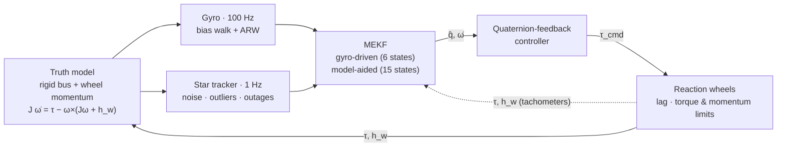
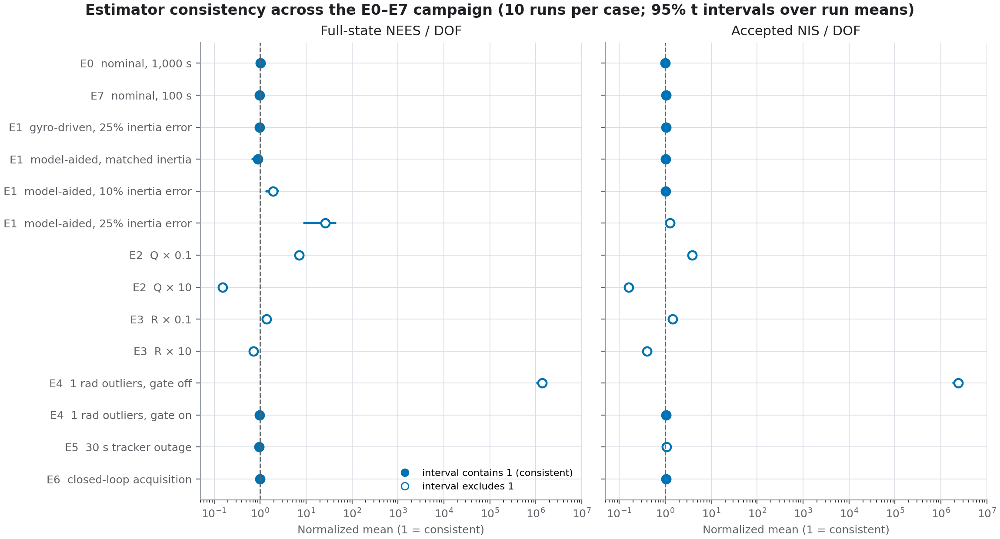
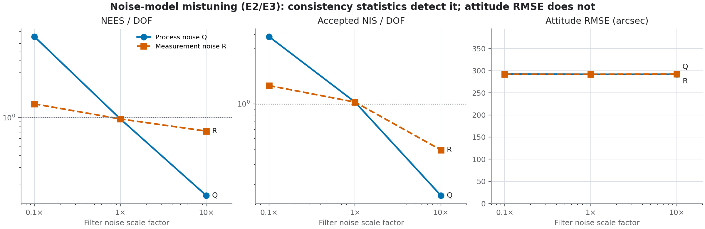
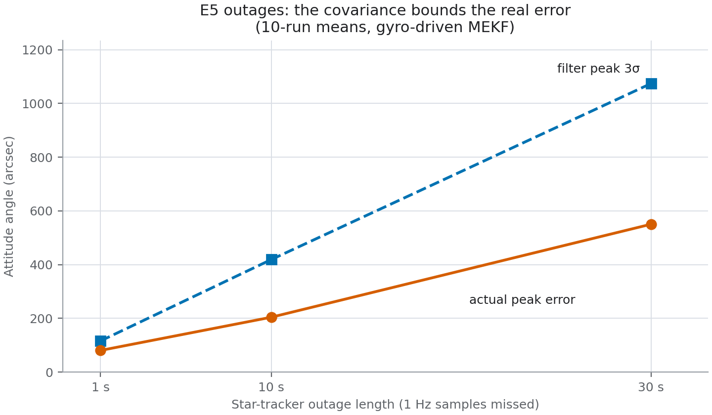
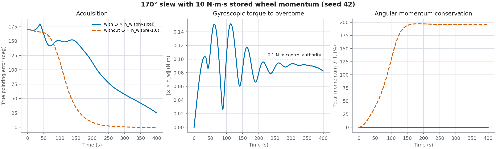

# Robust Spacecraft Attitude Estimation and Control Under Model Uncertainty

[](https://github.com/ISHMAEL555/Robust-Spacecraft-Attitude-Estimation-and-Control-Under-Model-Uncertainty/actions/workflows/tests.yml)


A closed-loop attitude GNC simulation built to answer one question: **when the navigation filter's knowledge is wrong, what happens to the pointing loop?** Two multiplicative extended Kalman filters (MEKFs) run in the loop with a quaternion-feedback controller and a constrained reaction-wheel assembly. Their knowledge is then degraded on purpose: inertia mismatch, mistuned noise models, star-tracker outliers, and outages. Each case is assessed on three questions, answered here in one line each and in detail in [Section 5](#5-results):

| # | Question | Short answer |
|:-:|---|---|
| 1 | **Is the estimator consistent?** Does the covariance describe the real error? | Yes when the filter model matches the truth (nominal NEES/DOF 1.02). The model-aided filter is not consistent once its inertia prior reaches 10%, and attitude RMSE does not show it. |
| 2 | **How does estimation error reach the controller?** | Mainly through the rate path. The gyro-driven filter adds 0.043° of steady-state pointing error over true-state feedback; the model-aided filter adds 0.0004°. |
| 3 | **Is the mission still achievable** with finite wheel torque and momentum? | Not within the 180 s E6 budget as specified: on fresh seeds the best controller passes 33 of 200 dispersed runs, and the shipped gains 1 of 200. Split into a detumble and an acquisition requirement, both are met by a two-phase mode manager (200/200 and 190–200/200). Actuator limits are never violated; the evidence points to the 180 s budget rather than a gain set, but E6 has not been shown infeasible. |

> **Scope.** Simulation evidence for this repository's models. Not hardware validation, qualification, mission acceptance, or flight-readiness evidence. Benchmark thresholds are project-defined, not mission requirements.


---

## Contents

1. [Summary of findings](#1-summary-of-findings)
2. [System architecture](#2-system-architecture)
3. [Design parameters](#3-design-parameters)
4. [Verification summary](#4-verification-summary)
5. [Results](#5-results)
6. [Reproducing the results](#6-reproducing-the-results)
7. [Repository and documentation](#7-repository-and-documentation)
8. [Limitations, risks, and roadmap](#8-limitations-risks-and-roadmap)

---

## 1. Summary of findings

### 1.1 Engineering conclusions

**Estimator consistency**

- **Attitude accuracy does not establish covariance consistency.** Under inertia mismatch the star tracker keeps attitude RMSE flat while the rate and inertia states become overconfident: the actual error variance is about 26× the reported covariance. Breaking NEES down by state group locates the failure; RMSE alone cannot.
- **Noise-model mistuning is invisible to RMSE.** Scaling Q or R by 0.1× or 10× moves NEES and NIS by up to an order of magnitude with no change in attitude accuracy. 3σ coverage approaches 100% under inflated noise, a symptom of mistuning rather than a sign of good performance.
- **Fixing the truth across seeds can bias a consistency result.** With the true inertia held at its nominal value, the model-aided filter's inertia states start with zero error against a 5% prior, so its 15-state NEES is low by construction (initial value 9 of 15). Sampling the truth from the filter's own prior removes that, and exposes a mildly over-confident inertia group at the matched prior and inconsistency from a 10% prior.
- **Statistical tests need calibration.** At the available sample size, the multivariate Ljung–Box test rejects white noise 11.1% of the time at nominal 5%. Whiteness is therefore judged against an empirically calibrated null.

**Estimation to control**

- **Estimation costs pointing through the rate path, not only through attitude knowledge.** With true-state feedback steady-state pointing is 0.0005°. With the gyro-driven filter it is 0.043°: the 1.73 mrad/s rate error passes through the derivative gain and moves the spacecraft, so the control error (0.044°) exceeds the attitude-estimation error (0.008°). The model-aided filter's rate estimate is 2,000× quieter and costs 0.0004°. A 30 s tracker outage does not show up in pointing.

**Mission performance and model fidelity**

- **The E6 end-to-end criterion (180 s) was not met by any frozen controller on fresh seeds.** The deterministic benchmark passes, but under dispersions the shipped gains pass 1/200, and the best of four controllers evaluated on 200 fresh seeds passes 33/200 [0.116, 0.224] (the untuned `rate_profile` law; it beats the two-phase manager on the same seeds, exact McNemar p = 1.4e-6). The torque command is saturated for a median 90–97% of each envelope run for the three saturation-aware controllers (69% for the ζ = 0.8 PD), and the two-phase design detumbles at 1.15× [1.08, 1.27] the proven momentum bound, so the shortfall is consistent with torque authority rather than gain choice. It is not proven: the best proven lower bound on end-to-end time is at most 107.8 s and exceeds 180 s for none of the 200 runs, and a tuned controller that turns while braking was not evaluated. E6 has therefore not been shown infeasible.
- **Split into modes, the requirement is met.** GNC-DET-001 (hand over at ≤ 0.01 rad/s true rate within 150 s) passes 200/200 and GNC-ACQ-001 (acquire from the handover condition) 190–200/200 with the two-phase mode manager (the drifted case re-scored with an absolute 1.2° settling band, a placeholder pending the requirement owner). Together they imply an end-to-end time well above 180 s: adding each seed's handover and drifted-acquisition times gives a median of 217.8 s and a 95th percentile of 259.5 s, and even that sum is optimistic against the envelope runs; directly, 192 of 200 two-phase envelope runs had not settled at 200 s. The split is a requirement change that needs sign-off against the mission need behind the 180 s figure (R-11).
- **Notes on the controllers.** Filtering ω̂ in the rate loop (Task D, not done) could make `rate_profile` the best controller overall: it settles fastest in both acquisition scenarios (78.9 s and 84.9 s median) and fails there mainly on the effort criterion, which here measures gyro noise in the command (in-band effort 0.98–0.99). The two-phase manager and the PD acquire about equally well: 200 vs 194 from 60° (p = 0.031, not significant after a Bonferroni correction) and 190 vs 192 from the drifted attitude (p = 0.77), settling at the same median time in the drifted case (139.0 s vs 139.7 s). Gyroscopic feedforward shows no measurable benefit in acquisition (0 and 1 discordant runs).
- **Model fidelity can create false passes.** Omitting the wheel gyroscopic term `ω × h_w` violated angular-momentum conservation by 197% and made a 170° slew appear to settle in 235 s. With correct physics it does not. The earlier result is withdrawn.

### 1.2 Status at a glance

| Area | Result | Status |
|---|---|:-:|
| Nominal consistency | E0 (1,000 s): NEES/DOF **1.023** [0.928, 1.117]; NIS/DOF **1.002** [0.982, 1.022] | Pass |
| Model-aided filter, truth inertia sampled from the 5% prior (30 seeds) | NEES/DOF **1.16** [0.94, 1.38]; NIS 1.02; inertia group **1.44** [1.09, 1.79], mildly over-confident. With truth fixed instead, NEES/DOF is 0.80 [0.70, 0.89]: biased low by construction | Pass (full NEES); inertia group flagged |
| Model-aided filter, inertia error | Fixed 10% / 25% offsets: NEES/DOF 1.85 / 31.97 (attitude RMSE unchanged at 0.081°). Truth sampled from a 10% / 25% prior: 2.83 / median run 19.8 | Inconsistent from a 10% prior (R-01) |
| Star-tracker outliers (1 rad, 5%) | With χ² gate: NEES/DOF 0.974, RMSE 0.085°. Without: RMSE 12.3° | Pass |
| Star-tracker outage (30 s) | Peak error 550″ inside filter peak 3σ of 1,074″ | Pass |
| Innovation whiteness | 12-seed ensemble vs calibrated white-noise null: KS p = 0.457 | Pass |
| Pointing benchmark (E6), one deterministic run | 2% settling **174.5 s** (≤ 180 s); terminal peak 1.01° (≤ 2°); wheel use 49.9% (≤ 80%) | Pass (3% margin) |
| Pointing benchmark (E6), 200-run Monte Carlo | **P(pass all criteria) = 0.005 [0.000, 0.028]**: 1 of 200 runs passes under random attitude axis, rate direction, inertia and sensor noise. Sensor noise alone: 100/100 pass. Actuator limits never violated | **Fails under dispersions (R-02)** |
| E6 end to end, four controllers, 200 fresh seeds | Best 33/200 [0.116, 0.224] (`rate_profile`); two-phase 6/200, with feedforward 12/200; PD ζ = 0.8 2/200. Proven lower bound ≤ 107.8 s, above 180 s in 0/200 runs | Not met; not shown infeasible (R-11) |
| GNC-DET-001 / GNC-ACQ-001 (two-phase mode manager) | Detumble 200/200 [0.982, 1.000], handover 82.0 s median at 1.15× the proven bound; acquisition 200/200 (60° axis) and 190/200 (drifted, absolute 1.2° band) | Pass; requirement change pending approval |
| Estimation cost on pointing (E6, 400–600 s) | Gyro-driven filter adds **+0.043°** [0.036, 0.049] APE over true-state feedback (0.0005°); model-aided adds +0.0004°. 0.1° project-defined requirement met throughout in both | Characterized (R-10) |
| 170° slew with stored momentum | Needs 0.152 N·m of gyroscopic torque against 0.1 N·m available; not settled at 400 s | Authority-limited (R-07) |

---

## 2. System architecture



| Subsystem | Model | Source |
|---|---|---|
| Truth dynamics | Rigid bus with wheel gyroscopic coupling; RK4 at 100 Hz; total angular momentum conserved to about 1e-14 | `src/dynamics/` |
| Gyro-driven MEKF | Error state `[δθ, δb]` (6); gyro as the kinematic input | `src/estimation/mekf.py` |
| Model-aided MEKF | Error state `[δθ, δω, δb, δJ]` (15); Euler's equation with online inertia estimation and measured wheel momentum | `src/estimation/mekf.py` |
| Filter numerics | Right-multiplicative body-frame error; exact quaternion exponential; Van Loan discretization; Joseph update; exact SO(3) reset Jacobian; χ² NIS gate | `src/estimation/mekf.py` |
| Gyro | Bias random walk plus angle random walk (continuous spectral densities) | `src/sensors/gyro.py` |
| Star tracker | Right-multiplicative noise; fractional-phase sampling; injected outliers; scheduled and random outages | `src/sensors/star_tracker.py` |
| Controller | Body-frame quaternion feedback; norm-limited, direction-preserving saturation | `src/control/` |
| Reaction wheels | Pseudo-inverse allocation; first-order motor lag; per-wheel torque limit; predictive hard momentum limit | `src/actuators/` |

The full equations, step timing, and metric definitions are in the [system design description](docs/system_description.md).

---

## 3. Design parameters

| Parameter | Value | Notes |
|---|---|---|
| Spacecraft inertia `J` | diag(100, 80, 60) kg·m² | Truth scaled by 1 + m for mismatch cases |
| Integration step | 0.01 s (100 Hz), RK4 | Zeroth-order-hold torque and gyro sample |
| Gyro rate noise σ_v | 1.0e-4 rad/√s | Angle random walk |
| Gyro bias walk σ_u | 1.0e-6 rad/s^1.5 | Rate random walk |
| Initial gyro bias | [1.0, −2.0, 0.5] mrad/s | |
| Star tracker | 1 Hz, 10″ (4.85e-5 rad) 1σ per axis | |
| Filter prior | 0.57° attitude, 1 mrad/s bias (1σ) | Initial error drawn from the prior |
| Model-aided rate noise σ_ω | 1e-7 (rad/s)/√s | Tuning parameter, see R-06 |
| Inertia prior | 5–25% relative (1σ) per element | |
| NIS gate | χ²₃(0.999999) = 30.66 | Optional, used in E4 |
| Controller gains | K_q = 1 N·m; K_ω = 10 N·m·s (20 in E6) | Body torque limit 0.1 N·m |
| Reaction wheels | 3 orthogonal; 0.1 N·m; 10 N·m·s (20 in E6) | 50 ms motor lag in E6 |

---

## 4. Verification summary

| Category | Method | Result |
|---|---|:-:|
| Error-state Jacobians, both filters, including six inertia sensitivities with and without wheel momentum | Test: central finite differences | Pass |
| Van Loan discretization | Test: Gauss–Legendre quadrature | Pass |
| SO(3) reset Jacobian at finite angles | Test: finite differences | Pass |
| Truth-model angular-momentum conservation | Test and analysis | Pass (< 1e-8) |
| Actuator torque and momentum limits | Test | Pass |
| Filter initialization drawn from prior | Test: mean initial NEES over 200 seeds | Pass |
| Random-stream independence and determinism | Test; 1- vs 4-worker campaign comparison | Pass |
| Statistical consistency, matched models | Analysis: 10-run Monte Carlo | Pass |
| Innovation whiteness | Analysis: calibrated 12-seed ensemble | Pass |
| Fault response (outliers, outages) | Analysis: 10-run Monte Carlo | Pass |
| Pointing benchmark E6 | Analysis: deterministic run | Pass |
| Pointing benchmark E6 under dispersions | Analysis: 200-run Monte Carlo, Clopper–Pearson intervals | **Fails**: P(pass) = 0.005 |
| E6 feasibility (bounds) | Analysis: proven momentum and angle-reach bounds per run | No run above 180 s |
| Detumble and acquisition modes (GNC-DET-001, GNC-ACQ-001) | Analysis: frozen controllers, 200 fresh seeds per scenario, exact McNemar tests | Pass (two-phase) |

289 automated tests run in CI on Python 3.10, 3.12 and 3.13, plus a job with the newest numpy/scipy/matplotlib. Locally all 289 pass on Python 3.10.20 (numpy 2.2.6), 3.11.9 (numpy 2.4.4), 3.12.13 and 3.13.13 (numpy 2.5.4). Regression tests against the 1.0.0 output use floating-point tolerances, not exact equality; a separate test requires identical repeat runs. The full verification matrix with requirement IDs, artifacts, and verdicts is in [requirements and traceability](docs/requirements_traceability.md).

---

## 5. Results

All results come from 33 campaign scenarios × 10 independent seeds (4.2 million propagation steps) plus targeted studies. Intervals are 95% Student-t over independent run means; correlated time samples are never counted as independent trials.

### 5.1 Estimator consistency across the campaign

Filled markers: the run-level interval contains 1, so the filter is consistent. Open markers: it does not.



| Case | NEES / DOF | Accepted NIS / DOF | Attitude RMSE |
|---|---:|---:|---:|
| E0 nominal, 1,000 s | 1.023 [0.928, 1.117] | 1.002 [0.982, 1.022] | 0.027° |
| E1 gyro-driven, 25% inertia error | 0.965 [0.834, 1.096] | 1.036 [0.990, 1.082] | 0.081° |
| E1 model-aided, matched inertia | 0.885 [0.685, 1.085] | 1.011 [0.943, 1.080] | 0.081° |
| E1 model-aided, 10% inertia error | 1.894 [1.384, 2.405] | 1.031 [0.966, 1.096] | 0.081° |
| E1 model-aided, 25% inertia error | **25.975** [9.125, 42.825] | 1.275 [1.140, 1.410] | 0.081° |
| E7 nominal repeatability, 100 s | 0.965 [0.834, 1.096] | 1.037 [0.991, 1.082] | 0.081° |

### 5.2 Inertia mismatch: accuracy versus consistency

The gyro-driven filter does not use inertia, so it is unaffected. The model-aided filter keeps its attitude accuracy but loses consistency as mismatch grows. The marginal NEES shows the error concentrated in the rate and inertia states.


**Deterministic offsets versus sampled truth inertia (30 seeds, model-aided):**

| Truth inertia | Prior σ | NEES / DOF | Median run | Inertia-group NEES / DOF |
|---|---:|---:|---:|---:|
| Fixed, 0% offset | 5% | 0.795 [0.700, 0.890] | 0.73 | 0.80 |
| Sampled | 5% | 1.163 [0.943, 1.383] | 1.06 | 1.44 [1.09, 1.79] |
| Fixed, 10% offset | 10% | 1.850 [1.424, 2.277] | 1.54 | 2.41 |
| Sampled | 10% | 2.834 [1.337, 4.332] | 2.18 | 3.79 |
| Fixed, 25% offset | 25% | 31.97 [13.54, 50.40] | 13.14 | 42.28 |
| Sampled (55% of draws rejected) | 25% | 174 (one run at 3,700; interval not meaningful) | 19.80 | 220.9 |


### 5.3 Noise-model mistuning

| Filter setting | NEES / DOF | Accepted NIS / DOF | Attitude 3σ coverage | Attitude RMSE |
|---|---:|---:|---:|---:|
| Q × 0.1 | 7.088 | 3.824 | 80.6% | 0.0812° |
| Q × 1 (nominal) | 0.965 | 1.037 | 99.7% | 0.0810° |
| Q × 10 | 0.151 | 0.161 | 100.0% | 0.0811° |
| R × 0.1 | 1.390 | 1.440 | 96.9% | 0.0811° |
| R × 10 | 0.719 | 0.399 | 100.0% | 0.0812° |



### 5.4 Sensor faults

**Star-tracker outliers (E4):** 5% probability, 1,000 samples per case.

| Outlier magnitude | NIS gate | NEES / DOF | Attitude RMSE | Rejected samples |
|---:|:-:|---:|---:|---:|
| 0.1 rad | off | 1.37 × 10⁴ | 1.232° | 0 / 1,000 |
| 1.0 rad | off | 1.37 × 10⁶ | 12.290° | 0 / 1,000 |
| 0.1–1.0 rad | on | 0.974 [0.861, 1.087] | 0.085° | 58 / 1,000 |


**Star-tracker outages (E5):** the covariance grows faster than the real error, so NEES stays consistent through the gap.

| Outage | NEES / DOF | Peak attitude error | Filter peak 3σ |
|---:|---:|---:|---:|
| 1 s | 0.974 [0.840, 1.108] | 81″ | 116″ |
| 10 s | 0.966 [0.834, 1.097] | 204″ | 419″ |
| 30 s | 0.960 [0.787, 1.132] | 550″ | 1,074″ |



### 5.5 Pointing benchmark (E6)

**Deterministic run:** 60° initial error, 0.1 rad/s initial rate, seed 42.

| Criterion | Limit | Measured | Verdict |
|---|---:|---:|:-:|
| 2% settling time | ≤ 180 s | 174.51 s | Pass |
| Hold after settling | ≥ 20 s | 25.48 s | Pass |
| Final-20 s peak pointing error | ≤ 2° | 1.014° | Pass |
| Final body-rate norm | ≤ 1e-3 rad/s | 3.0e-4 rad/s | Pass |
| Peak wheel momentum use | ≤ 80% | 49.9% | Pass |
| Achieved / requested squared-torque effort | ≥ 85% | 87.9% | Pass |
| Peak commanded and wheel torque | ≤ 0.1 N·m | 0.100 N·m | Pass |

**Monte Carlo (200 runs):** the same configuration and criteria, with a random 60° attitude axis, a random 0.1 rad/s rate direction, per-seed inertia (5% prior) and new sensor noise. Probabilities are with Clopper–Pearson 95% intervals; thresholds are project-defined.

| Criterion | Passes / 200 | P(pass) |
|---|---:|---:|
| 2% settling ≤ 180 s; hold ≥ 20 s | 1 | 0.005 [0.000, 0.028] |
| Final-20 s peak pointing ≤ 2° | 1 | 0.005 [0.000, 0.028] |
| Final body-rate norm ≤ 1e-3 rad/s | 7 | 0.035 [0.014, 0.071] |
| Effort fraction ≥ 85% | 192 | 0.960 [0.923, 0.983] |
| Wheel momentum ≤ 80%; torque ≤ 0.1 N·m | 200 | 1.000 [0.982, 1.000] |
| **All criteria** | **1** | **0.005 [0.000, 0.028]** |

The median run is still 16° off in the last 20 s (5th–95th percentile 4.0°–41.1°), and settling is not reached within 200 s in 199 runs. Ablations (100 runs each): sensor noise only passes 100/100; adding a random attitude axis, a random rate direction, or inertia dispersion gives 0/100, 0/100 and 14/100. Rate direction is only weakly related to the terminal error (|ρ| ≈ 0.3), with errors lower when the rate is aligned with the slew axis, as in the benchmark.


### 5.6 Mode manager, GNC-DET-001 and GNC-ACQ-001

The 180 s E6 budget combines two flight modes: a detumble from 0.1 rad/s, whose proven momentum bound is a median 81 s (maximum 109 s), and an acquisition from wherever the attitude drifted meanwhile (median 137° away). Version 1.2.0 proposes splitting it into two project-defined requirements, pending owner approval:

- **GNC-DET-001**: hand over to acquisition with the true ‖ω‖ ≤ 0.01 rad/s within 150 s (1.3× the momentum bound for the largest principal moment at +3σ), inside the actuator limits.
- **GNC-ACQ-001**: from ‖ω‖ = 0.01 rad/s, meet every E6 criterion; tested from a 60° random-axis error and from the attitude reached after the detumble.

The **two-phase mode manager** (`controller.control_type: "two_phase"`) damps the body momentum at the torque limit, then hands over to a rate-limited eigenaxis slew (`rate_profile`, after Wie and Lu 1995). The switch uses a 1 s low-pass of the estimated rate at 0.009 rad/s, sized so that threshold + 3σ of the filtered noise stays below 0.01 rad/s, with a return to detumble only above 0.15 rad/s. It switched exactly once in all 1,200 runs. Parameters were chosen on design seeds over four committed rounds and frozen before the evaluation on 200 fresh seeds per scenario ([results §5.7](docs/current_evidence.md#57-b5-controller-comparison-detumble-acquisition-and-the-end-to-end-envelope)).

| Controller (frozen) | E6 end to end | GNC-DET-001 | GNC-ACQ-001, 60° | GNC-ACQ-001, drifted |
|---|---:|---:|---:|---:|
| PD, ζ = 0.8 | 2/200 | 160/200 | 194/200 | 192/200 |
| `rate_profile` (untuned) | **33/200** | 167/200 | 0/200 | 24/200 |
| two-phase | 6/200 | **200/200** | **200/200** | **190/200** |
| two-phase + gyroscopic feedforward | 12/200 | **200/200** | **200/200** | 189/200 |

### 5.7 Large-angle slew with stored wheel momentum

A 170° slew about z while 10 N·m·s of the initial x-axis spin sits in the wheels. Rotating that stored momentum through the body frame needs gyroscopic torque beyond the controller's authority.

| Model | Momentum drift | Peak `‖ω × h_w‖` | 2% settling | Final error (400 s) |
|---|---:|---:|---:|---:|
| With `ω × h_w` (physical) | 6.7e-14 | 0.152 N·m | not reached | 24.9° |
| Without `ω × h_w` (pre-1.0 model) | 197% | n/a | 235 s | 0.07° |



### 5.8 Estimation cost

E0, E5 and E6, 10 paired seeds: the same seed is run with the controller fed the filter estimate and the true state. Increment = estimated minus truth feedback, with a 95% t interval over the per-seed differences. The 0.1° requirement is project-defined.

| Case (window) | Filter | APE RMS, estimated | APE RMS, truth | Increment | Within 0.1° (estimated / truth) |
|---|---|---:|---:|---:|---:|
| E6 (400–600 s) | Gyro-driven | 0.0431° | 0.0005° | **+0.0425°** [0.0361, 0.0490] | 100% / 100% |
| E6 (400–600 s) | Model-aided | 0.0009° | 0.0005° | +0.0004° [0.0003, 0.0006] | 100% / 100% |
| E5, outage 450–480 s (400–600 s) | Gyro-driven | 0.0460° | 0.0005° | +0.0455° [0.0392, 0.0517] | 100% / 100% |
| E0 (100–300 s) | Gyro-driven | 0.0351° | 0.0134° | +0.0217° [0.0180, 0.0253] | 99.6% / 100% |
| E6 (from 2% settling, 600 s) | Gyro-driven | 0.2294° | 0.2411° | −0.0117° [−0.0178, −0.0057] | 80.8% / 79.9% |

The gyro-driven filter's 1.73 mrad/s rate error is the raw per-sample gyro noise, σ_v/√dt = 1e-4/√0.01 = 1e-3 rad/s per axis times √3; nothing filters ω̂ before the K_ω term, so the 0.043° cost is gyro noise passed through the damping gain.

Over the 2%-settling window the error is dominated by the acquisition tail, and estimated feedback with the gyro-driven filter scores slightly *better* than truth feedback. That is unexplained and is not an estimation benefit ([details](docs/current_evidence.md#54-estimation-cost-estimated-versus-true-state-feedback)).


### 5.9 Innovation whiteness

| Quantity | Value |
|---|---:|
| Seed-42 single-run Ljung–Box (10 lags, 90 DOF) | Q = 127.0, p = 0.006 |
| Rejection rate of the same test on white noise (n = 200) | 11.1% at nominal 5% |
| 12-seed ensemble vs calibrated null (two-sample KS) | **p = 0.457**, consistent with white noise |

The complete analysis, including rate-process-noise sensitivity, robustness slices, and E6 stress cases, is in the **[results report](docs/current_evidence.md)**.

---

## 6. Reproducing the results

Requires Python 3.10 or later.

```bash
git clone https://github.com/ISHMAEL555/Robust-Spacecraft-Attitude-Estimation-and-Control-Under-Model-Uncertainty.git
cd Robust-Spacecraft-Attitude-Estimation-and-Control-Under-Model-Uncertainty
python -m pip install -r requirements.txt
python -m pytest                                  # 289 tests, about 2 min
```

| Task | Command | Runtime |
|---|---|---|
| Single simulation and analysis figures | `python scripts/run_experiment.py --config config/nominal.yaml --output reports/nominal.npz`<br/>`python scripts/analyze_results.py reports/nominal.npz --all --output-dir reports/nominal_analysis` | ~1 min |
| E6 pointing benchmark | `python scripts/evaluate_e6_benchmark.py` | ~1 min |
| Full E0–E7 campaign | `python scripts/run_research_campaigns.py --campaign all --runs 10 --duration 100 --jobs 8 --output-dir reports/research_campaigns/e0_e7_refresh` | ~15 min (16 cores) |
| Estimation cost (estimated vs true-state feedback) | `python scripts/verify_estimation_cost.py --jobs 14` | ~10 min (16 cores) |
| Inertia sampling study (deterministic vs sampled truth) | `python scripts/verify_inertia_sampling_study.py --jobs 6` | ~5 min (6 workers) |
| E6 Monte Carlo (200 runs) | `python scripts/run_e6_monte_carlo.py --jobs 14` | ~5 min (16 cores) |
| E6 feasibility and end-to-end bounds | `python scripts/analyze_e6_feasibility.py --demonstrate 20 --jobs 6`<br/>`python scripts/end_to_end_bounds.py` | ~3 min |
| B5 controller evaluation (frozen controllers, fresh seeds) | `python scripts/run_b5_comparison.py --controllers-file config/b5_controllers.yaml --stage evaluation --base-seed 20000042 --runs 200 --design-base-seed 10000042 --design-runs 100 --jobs 10 --output-dir docs/b5_evaluation`<br/>`python scripts/summarize_b5.py`; `python scripts/b5_paired_tests.py` | ~65 min (16 cores) |
| Targeted studies | `verify_model_aided_consistency.py`, `verify_robustness_slices.py`, `verify_innovation_whiteness.py`, `verify_wheel_coupling.py` | ~15 min |
| README figures | `python scripts/plot_readme_figures.py` | ~2 min |

**Reproducibility controls**

- Each run seed is split with `SeedSequence` into independent streams for filter initialization, gyro, and star tracker. No global random state is used, and results do not depend on the number of parallel workers.
- The E6 Monte Carlo and the campaign runner stop with an error if any run fails, and their JSON records `n_requested`, `n_completed` and the seeds.
- Campaign results carry a source-code fingerprint, so `--resume` cannot reuse results from older code.
- The [evidence manifest](docs/e0_e7_campaign_metadata.json) records SHA-256 hashes of every source file, configuration, document, and figure, plus the git commit.

The full sequence is in [results §8](docs/current_evidence.md#8-reproduction).

---

## 7. Repository and documentation

```
src/
  dynamics/      quaternion algebra; rigid-body truth model with wheel coupling
  estimation/    gyro-driven and model-aided MEKF; NEES/NIS
  sensors/       gyro and star-tracker models
  control/       quaternion-feedback controller and gain design
  actuators/     reaction-wheel assembly
config/          scenario definitions (YAML)
scripts/         simulation runner, campaigns, verification, plotting
tests/           unit and integration tests
docs/            design description, results, traceability, evidence, figures
```

| Document | Contents |
|---|---|
| [System design description](docs/system_description.md) | Models, algorithms, equations, step timing, metric definitions |
| [Results report](docs/current_evidence.md) | Findings, tables, figures, reproduction steps |
| [Requirements, traceability & risks](docs/requirements_traceability.md) | Verification matrix with verdicts; risk register |
| [Frames & conventions](docs/conventions.md) | Quaternion, frame, sign, and state conventions |
| [E0–E7 campaign design](docs/e0_e7_campaign.md) | Campaign structure and statistical method |
| [Changelog](CHANGELOG.md) | Release history and corrections to earlier results |

---

## 8. Limitations, risks, and roadmap

**Model limitations**

- Rigid bus only: no flexible modes, propellant slosh, environmental disturbance torques, wheel friction, or momentum desaturation.
- Sensor timing is idealized: no latency, jitter, out-of-sequence measurements, or gyro scale-factor and misalignment errors.
- 10 runs per campaign case (5 per robustness slice), one factor at a time, diagonal inertia mismatch only in the campaigns. Truth inertia is fixed across seeds by default; `spacecraft.inertia_truth_mode: "sampled_from_prior"` draws it per seed from the filter prior (full tensor, realisable only), used in the 30-seed inertia study. Rejecting non-realisable draws truncates the prior (55% rejected at a 25% prior). This is enough for the large effects reported, not for an operating envelope.

**Study-design limitations**

- **Inertia truth is fixed across seeds by default**, so in the matched-inertia case the inertia states start with zero error against a 5% prior and the 15-state NEES is biased low by construction. This is now quantified: `spacecraft.inertia_truth_mode: "sampled_from_prior"` draws the truth per seed, and the fixed-offset cases are kept as a separately labelled deterministic study ([Section 5.2](#52-inertia-mismatch-accuracy-versus-consistency)). The E0–E7 campaign tables in 5.1 still use the fixed truth, so their run-level intervals reflect sensor-noise variation only.
- **The model-aided filter knows the applied wheel torque exactly**, and all campaigns use zero disturbance torque. Its rate model is therefore optimistic compared with hardware, where wheel friction, torque noise, and gravity-gradient or solar-pressure torques would enter as unmodelled rate process noise (see R-06).
- **The deterministic E6 run is not a probability of success.** Its 3% settling margin says nothing about robustness; the 200-run Monte Carlo over attitude axis, rate direction, inertia and sensor noise is what measures it (P(pass) = 0.005, [Section 5.5](#55-pointing-benchmark-e6)). Disturbance torques are not in that Monte Carlo.
- **The settling band is a placeholder.** The published E6 band is 2% of the initial error, which made the drifted acquisition looser (median 2.7°) than the 60° cases (1.2°). The drifted results are re-scored with an absolute 1.2° band on identical trajectories (two-phase 196 → 190/200; PD and `rate_profile` unchanged). No acquisition pointing need exists in the repository, so 1.2° is a placeholder pending the requirement owner.

**Open risks** (full register in [traceability](docs/requirements_traceability.md#3-risk-register))

| ID | Risk | Severity |
|---|---|:-:|
| R-01 | Model-aided covariance inconsistent under inertia mismatch | High |
| R-02 | Single-budget E6 criterion passes only for its deterministic run (1/200 under dispersions); the cause is the criterion's sizing (R-11), and no controller tested exceeds 33/200 end to end | Medium |
| R-11 | 180 s E6 criterion not sized against the 0.1 rad/s envelope; proposed split into GNC-DET-001 / GNC-ACQ-001 is a requirement change, pending owner approval | Medium |
| R-06 | Model-aided rate-process noise is a tuning parameter, not identified | Medium |
| R-07 | Large slews with stored wheel momentum exceed gyroscopic torque authority | High |

**Roadmap**

Quantify how much pointing error estimation *causes*, separately from the control floor (method and status in [results §5.4](docs/current_evidence.md#54-estimation-cost-estimated-versus-true-state-feedback)):

- [ ] Perfect-knowledge baseline: rerun each scenario with the controller fed the true state, using the same seeds. *Done for E0, E5 and E6 (both filters, 10 seeds). Remains: E1–E4, E7 and the E6 stress cases.*
- [x] Steady-state absolute and relative pointing error (APE/RPE) after acquisition, with tracker outages placed inside that window.
- [x] Decomposition of pointing error into control tracking error and estimation error, including how gyro noise in the rate feedback becomes pointing error; gyro-driven vs model-aided filters. *Not done: an experiment that separates the rate path from the attitude path.*
- [ ] Mission-level metric: time inside a stated pointing requirement for each estimation fault. *Metric implemented; evaluated for the tracker outage only. Remains: outliers (E4), noise mistuning (E2/E3) and inertia mismatch (E1), and a requirement near the achieved error, since 0.1° is met throughout in steady state.*

**Future work**

- [ ] **Time-optimal feasibility check** by direct collocation (for example CasADi and IPOPT), under both the 0.1 N·m norm limit and the per-wheel box limit, with each run's truth inertia and the wheel momentum limit, and each solution replayed open loop in the simulator. *Rationale: the best valid lower bound on end-to-end time is at most 107.8 s, so E6 is not shown infeasible.*
- [ ] **Rate-feedback filtering (Task D)**: low-pass ω̂ before the K_ω term. *Rationale: `rate_profile` settles fastest in both acquisition scenarios but fails mainly on the effort criterion, which is driven by gyro noise in the command.*
- [ ] **A tuned controller that turns toward the target while braking**, designed on design seeds. *Rationale: the untuned `rate_profile` beats the two-phase manager end to end, 30 seeds to 3 (exact McNemar p = 1.4e-6).*
- [ ] **Absolute settling band confirmed by the requirement owner.** *Rationale: the 1.2° band in `config/e6_criteria.yaml` is a placeholder; the only pointing need in the repository is the 0.1° steady-state requirement.*
- [ ] **Owner decision on the E6 requirement split (R-11)**: accept GNC-DET-001 / GNC-ACQ-001, or resize the single budget from the measured end-to-end times.

---

## Citation

```bibtex
@software{kowluri_robust_attitude_2026,
  author  = {Kowluri, Ishmael},
  title   = {Robust Spacecraft Attitude Estimation and Control Under Model Uncertainty},
  year    = {2026},
  version = {1.1.0},
  url     = {https://github.com/ISHMAEL555/Robust-Spacecraft-Attitude-Estimation-and-Control-Under-Model-Uncertainty}
}
```

## License

[MIT](LICENSE) © 2026 Kowluri Ishmael
