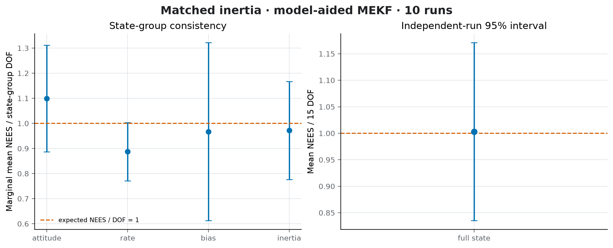
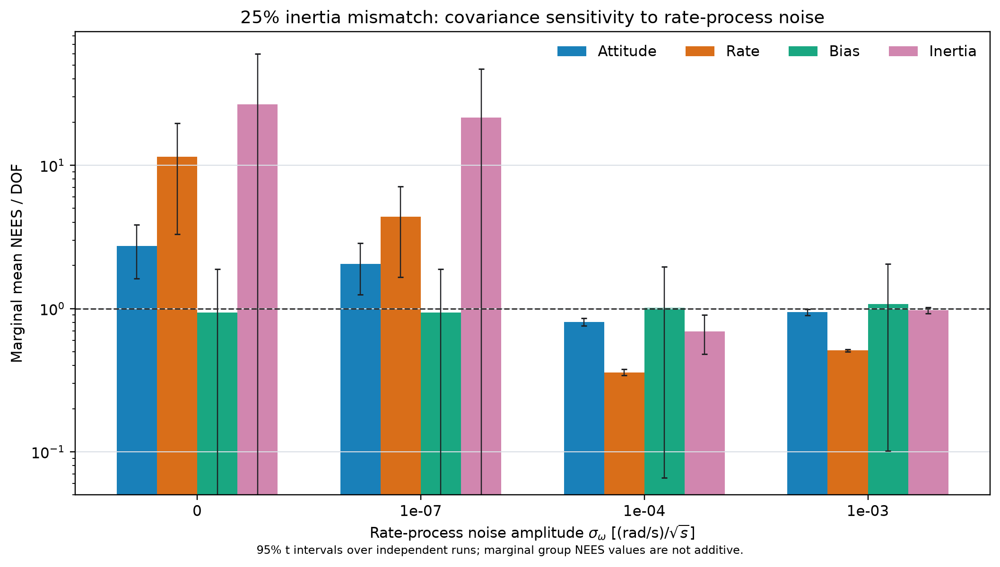
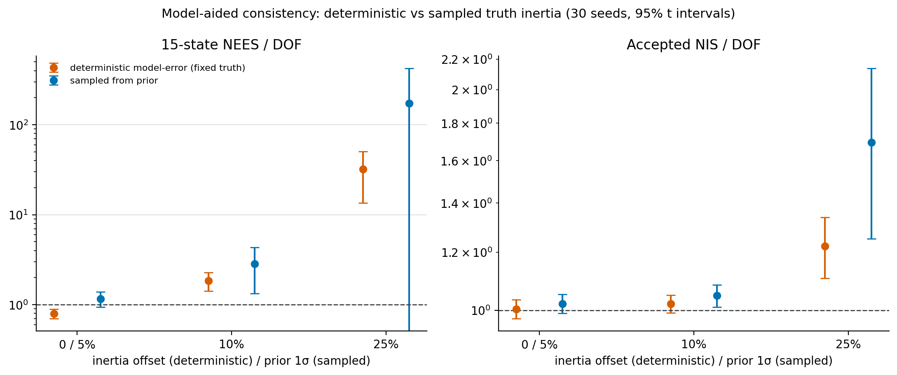
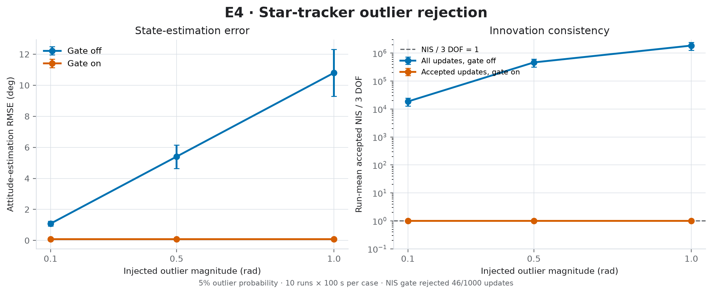
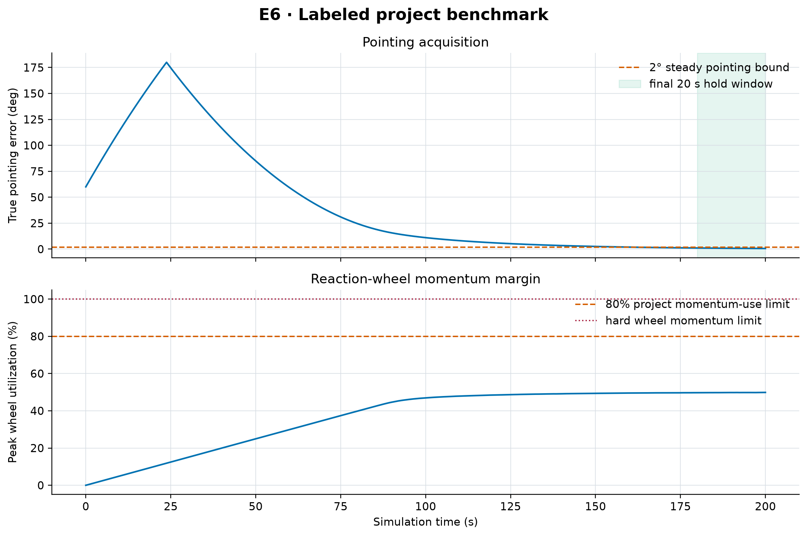
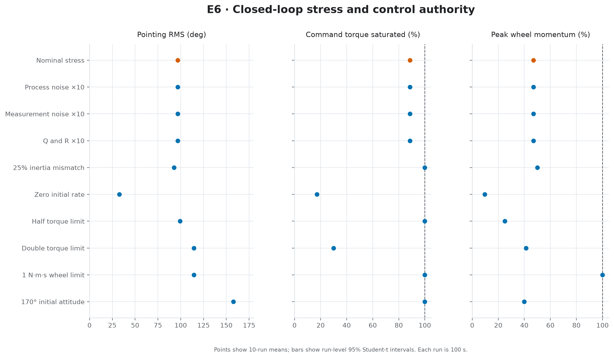
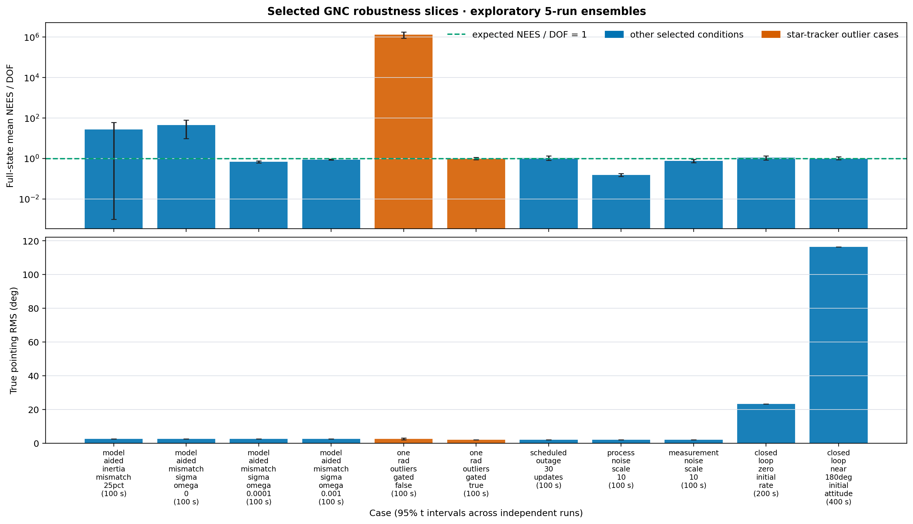
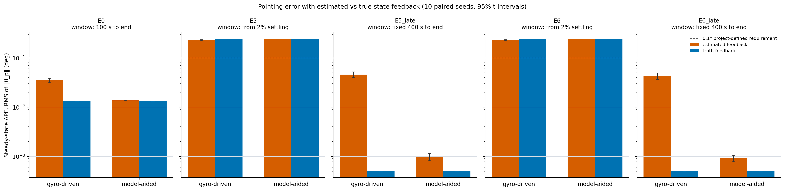
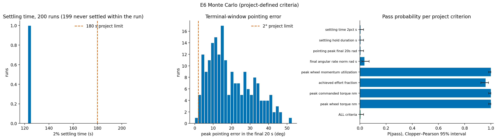
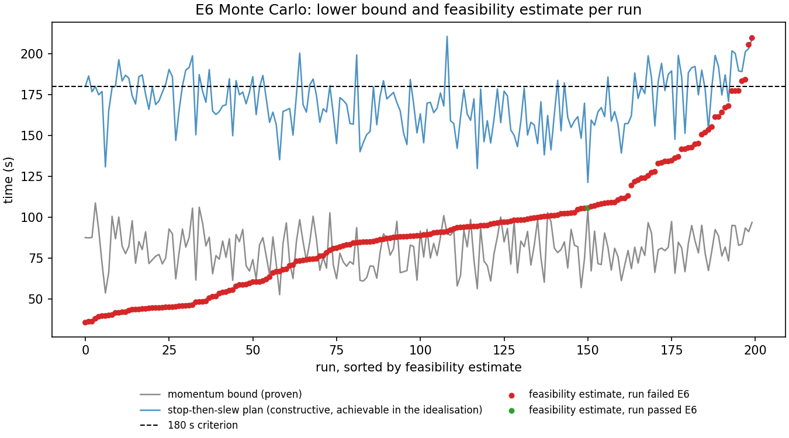

# Simulation Results Report

**Release:** 1.0.0 · **Status:** current · **Scope:** simulation characterization of this repository's models. These are not hardware, qualification, mission-acceptance, or flight-readiness results.

This report presents the evidence generated by release 1.0.0. The models are specified in the [system description](system_description.md); requirement verdicts and open risks are in the [traceability matrix and risk register](requirements_traceability.md). Every number below is reproduced by the commands in [§8](#8-reproduction) and is backed by a machine-readable file in `docs/`.

> **Results before 1.0.0 are superseded.** Release 1.0.0 corrected a reporting defect, added wheel gyroscopic coupling to the truth model, made random streams independent, and initializes the filter from its own prior. See the [changelog](../CHANGELOG.md#impact-on-published-results). The most consequential change is in §5.3: the earlier 170° acquisition result was physically invalid.

## Contents

1. [Summary of findings](#1-summary-of-findings)
2. [Estimator verification (local mathematics)](#2-estimator-verification-local-mathematics)
3. [Statistical consistency](#3-statistical-consistency)
4. [Sensor faults: outliers and outages](#4-sensor-faults-outliers-and-outages)
5. [Closed-loop pointing and actuator authority](#5-closed-loop-pointing-and-actuator-authority)
6. [Innovation whiteness](#6-innovation-whiteness)
7. [Statistical method and interpretation limits](#7-statistical-method-and-interpretation-limits)
8. [Reproduction](#8-reproduction)

---

## 1. Summary of findings

| # | Finding | Evidence |
|---|---|---|
| F1 | **Both filters are statistically consistent for matched models.** Run-level 95% intervals for NEES/DOF and accepted NIS/DOF contain 1 for E0 (1,000 s), the matched E1 cases, and E7. Caveat (F10): for the model-aided filter with fixed truth inertia the matched case is conservative, not exactly consistent, at 30 seeds. | §3.1, [campaign CSV](e0_e7_campaign_summary.csv) |
| F2 | **The model-aided filter becomes inconsistent under inertia mismatch, even though its attitude accuracy is unchanged.** At 25% diagonal mismatch, NEES/DOF is 25.98 [9.13, 42.83] while attitude RMSE stays at 0.081°. The marginal rate and inertia groups dominate. | §3.2 |
| F3 | **Rate-process noise trades consistency against model knowledge.** At 25% mismatch, raising `sigma_omega_process` from 1e-7 to 1e-3 brings NEES/DOF from 27.5 to 0.88. The value is not physically identified (risk R-06). | §3.3 |
| F4 | **The NIS gate is necessary and sufficient for the injected outliers.** Without it, 1 rad outliers drive attitude RMSE to 12.3°; with it, 58 of 1,000 updates are rejected and NEES/DOF is 0.97 [0.86, 1.09]. | §4.1 |
| F5 | **Covariance correctly bounds error growth through tracker outages.** In a 30-update outage, peak error is 0.153° against a peak 3σ of 0.298°. | §4.2 |
| F6 | **The E6 project benchmark passes for the single deterministic run** (F11 for dispersions), with corrected physics: 2% settling at 174.51 s, 25.48 s hold, 1.014° terminal-window peak, 49.9% peak wheel use. | §5.1, [benchmark JSON](e6_project_benchmark.json) |
| F7 | **Large off-axis slews with stored wheel momentum are torque-limited by gyroscopic coupling.** A 170° slew about z, carrying the initial x-axis spin, needs up to 0.152 N·m of `ω × h_w` torque against a 0.1 N·m limit. It does not settle in 400 s. The earlier "settles at 235 s" result came from a model that violated angular-momentum conservation by 197%. | §5.3, [coupling JSON](wheel_coupling_effect.json) |
| F8 | **Innovations are consistent with white noise** when the test is calibrated. The seed-42 single-run p-value of 0.006 is not evidence of mis-modeling: the uncalibrated test rejects white noise 11.1% of the time at this sample size, and the 12-seed ensemble matches the white-noise null (KS p = 0.457). | §6, [whiteness JSON](innovation_whiteness.json) |
| F9 | **With the gyro-driven filter the estimator costs about 0.04° of steady-state pointing; with the model-aided filter it costs about 0.0004°.** Late-window (400–600 s) APE RMS 0.043° against 0.0005° with true-state feedback, driven by gyro noise in the rate feedback rather than by attitude-knowledge error. A 30 s tracker outage is not visible in pointing. Everything stays inside the 0.1° project-defined requirement in steady state. | §5.4, [estimation_cost.json](estimation_cost.json) |
| F10 | **Fixing the inertia truth across seeds biased the matched-inertia consistency result.** With 30 seeds the fixed matched case is conservative (NEES/DOF 0.795 [0.700, 0.890], initial NEES 9 for 15 DOF). With inertia sampled from the filter prior, the matched-prior NEES/DOF is 1.163 [0.943, 1.383], and the inertia group is mildly over-confident (1.44 [1.09, 1.79]). Inconsistency starts at a 10% prior (2.83) and is severe at 25% (median run 19.8); the R-01 conclusion stands. | §3.5, [model_aided_inertia_sampling.json](model_aided_inertia_sampling.json) |
| F11 | **The E6 benchmark does not hold under dispersions.** With a random 60° attitude axis, a random 0.1 rad/s rate direction, per-seed inertia and new sensor noise, 1 of 200 runs passes every criterion: P(pass) = 0.005 [0.000, 0.028]. Actuator limits are never violated; the pointing criteria fail (median terminal-window error 16°). Sensor noise alone leaves 100 of 100 passing, and each of the three other dispersions alone breaks the pass. | §5.5, [e6_monte_carlo.json](e6_monte_carlo.json) |
| F12 | **The single 180 s E6 budget was mis-sized; split into modes it is met.** No proven bound rules out any of the 200 runs, but the constructive plan needs a median 170 s, and on 200 fresh seeds no controller passes the end-to-end criterion in more than 33/200. A two-phase mode manager meets detumble (GNC-DET-001) in 200/200 at the momentum bound and acquisition (GNC-ACQ-001) in 196–200/200. | §5.6, §5.7 |

## 2. Estimator verification (local mathematics)

These checks are deterministic unit tests in `tests/unit/test_mekf_linearization.py`; all pass.

| Check | Method | Result |
|---|---|---|
| Gyro-driven error dynamics `F` | Central finite differences of the exact right-error flow | Pass, all 6 columns |
| Model-aided error dynamics `F`, including six inertia sensitivities | Finite differences, **with and without wheel momentum** | Pass, all 15 columns, both cases |
| Van Loan `Φ`, `Q_d` | Matrix exponential and Gauss–Legendre quadrature | Pass |
| Measurement residual | Local attitude Jacobian equals identity | Pass |
| Attitude reset | Exact SO(3) right Jacobian vs finite differences at finite angles | Pass |

The truth model is verified separately. Total inertial angular momentum `R(q)(Jω + h_w)` is conserved to better than 1e-8 under time-varying multi-axis wheel torque, and to 7e-15 and 7e-14 in the two closed-loop runs of §5.3. Without the coupling term the same test fails (`tests/unit/test_rigid_body.py`).

## 3. Statistical consistency

Ten independent runs per case. E0 runs 1,000 s; all other cases run 100 s. Intervals are 95% Student-t over run means. NEES is normalized by the state dimension (6 or 15), NIS by 3.

### 3.1 Nominal and repeatability (E0, E7)

| Case | NEES / DOF | Accepted NIS / DOF | Attitude RMSE | Attitude / bias 3σ coverage | True pointing RMS |
|---|---:|---:|---:|---:|---:|
| E0 nominal, 1,000 s | 1.023 [0.928, 1.117] | 1.002 [0.982, 1.022] | 0.0271° | 99.7% / 99.7% | 0.640° |
| E7 nominal, 100 s | 0.965 [0.834, 1.096] | 1.037 [0.991, 1.082] | 0.0810° | 99.7% / 99.8% | 2.021° |

The 100 s runs include the initial convergence and control transient, so their RMS values are not comparable with the 1,000 s baseline.

### 3.2 Inertia mismatch (E1)

The truth inertia diagonal is scaled by 1 + m. The model-aided filter starts from the nominal inertia and estimates a correction, with a prior of `max(m, 0.05)` one sigma. The gyro-driven filter does not use inertia.

| Filter | Mismatch | NEES / DOF | Accepted NIS / DOF | Attitude RMSE | Attitude / bias 3σ coverage | Inertia rel. RMSE | Pointing RMS |
|---|---:|---:|---:|---:|---:|---:|---:|
| Gyro-driven | 0% | 0.965 [0.834, 1.096] | 1.037 [0.991, 1.082] | 0.0810° | 99.7% / 99.8% | — | 2.021° |
| Gyro-driven | 10% | 0.965 [0.834, 1.096] | 1.036 [0.991, 1.082] | 0.0810° | 99.7% / 99.8% | — | 2.227° |
| Gyro-driven | 25% | 0.965 [0.834, 1.096] | 1.036 [0.990, 1.082] | 0.0810° | 99.7% / 99.8% | — | 2.539° |
| Model-aided | 0% | 0.885 [0.685, 1.085] | 1.011 [0.943, 1.080] | 0.0805° | 99.8% / 99.8% | 0.93% | 2.001° |
| Model-aided | 10% | 1.894 [1.384, 2.405] | 1.031 [0.966, 1.096] | 0.0805° | 99.5% / 99.8% | 3.54% | 2.206° |
| Model-aided | 25% | **25.975 [9.125, 42.825]** | 1.275 [1.140, 1.410] | 0.0806° | 91.3% / 99.7% | 7.97% | 2.515° |

**Interpretation.** The gyro-driven filter is insensitive to inertia by construction; only the closed-loop pointing changes, because the truth responds differently to the same torque. The model-aided filter is consistent at matched inertia, mildly over-confident at 10%, and strongly inconsistent at 25%. Its attitude accuracy does not degrade, because the star tracker dominates attitude. The inconsistency lives in the rate and inertia states (§3.3). Attitude accuracy alone therefore does not establish a calibrated full-state covariance.

The dedicated matched-inertia check ([model_aided_consistency.json](model_aided_consistency.json), 10 runs, 5% inertia prior) gives full NEES 13.28 [10.28, 16.28] for 15 DOF and NIS 3.03 [2.83, 3.24] for 3 DOF. The marginal group means are attitude 2.48/3, rate 2.24/3, bias 2.79/3, and inertia 5.60/6, and every group interval contains its DOF.



### 3.3 Inertia mismatch versus rate-process noise

Five runs per amplitude, 25% diagonal mismatch, 25% inertia prior. Only `sigma_omega_process` changes. Marginal NEES uses each group's covariance block and is not additive.

| `sigma_omega_process` [(rad/s)/√s] | Full NEES / DOF (95% t interval) | Marginal NEES / DOF: attitude / rate / bias / inertia | Accepted NIS (3 DOF) |
|---:|---:|---:|---:|
| 0 | 44.535 [9.837, 79.234] | 4.745 / 24.596 / 1.090 / 43.121 | 3.930 |
| 1e-7 (configured) | 27.459 [−5.487, 60.405] | 3.372 / 10.576 / 1.090 / 39.321 | 3.714 |
| 1e-4 | 0.684 [0.614, 0.755] | 0.824 / 0.385 / 1.041 / 0.614 | 2.543 |
| 1e-3 | 0.881 [0.836, 0.925] | 0.978 / 0.531 / 1.038 / 0.970 | 3.058 |

The mismatch shows up in the inertia and rate states, while bias stays near its reference. More rate-process noise makes the covariance absorb the model error; 1e-4 is already conservative (NIS 2.54 < 3). This is a sensitivity map, not a tuning result. A defensible value must come from an identified torque and model-error spectrum. The five-run intervals at low noise are wide and cross zero; the untruncated intervals are kept in [robustness_slices.json](robustness_slices.json).



### 3.4 Process- and measurement-noise mismatch (E2, E3)

Gyro-driven filter, ten runs each.

| Sweep | Scale | NEES / DOF | Accepted NIS / DOF | Attitude 3σ coverage | Bias 3σ coverage | Attitude RMSE |
|---|---:|---:|---:|---:|---:|---:|
| `Q` | 0.1× | 7.088 [5.863, 8.312] | 3.824 [3.600, 4.047] | 80.6% | 70.2% | 0.0812° |
| `Q` | 1× | 0.965 [0.834, 1.096] | 1.037 [0.991, 1.082] | 99.7% | 99.8% | 0.0810° |
| `Q` | 10× | 0.151 [0.138, 0.164] | 0.161 [0.146, 0.175] | 100.0% | 100.0% | 0.0811° |
| `R` | 0.1× | 1.390 [1.256, 1.524] | 1.440 [1.377, 1.504] | 96.9% | 99.8% | 0.0811° |
| `R` | 1× | 0.965 [0.834, 1.096] | 1.037 [0.991, 1.082] | 99.7% | 99.8% | 0.0810° |
| `R` | 10× | 0.719 [0.600, 0.839] | 0.399 [0.372, 0.427] | 100.0% | 99.9% | 0.0812° |

Mistuning moves NEES and NIS by up to an order of magnitude while RMSE barely changes. NEES and NIS detect mistuning; RMSE does not, and 100% coverage under inflated noise is a symptom, not a virtue.

### 3.5 Deterministic model-error study versus sampled truth inertia

The E1 cases above, and the matched-inertia check, fix the truth inertia across seeds. For the matched case the inertia states then start with **zero** error against a 5% prior, so the 15-state NEES is biased low by construction (expected initial value 9, not 15), and the mismatch cases vary only the sensor noise across seeds. `spacecraft.inertia_truth_mode: "sampled_from_prior"` draws each seed's truth inertia from the filter's own prior (realisable tensors only; [system description §2.3](system_description.md#23-inertia-mismatch)), which removes both defects. Both studies are reported side by side by [`verify_inertia_sampling_study.py`](../scripts/verify_inertia_sampling_study.py): 30 seeds per case (the first 10 are the campaign seeds), 100 s, model-aided filter with `sigma_omega_process = 1e-7`, 95% t intervals over run-level means. In the deterministic study the filter prior is `max(m, 5%)` as in E1; in the sampled study it is the sampling σ.

| Truth inertia | Prior σ | Rejected draws | NEES / DOF | Median run NEES / DOF | Accepted NIS / DOF | Marginal NEES / DOF: attitude / rate / bias / inertia |
|---|---:|---:|---:|---:|---:|---|
| **Deterministic**, 0% offset | 5% | n/a | 0.795 [0.700, 0.890] | 0.73 | 1.004 | 0.88 / 0.74 / 0.85 / 0.80 |
| **Sampled** | 5% | 0% | **1.163 [0.943, 1.383]** | 1.06 | 1.021 | 0.96 / 1.00 / 0.86 / **1.44 [1.09, 1.79]** |
| **Deterministic**, 10% offset | 10% | n/a | 1.850 [1.424, 2.277] | 1.54 | 1.020 | 1.00 / 1.21 / 0.85 / 2.41 |
| **Sampled** | 10% | 6% (30 runs); 1.8% (20,000 draws) | 2.834 [1.337, 4.332] | 2.18 | 1.047 | 1.20 / 1.87 / 0.85 / 3.79 |
| **Deterministic**, 25% offset | 25% | n/a | 31.969 [13.544, 50.395] | 13.14 | 1.222 | 2.94 / 8.55 / 0.88 / 42.28 |
| **Sampled** | 25% | 55% | 174.0 [−75.9, 424.0] (one run at 3,700; interval not meaningful) | 19.80 | 1.695 | 8.47 / 28.39 / 0.92 / 220.9 |



*(The sampled 25% interval extends below zero and is clipped on the log axis.)*

- **The fixed matched case is not "consistent"; it is conservative by construction.** With 30 seeds its NEES/DOF is 0.795 [0.700, 0.890], which excludes 1 from below, and the mean initial NEES is 9.0 for 15 DOF. The earlier 10-seed matched results (0.885 [0.685, 1.085]; 13.28 [10.28, 16.28] for 15 DOF) contained their targets only because 10 runs gave wide intervals.
- **With a correctly sampled truth, the matched-prior full NEES is consistent** (1.163 [0.943, 1.383]; initial NEES 15.9 over these seeds, 15.2 ± 0.4 over 200 seeds in the test). But the **inertia group is mildly over-confident even here** (1.44 [1.09, 1.79]), a signal the fixed case hid.
- **Inconsistency starts at a 10% prior.** NEES/DOF is 2.83 sampled against 1.85 deterministic, and the sampled version is more variable because truth varies across seeds. NIS stays near 1 through 10%.
- **At 25% the filter is badly inconsistent in both studies.** The deterministic offset gives 31.97 [13.54, 50.40]. The sampled mean (174) is dominated by one run; the median run is 19.8 and 27 of 30 runs exceed 5. The t interval is wide enough to contain 1, which is an artefact of the heavy tail, not evidence of consistency.
- **Truncation does not explain the 25% result.** 55% of draws are non-realisable there, so the sampled truth is narrower than the filter's prior, which favours consistency. The filter is still inconsistent. The 25% sampled study should be read as "a heavily truncated 25% prior", not as N(J_nom, P0_J).
- **The R-01 conclusion stands.** Accuracy is unaffected (attitude RMSE and NIS stay near nominal until 25%), and the covariance becomes over-confident in the rate and inertia states as the inertia error grows. The sampled study adds that the effect starts at a 10% prior and varies strongly across seeds.

Limits: diagonal-scaling offsets in the deterministic study, one filter tuning (`sigma_omega_process` is not identified, R-06), 100 s runs, one nominal inertia, 30 seeds.

## 4. Sensor faults: outliers and outages

### 4.1 Star-tracker outliers and NIS gating (E4)

Outlier probability 5% per sample; 1,000 tracker samples per case (10 runs × 100 s). Gate threshold χ²₃(0.999999) = 30.66.

| Outlier magnitude | Gate | NEES / DOF | Accepted NIS / DOF | Attitude RMSE | Rejected |
|---:|:---:|---:|---:|---:|---:|
| 0.1 rad | off | 1.37×10⁴ | 2.37×10⁴ | 1.232° | 0 / 1,000 |
| 0.1 rad | on | 0.974 [0.861, 1.087] | 1.034 [0.967, 1.102] | 0.0851° | 58 / 1,000 |
| 0.5 rad | off | 3.43×10⁵ | 5.93×10⁵ | 6.145° | 0 / 1,000 |
| 0.5 rad | on | 0.974 [0.861, 1.087] | 1.034 [0.967, 1.102] | 0.0851° | 58 / 1,000 |
| 1.0 rad | off | 1.37×10⁶ | 2.37×10⁶ | 12.290° | 0 / 1,000 |
| 1.0 rad | on | 0.974 [0.861, 1.087] | 1.034 [0.967, 1.102] | 0.0851° | 58 / 1,000 |

The gated cases are identical across magnitudes because every injected outlier exceeds the gate, so the same 58 samples are rejected. That is about 5.8%, matching the 5% injection rate within sampling scatter. The independent random streams make this a paired comparison: the gyro and filter-initialization noise are identical between gate-off and gate-on. Outliers smaller than about √30.66 ≈ 5.5 innovation standard deviations (sub-milliradian here) pass the gate. That regime, where outliers are subtle enough to be absorbed as valid measurements, is not characterized. Gating is outlier rejection, not a complete fault detection, isolation, and recovery (FDIR) design.



### 4.2 Star-tracker outages (E5)

A scheduled outage begins at 5 s. The estimator response is evaluated from outage start to 30 s after the outage ends.

| Outage | Valid samples | NEES / DOF | Accepted NIS / DOF | Attitude RMSE | Peak attitude error | Peak attitude 3σ |
|---:|---:|---:|---:|---:|---:|---:|
| 1 sample | 990 / 1,000 | 0.974 [0.840, 1.108] | 1.058 [1.002, 1.115] | 0.0811° | 0.0224° | 0.0322° |
| 10 samples | 900 / 1,000 | 0.966 [0.834, 1.097] | 1.028 [0.963, 1.093] | 0.0823° | 0.0567° | 0.1164° |
| 30 samples | 700 / 1,000 | 0.960 [0.787, 1.132] | 1.065 [1.010, 1.120] | 0.0998° | 0.1529° | 0.2983° |

During an outage the gyro-driven attitude covariance grows as gyro noise and bias uncertainty integrate. The actual error grows with it and stays inside the envelope, so NEES remains consistent through the outage and the recovery.

The pointing-based recovery metric (re-entry into 2% of the pre-outage peak) is **not reached within 100 s** in these cases. That is not an outage effect: the spacecraft starts at the target with a 0.01 rad/s rate, so the pre-outage peak is the controller's start-up transient, and the 2% band of 0.057° lies below the pointing reached in 100 s. The metric is kept but is not used as outage evidence.

## 5. Closed-loop pointing and actuator authority

### 5.1 E6 project benchmark (GNC-PB-001/002)

Deterministic seed-42, 200 s run: 60° about x and 0.1 rad/s about x. Limits are 0.1 N·m (body and per wheel) and 20 N·m·s per wheel, with a 50 ms motor lag. Wheel gyroscopic coupling is on.

| Criterion | Limit | Measured | Verdict |
|---|---:|---:|:---:|
| 2% settling time | ≤ 180 s | 174.51 s | Pass |
| Hold after settling | ≥ 20 s | 25.48 s | Pass |
| Final-20 s peak pointing | ≤ 2° | 1.014° | Pass |
| Final body-rate norm | ≤ 1e-3 rad/s | 3.00e-4 rad/s | Pass |
| Peak wheel momentum use | ≤ 80% | 49.9% | Pass |
| Achieved / requested effort | ≥ 85% | 87.9% | Pass |
| Peak commanded / wheel torque | ≤ 0.1 N·m | 0.1000 / 0.1000 N·m | Pass |

The full-run pointing RMS of 68.5° is dominated by the acquisition transient and is not a steady-state metric. The settling margin is 5.5 s (3%), which is thin; see R-02.



### 5.2 Closed-loop stress cases (E6 campaign)

Ten runs × 100 s each. These are characterization slices, not benchmark runs: 100 s is shorter than the benchmark's 180 s settling allowance, so final errors here are mid-acquisition.

| Case | Pointing RMS | Final error | Time at torque limit | Peak wheel use | Time near wheel limit | Achieved effort |
|---|---:|---:|---:|---:|---:|---:|
| Nominal | 96.71° | 11.05° | 88.6% | 46.9% | 0.0% | 97.9% |
| `Q × 10` / `R × 10` / both | 96.71° | 11.05° | 88.6% | 46.9% | 0.0% | 97.9% |
| 25% inertia mismatch | 92.70° | 44.11° | 100.0% | 49.9% | 0.0% | 99.8% |
| Zero initial rate | 32.73° | 5.01° | 17.3% | 9.6% | 0.0% | 72.0% |
| Half torque authority | 99.34° | 129.86° | 100.0% | 25.0% | 0.0% | 99.9% |
| Double torque authority | 114.44° | 34.73° | 30.0% | 41.4% | 0.0% | 94.8% |
| 1 N·m·s wheel momentum limit | 114.34° | 141.50° | 100.0% | 100.0% | 30.2% | 10.0% |
| 170° initial attitude | 160.03° | 150.71° | 100.0% | 31.2% | 0.0% | 99.9% |

The acquisition is authority-limited: torque is saturated for most of the run, and estimator tuning has no visible effect on pointing. The 1 N·m·s case cannot absorb the 10 N·m·s initial body momentum. Its wheels saturate and only 10% of the requested effort is delivered, so it cannot complete the acquisition. Doubling torque authority gives a *higher* error at 100 s than nominal (34.7° vs 11.1°) and a higher 100 s RMS (114.4° vs 96.7°). In a window that ends mid-acquisition, both numbers depend on where each trajectory is in its transient, so these slices rank cases poorly and must not be read as "more authority is worse". Use the full-length benchmark for pass/fail.



### 5.3 Large-angle acquisition and wheel gyroscopic coupling

Five-run robustness slices:

| Case | Duration | 2% settling | Final pointing | Final rate | Peak wheel use |
|---|---:|---:|---:|---:|---:|
| 60° from rest (zero initial rate) | 200 s | 149.2 s (hold 50.8 s) | 0.275° | 1.6e-4 rad/s | 9.6% |
| 170° about z with 0.1 rad/s about x | 400 s | **not reached** | 24.97° | 8.6e-3 rad/s | 56.8% |

The deterministic coupling comparison ([wheel_coupling_effect.json](wheel_coupling_effect.json), seed 42) isolates the cause:

| Scenario | Coupling | Momentum drift | Peak `‖ω × h_w‖` | 2% settling | Final pointing | Time at torque limit |
|---|:---:|---:|---:|---:|---:|---:|
| E6, 60° about x | on | 7.1e-15 | 0.0015 N·m | 174.51 s | 0.529° | 44.3% |
| E6, 60° about x | off | 1.4e-3 | — | 174.52 s | 0.529° | 44.3% |
| 170° about z | on | 6.7e-14 | **0.152 N·m** | not reached | 24.94° | 100.0% |
| 170° about z | off | **1.97 (197%)** | — | 235.26 s | 0.073° | 30.6% |

**Interpretation.** The initial spin stores about 10 N·m·s in the wheels. In E6 the slew axis and the stored momentum are both along x, so `ω × h_w` stays small (0.0015 N·m) and coupling does not change the benchmark. The 170° slew is about z. Rotating the body moves the stored momentum vector through the body frame, which needs gyroscopic torque up to 0.152 N·m, more than the 0.1 N·m available. The controller stays saturated and converges slowly: 150.7° at 100 s, 57.4° at 300 s, 24.9° at 400 s.

The uncoupled model reached the target only by violating conservation of angular momentum. The earlier "settles at about 235 s" result was an artifact and is withdrawn.

Engineering implications, tracked as R-07: large-angle slews with stored momentum need momentum management first (desaturation or unloading), more authority, gyroscopic feedforward, or a slew planner that accounts for `ω × h_w`.



### 5.4 Estimation cost: estimated versus true-state feedback

[`verify_estimation_cost.py`](../scripts/verify_estimation_cost.py) runs every case twice per seed, once with the controller fed `q̂, ω̂` and once fed the truth (`controller.state_feedback: "truth"`), for both filters, over 10 seeds (`42 + 1000·i`). Within a seed the two runs share the same filter-initialization, gyro, and tracker random draws; the realized tracker measurements still differ once the trajectories diverge. The *estimation cost* is the paired difference (estimated minus truth) per seed, with a 95% Student-t interval over the 10 per-seed differences. Pointing error is decomposed as `θ_p ≈ θ_c + θ_e` ([system description §7.1](system_description.md#71-pointing-error-decomposition-and-steady-state-metrics)). Model-aided runs use matched inertia, `inertia_relative_sigma = 0.05`, and `sigma_omega_process = 1e-7`. The 0.1° requirement is **project-defined**.

| Scenario | Duration | Window |
|---|---:|---|
| E0 | 300 s | 100 s to end (run starts on target, so there is no settling event; configured fallback) |
| E5 | 600 s | from 2% settling (about 177 s); 30 s tracker outage from 450 s |
| E6 | 600 s | from 2% settling (about 177 s) |
| E5 / E6 `_late` | 600 s | fixed 400–600 s, evaluated on the same runs as E5 / E6 |
| E6 200 s | 200 s | from 2% settling; the length used by the benchmark |

Both feedback modes are evaluated over a **common window per seed**, starting at the later of the two runs' settling times. (A first version of this study used each run's own settling time and so compared different samples; that was corrected before the numbers below were produced.) The fixed late window was added after seeing that the specified 2%-settling window still contains the tail of the acquisition transient; both windows are reported.

**Steady-state pointing (late window, 400–600 s; E6 runs, E5 in brackets).** Increments are estimated minus truth.

| Filter | APE RMS, estimated | APE RMS, truth | Increment [95% interval] | RPE (10 s) increment | `θ_e` APE RMS | Rate-feedback error RMS |
|---|---:|---:|---:|---:|---:|---:|
| Gyro-driven | 0.0431° (0.0460°) | 0.0005° | **+0.0425° [0.0361, 0.0490]** (+0.0455° [0.0392, 0.0517]) | +0.0245° [0.0232, 0.0257] | 0.0083° (0.0167°) | 1.73 mrad/s |
| Model-aided | 0.0009° (0.0010°) | 0.0005° | +0.0004° [0.0003, 0.0006] (+0.0005° [0.0003, 0.0006]) | +0.0003° [0.0003, 0.0004] | 0.0008° | 0.0008 mrad/s |

- **The estimator adds a measurable pointing error with the gyro-driven filter, about 90× the truth-feedback floor, and almost none with the model-aided filter.** The cause is the rate path, not attitude knowledge: the gyro-driven filter's rate is the raw gyro minus the bias estimate, so its 1.73 mrad/s RMS error passes through `K_ω = 20 N·m·s` into torque and moves the spacecraft. That number is the raw per-sample gyro noise: the angle random walk σ_v = 1e-4 rad/√s sampled at dt = 0.01 s gives σ_v/√dt = 1e-3 rad/s per axis, and √3 × 1e-3 = 1.73e-3 rad/s for the vector. Nothing filters ω̂ before the K_ω term, so the 0.043° estimation cost is gyro noise passed through the damping gain (`test_rate_feedback_noise.py`: measured 1.725e-3 against 1.732e-3, within the sampling uncertainty; the error is white, lag-1 correlation below 0.04). The *control* error `θ_c` (0.044°) is five times the *estimation* error `θ_e` (0.008°), so the pointing error the controller creates by chasing noise exceeds the error in what it knows. This explanation follows from the logged quantities; no experiment here isolates the rate path separately from the attitude path.
- **The 30 s tracker outage is not visible in pointing.** E5 and E6 differ by 0.003° APE for the gyro-driven filter and 0.0001° for the model-aided one, with the increments' intervals overlapping (a paired E5-versus-E6 test was not run). The outage doubles `θ_e` for the gyro-driven filter (0.0167° against 0.0083°) and leaves the model-aided filter unchanged.
- **Mission-level fraction (‖θ_p‖ ≤ 0.1°) in the late window is 1.000 for every case and mode.** The requirement is met throughout in steady state, with or without estimation. In E0 the gyro-driven estimated-feedback fraction is 0.996 against 1.000 for truth (increment −0.004 [−0.013, 0.005], not distinguishable from zero).

**Over the specified settling-based window (E5 and E6).** Pointing is dominated by the acquisition tail, not by noise: APE RMS is 0.241° for truth feedback, and the fraction within 0.1° is 0.80 in both modes (about 85 s of the 423 s window is above 0.1°).

| Filter | Scenario | APE RMS increment [95% interval] | Fraction-within-requirement increment |
|---|---|---:|---:|
| Gyro-driven | E6 | −0.0117° [−0.0178, −0.0057] | +0.008 [−0.008, 0.024] |
| Model-aided | E6 | +0.0000° [−0.0001, 0.0001] | +0.0002 [−0.0001, 0.0006] |
| Gyro-driven | E6 200 s | −0.0543° [−0.0689, −0.0396] | 0 (fraction is 0 in both modes) |
| Model-aided | E6 200 s | +0.0001° [−0.0003, 0.0006] | 0 |

- **Surprising and unexplained: with the gyro-driven filter, estimated feedback gives a lower APE than truth feedback in the acquisition tail** (−0.012° over the 600 s window, −0.054° over the 200 s benchmark window; the intervals exclude zero). The estimated-feedback runs settle slightly earlier (173.8–175.5 s against 176.8 s). It is not an estimation benefit in any general sense, and no mechanism has been tested. A plausible but unverified candidate is an interaction between rate-feedback noise and the torque-saturated part of the slew. It does not affect the steady-state conclusions above.
- **The E6 benchmark's terminal-window error (about 1°) is a control-transient effect, not an estimation effect.** In the 200 s window the model-aided estimation cost is +0.0001° [−0.0003, 0.0006], and the gyro-driven cost is negative. The 3% settling margin (R-02) is a controller-design question.



Machine-readable results: [estimation_cost.json](estimation_cost.json). Limits: matched inertia and no disturbance torques; one start condition per scenario; 10 seeds; the late-window fraction saturates at 1.0, so it cannot separate cases that comfortably meet 0.1°. A requirement near the achieved error (for example 0.01–0.05°) would be needed to discriminate them and was not run.

### 5.5 E6 Monte Carlo: the benchmark under dispersions (GNC-PB-003)

The E6 benchmark of §5.1 is one deterministic run: 60° about x with a 0.1 rad/s initial rate also about x. [`run_e6_monte_carlo.py`](../scripts/run_e6_monte_carlo.py) repeats it 200 times with the **same configuration and the same criteria** (`evaluate_e6_project_benchmark`, not redefined) while dispersing, each from its own `SeedSequence` stream:

- initial attitude: 60° about a uniformly random axis;
- initial rate: 0.1 rad/s in a uniformly random body direction;
- truth inertia: sampled per run from the 5% prior ([§3.5](#35-deterministic-model-error-study-versus-sampled-truth-inertia); no rejections at 5%);
- sensor noise and filter initialization: new seeds per run (`42 + 1000·i`).

The dispersion ranges are project choices, not a mission environment, and the controller gains were not designed for them. Results are identical for any `--jobs`. Intervals on pass probabilities are Clopper–Pearson 95%.

| Criterion (project-defined limit) | Passes / 200 | P(pass) [95% interval] |
|---|---:|---:|
| 2% settling time ≤ 180 s | 1 | 0.005 [0.000, 0.028] |
| Hold after settling ≥ 20 s | 1 | 0.005 [0.000, 0.028] |
| Final-20 s peak pointing error ≤ 2° | 1 | 0.005 [0.000, 0.028] |
| Final body-rate norm ≤ 1e-3 rad/s | 7 | 0.035 [0.014, 0.071] |
| Peak wheel momentum use ≤ 80% | 200 | 1.000 [0.982, 1.000] |
| Achieved / requested effort ≥ 85% | 192 | 0.960 [0.923, 0.983] |
| Peak commanded and wheel torque ≤ 0.1 N·m | 200 | 1.000 [0.982, 1.000] |
| **All criteria** | **1** | **0.005 [0.000, 0.028]** |

| Distribution over 200 runs | Median | 5th percentile | 95th percentile |
|---|---:|---:|---:|
| 2% settling time | not reached in 199 of 200 runs | n/a | n/a |
| Peak pointing error in the final 20 s | 16.1° | 4.0° | 41.1° |
| Peak wheel momentum use | 37.2% | 26.1% | 46.4% |



**The deterministic pass does not hold under dispersions.** Only the pointing criteria fail. Settling time fails most often (199 of 200 runs; the hold-duration criterion is the same event, because a 200 s run holds ≥ 20 s exactly when it settles by 180 s). The failures are not marginal: the median run is still 16° off in the last 20 s of the run. Actuator limits are never violated.

**Attribution (100 runs each, one dispersion at a time).** Files in [`e6_monte_carlo_ablation/`](e6_monte_carlo_ablation/), each with per-run records and `n_requested = n_completed = 100` (regenerated in 1.2.0 to add these; all results unchanged).

| Dispersed | All-criteria pass | Median settling |
|---|---:|---:|
| Sensor noise only | 100 / 100 [0.964, 1.000] | 175.1 s (5th–95th: 174.0–176.6 s) |
| Sensor noise + attitude axis | 0 / 100 [0.000, 0.036] | not reached (median terminal error 25.9°) |
| Sensor noise + rate direction | 0 / 100 [0.000, 0.036] | not reached (median terminal error 12.6°) |
| Sensor noise + inertia (5% prior) | 14 / 100 [0.079, 0.224] | 196.7 s; 41 runs never settle |

Sensor noise alone leaves the nominal case passing, so the 3% margin is robust to noise; it is not robust to anything else tested. Each of the three dispersions alone is enough to break the pass. The inertia result is not a sampler artefact: with the truth inertia scaled deterministically, 2% settling is 193.6 s at 0.95×, 174.5 s at 1.00×, 133.4 s at 1.05×, and never at 1.10× (final-20 s peak 2.5°). The dependence on inertia is strong and not monotonic; the mechanism was not investigated.

**Rate direction.** Failure itself cannot be correlated with anything: 199 of 200 runs fail, so the binary and settling-time targets are degenerate. (The first version of this analysis used only those targets and found nothing; the continuous targets below were added for that reason.) Exploratory Spearman correlations with the continuous peak terminal error: |rate · major axis| ρ = +0.32 (p = 3e-6), |rate · attitude axis| ρ = −0.34 (p = 1e-6), |rate · minor axis| ρ = −0.15 (p = 0.04), |rate · intermediate axis| ρ = −0.03. Of 25 covariate-target pairs, the three with p < 1e-5 survive a Bonferroni threshold of 0.002. All are weak (|ρ| ≈ 0.3): errors are lower when the rate is aligned with the slew axis, as in the benchmark, but even the best-aligned runs fail. In the rate-only ablation the major-axis sign reverses (ρ = −0.29), because there the slew axis is x, the major axis, so alignment with it is benign. The principal-axis coefficients are therefore not a stable explanation on their own.

**Hypotheses, not tested.** (a) With K_ω = 20 N·m·s and K_q/2 = 0.5 N·m/rad, the linearised slow pole is about −0.027 to −0.029 s⁻¹ (inertia 100 to 60 kg·m²), roughly 130–145 s to reach 2% from 60° before saturation and slewing add to it, so the benchmark's 174.5 s leaves little room above its linear floor. (b) With 0.1 N·m of authority, stopping a 0.1 rad/s spin of a 100 kg·m² body takes about 100 s, so rate dispersions in unfavourable directions consume much of the 180 s budget. A gain redesign would test both; it is proposed as a separate follow-up and the gains were not changed here.

### 5.6 E6 feasibility: is the 180 s criterion reachable in the dispersion envelope? (GNC-FEAS-001/002/003)

The reviewer's hypothesis was that the 180 s settling criterion was never sized against the 0.1 rad/s dispersion envelope, so most of the failures in §5.5 would be unavoidable. [`analyze_e6_feasibility.py`](../scripts/analyze_e6_feasibility.py) tests this on the 200 stored runs, rebuilding each run's own attitude, rate and sampled inertia from its seed (the rebuilt inertia and initial state equal the simulation's own, tested). Definitions and the proof of the momentum bound are in [system description §6.1](system_description.md#61-feasibility-bounds-and-estimates-for-rest-to-rest-acquisition). Output: [e6_feasibility.json](e6_feasibility.json), [figure](figures/e6_feasibility.png). `n_requested = n_completed = 200`.

**Linearised closed loop of the shipped gains** (K_q = 1, K_ω = 20, effective stiffness K_q/2; factor of 2 checked against `compute_control_gains`):

| Axis | J (kg·m²) | ζ | Poles (s⁻¹) | Settling, slow pole `ln 50/|p|` | Settling, exact from rest |
|---|---:|---:|---|---:|---:|
| x | 100 | 1.414 | −0.0293, −0.1707 | 133.6 s | 140.0 s |
| y | 80 | 1.581 | −0.0282, −0.2218 | 138.8 s | 143.7 s |
| z | 60 | 1.826 | −0.0272, −0.3061 | 143.7 s | 147.2 s |

All three axes are overdamped. The reviewer's hand estimate for x (ζ ≈ 1.4, slow pole ≈ −0.029 s⁻¹, about 133 s) is confirmed; the exact response, which includes the fast pole's residual, is 140.0 s.

**Bounds and estimates over the 200 runs** (5th / median / 95th percentile; runs above 180 s):

| Quantity | Kind | 5th / median / 95th | Runs > 180 s |
|---|---|---:|---:|
| Momentum bound `‖J ω₀‖/τ_max`, (a) | proven | 61.6 / 81.4 / 100.2 s (max 108.9) | **0** |
| Momentum bound with per-wheel clips, (b) | proven, conservative | max 62.9 s | **0** |
| Rest-to-rest slew `2√(θ J_eff/τ_max)` | approximation | 50.7 / 57.6 / 64.4 s (max 68.3) | 0 |
| Single-axis feasibility estimate (initial rate, 2π wrap) | estimate, not a bound | 41.7 / 88.8 / 161.6 s (max 209.7) | 4 |
| Stop-then-slew plan | constructive, idealised | 144.6 / 170.4 / 198.9 s | 57 (143 are ≤ 180 s) |
| Linear unsaturated settling of the shipped gains | linear model | all ≤ 180 s | 0 |
| Saturated single-axis settling of the shipped gains | model | 85 of 200 ≤ 180 s | 115 |
| Monte Carlo result (§5.5) | simulation | 1 of 200 settled ≤ 180 s | 199 |



**What this shows**

- **No proven bound declares any run infeasible.** The momentum bound is at most 108.9 s for every run, and 62.9 s with the per-wheel clips, so the *proven* part of the hypothesis (that the criterion cannot be met by any controller in X of 200 runs) is **not supported**. The bound is tight for stopping: the stopping phase of the plan takes 1.026 × the bound (median).
- **The 0.1 rad/s rate is a large share of the budget.** Median perpendicular rate is 0.084 rad/s of 0.1. Stopping needs a median 81 s of torque at the limit (83.8 s in the plan), during which the attitude drifts to a median 137° from the target (5th to 95th percentile 73° to 176°), so the slew that follows starts far from the target. This, not the poles, is what the 3-axis problem adds.
- **The linear poles do not explain the failures.** The unsaturated linear model puts all 200 runs inside 180 s, and the single-axis saturated model puts 85 inside, against 1 in the simulation. Both ignore the perpendicular rate; the −0.029 s⁻¹ slow pole is real but is not the binding limit on its own, and the proposed wording "the overdamped linear PD is the limiting factor, not the actuator authority" is not supported by this analysis.
- **The truth for the undecided runs is between two numbers.** 143 runs have an achievable plan inside 180 s in the idealisation; 4 are above 180 s even by the optimistic single-axis estimate; 53 lie between and are undetermined. "The criterion is achievable in X% of the envelope" can be stated only as 71.5% (143/200) *in an idealised open-loop plan* and at most 98% (196/200) by the estimate.
- **No valid lower bound on end-to-end time exceeds 180 s for any run.** Two bounds hold for any controller under the 0.1 N·m body-torque limit with the wheels starting empty ([`end_to_end_bounds.py`](../scripts/end_to_end_bounds.py), [e6_end_to_end_bounds.json](e6_end_to_end_bounds.json), both tested against saturated true-state controllers in simulation): the momentum bound to the 1e-3 rad/s final-rate criterion, median 80.3 s, maximum 107.8 s (published seeds; 78.7 s and 105.5 s on the B5 evaluation seeds), and an angle-reach bound, from `d(ωᵀJω)/dt = 2 ω·τ` (gyroscopic terms do no work) and the geodesic distance to the 2% band, median 8.3 s, maximum 9.5 s. Their maximum is a valid end-to-end bound, and it is above 180 s in **0 of 200** runs in both seed sets. Their sum is not a bound, because a controller can turn toward the target while it brakes, and the constructive stop-then-slew plan is not a bound either (ratios below 1 occur). So the bounds cannot show the 180 s criterion infeasible for any run; the gap between about 105 s (proven) and 170 s (constructive plan, median) is not closed.
- **A closed-loop controller has not yet demonstrated it.** On 20 runs chosen evenly by plan time among those the estimate calls feasible, the `rate_profile` controller with parameters fixed in advance and **not tuned** (`K_ω = 20`, `k_p = 0.05 s⁻¹`, `f = 0.7`, gyro-driven filter, estimated feedback) settled within 180 s in **2** runs (134.1 s and 148.3 s, 1.3× and 1.7× the estimate; both pass every criterion) and in 182.4 s and 190.1 s in two more; the other 16 did not settle by 200 s (terminal error 3.6° to 55°). Wheel momentum use was 29–55%, inside the 80% limit. So feasibility of most of the envelope is **not demonstrated**; the untuned controller is far from the estimate, and a controller that reaches the plan times in the nonlinear simulation is still to be built and evaluated (task B5).

### 5.7 B5 controller comparison: detumble, acquisition and the end-to-end envelope

**Why the requirement was split.** §5.6 showed that the E6 criterion puts two flight modes into one 180 s budget: a detumble from a random 0.1 rad/s (proven momentum bound median 81 s, maximum 109 s) and a 60° acquisition from wherever the attitude has drifted (median 137°). As a check, 81 s + 2√(2.39 J/0.1) ≈ 81 + 87–98 s, consistent with the constructive plan's median of 170 s. GNC-PB-001/002 and the published 1/200 result stay as they are. Two project-defined mode requirements are added, and the end-to-end envelope is characterized against the plan times rather than judged pass/fail:

- **GNC-DET-001 (detumble).** From ‖ω₀‖ ≤ 0.1 rad/s in a random direction, hand over to acquisition with the **true** ‖ω‖ ≤ ω_entry = 0.01 rad/s within T_det = 150 s, inside the actuator limits. Judged at the handover instant: the mode switch for the mode manager, otherwise the first time the true rate reaches ω_entry. A later speed-up by the acquisition slew is intended and is not a detumble failure. T_det is 1.3 × 115 s, the momentum bound for the largest principal moment at nominal + 3σ (115 kg·m²); the largest bound in the 200 published draws is 108.9 s (margin 1.38×). ω_entry is about 6× the gyro-driven rate-estimate noise (1.73 mrad/s RMS, §5.4), so a switch near it is not decided by noise.
- **GNC-ACQ-001 (acquisition).** From the detumble exit condition (‖ω₀‖ = ω_entry, random direction) meet every E6 criterion of GNC-PB-001/002 within the 200 s run. Reported two ways: a 60° random-axis error (`acq_axis60`), and the attitude reached when the same envelope draw is stopped at full torque (`acq_drifted`, median 137°).

**Design history.** Parameters were chosen only on design seeds (base 10000042, 60 runs per candidate), with each round's candidates and selection rule committed before its runs; evaluation seeds were never used before the freeze. The selection rule was committed (`e84d815`) after the design sweep had started but before any design result was viewed; the evaluation seeds were never used before the parameters were frozen.

| Round | Candidates | Rule (committed first) | Selected | What the round showed |
|---|---|---|---|---|
| 1 (`e84d815`) | PD ζ = 0.8 for 2% targets of 60, 90, 120 s; two-phase with f ∈ {0.5, 0.7, 0.9}, k_p ∈ {0.03, 0.05, 0.08}, K_ω ∈ {20, 40}, T_d ∈ {10, 20} | envelope:e6 + acq_drifted:e6; tie → lower acq_drifted median settling | `pd_z08_T90` (tie with T60 at 60, broken on 109.5 s vs 126.9 s); `tp_f09` (36) | Two defects in the two-phase design: (1) switching on the estimated rate at 0.01, the same value GNC-DET-001 requires of the true rate, left the true rate above 0.01 at the switch in 60/60 envelope runs; (2) its acquisitions settled fast but failed the effort-fraction criterion |
| 2 (`940e8e5`) | Switch at 0.007 on the raw estimate; K_ω ∈ {20, 14, 10}; k_p 0.08 | envelope:det + envelope:e6 + acq_drifted:e6 (DET added because of defect 1) | `tp2_e007_kw10_kp08` (tie with K_ω 10, k_p 0.05 at 119, broken on 118.80 s vs 118.95 s, effectively a coin flip) | Effort failures fall with K_ω (23 → 3 → 0 of 60 at K_ω = 20, 14, 10) at the same torque limit; a single-sample switch still let the true rate exceed 0.01 in 3/60 runs |
| 3 (`bc02880`) | Switching signal = first-order low-pass of ‖ω̂‖, T_f ∈ {1, 2} s, threshold ∈ {0.009, 0.008}; DET judged at the handover | same as round 2 | `tp3_lp1_t009` | Persistence works (0 handovers above 0.01), but exposed a defect: the filter started at the first raw sample, so one acquisition run (seed 10058042) switched at t = 0 on a single 0.0085 rad/s sample |
| 3b (`276e4cd`) | Same three low-pass candidates; filter now starts at ω_exit | same | `tp3_lp1_t009` (tie at 120 with T_f 1 s, 0.008; broken on 123.2 s vs 124.5 s) | No switch at t = 0; one switch per run in every run |

**Switch threshold margin (T_f = 1 s, dt = 0.01 s).** Per-sample rate noise σ = σ_v/√dt = 1e-3 rad/s per axis. Low-pass with a = dt/(T_f + dt): σ_f = σ√(a/(2 − a)) = 7.0e-5 rad/s. Threshold + 3σ_f ≤ ω_entry allows up to 0.0098 rad/s. Two effects bias the switching signal high, so they make the switch later (safe): the norm of a noisy vector, E‖ω + n‖ ≈ ‖ω‖ + σ²(n − 1)/(2‖ω‖) = +1e-4 rad/s at 0.01 rad/s (n = 3), and the filter lag, about T_f × (rate of decay) ≈ +5e-4 rad/s near the switch. Measured on the design runs, over the 10 s before the handover, against the same filter applied to the true rate: mean offset +8.7e-5 rad/s (the norm bias), standard deviation 6.2e-5 rad/s (median over runs; analytic 7.0e-5); the unfiltered signal's error standard deviation is 9.9e-4 rad/s, which is why the single-sample switch failed. With the 0.009 threshold, the true rate at the handover was 0.0083–0.0086 rad/s (5th–95th percentile) on the design seeds. The exit back to detumble is at 0.15 rad/s on the same filtered signal. The fastest rate acquisition can command is √(2 f τ_max π / J_min) ≈ 0.10 rad/s (f = 0.9, J_min = 57 kg·m²); a test with that inertia, a 179° slew about the minor axis and the entry rate along it peaked at 0.069 rad/s and switched once.

**Rate-loop bandwidth.** The rate loop is L(s) = K_ω/(J s), so the crossover is K_ω/J = 0.10–0.33 rad/s for K_ω = 10–20 and J = 60–100 kg·m², 12–40 times below 1/5 of the wheel bandwidth (20 rad/s). Bandwidth does not explain the effort failures. The rate loop is linear with a norm limit, so there is no hard switch to soften; the detumble law already has a proportional region (T_d = 20 s) near zero rate.

**Frozen parameters** (`config/b5_controllers.yaml`, `c397596`). (i) `pd_zeta08`: quaternion feedback, K_q = 0.4938, K_ω = 7.1111 (ζ = 0.8, 2% target 90 s, mean inertia). (ii) `rate_profile`: K_ω = 20, k_p = 0.05 s⁻¹, f = 0.7 (the original parameters, not tuned). (iii) `two_phase`: detumble T_d = 20 s; switch at low-passed ‖ω̂‖ ≤ 0.009 rad/s (T_f = 1 s), exit at > 0.15 rad/s; acquisition `rate_profile` with K_ω = 10, k_p = 0.08 s⁻¹, f = 0.9. (iv) `two_phase_ff`: (iii) with gyroscopic feedforward in acquisition only.

**Evaluation.** Fresh seeds 20000042 to 20199042 (200 runs); design 10000042 to 10099042; published 42 to 199042; disjointness asserted in code and recorded in every file. Every campaign completed 200/200. Files in [`b5_evaluation/`](b5_evaluation/); per-phase ratios in [`b5_evaluation/phase_ratios.json`](b5_evaluation/phase_ratios.json) (`summarize_b5.py`). Probabilities are Clopper–Pearson 95%.

| Scenario | Controller | E6 all criteria | GNC-DET-001 | Settling median [5th, 95th] | Not settled | Main failure |
|---|---|---:|---:|---:|---:|---|
| Envelope (0.1 rad/s) | (i) PD ζ 0.8 | 2/200 [0.001, 0.036] | 160/200 [0.738, 0.853] | 171.3 s (3 settled by 200 s) | 197 | settling |
| | (ii) rate_profile | **33/200** [0.116, 0.224] | 167/200 [0.776, 0.884] | 172.1 [119.3, 193.7] s (59 settled by 200 s) | 141 | settling |
| | (iii) two_phase | 6/200 [0.011, 0.064] | **200/200** [0.982, 1.000] | 171.4 s (8 settled by 200 s) | 192 | settling |
| | (iv) two_phase + ff | 12/200 [0.031, 0.102] | **200/200** [0.982, 1.000] | 173.9 [155.1, 197.1] s (17 settled by 200 s) | 183 | settling |
| ACQ, 60° axis | (i) | 194/200 [0.936, 0.989] | – | 113.0 [76.8, 133.8] s | 0 | effort (6) |
| | (ii) | 0/200 [0.000, 0.018] | – | 78.9 [69.8, 85.6] s | 0 | effort (200) |
| | (iii) | **200/200** [0.982, 1.000] | – | 90.9 [77.5, 105.2] s | 0 | none |
| | (iv) | **200/200** [0.982, 1.000] | – | 90.3 [77.7, 104.8] s | 0 | none |
| ACQ, drifted | (i) | 192/200 [0.923, 0.983] | – | 112.3 [80.8, 143.5] s | 0 | effort (8) |
| | (ii) | 24/200 [0.078, 0.173] | – | 84.9 [69.4, 102.1] s | 0 | effort (176) |
| | (iii) | **196/200** [0.950, 0.995] | – | 118.4 [84.4, 143.5] s | 0 | effort (3), terminal error (1) |
| | (iv) | 195/200 [0.943, 0.992] | – | 118.6 [83.7, 143.1] s | 0 | effort (3), terminal error (2) |

**Detumble against the proven bound.** An earlier version of this table reported the detumble as 0.99 [0.97, 1.07] × "the bound", which would mean some runs beat a proven bound. They do not: that ratio was against the constructive plan's stopping time, which is not the bound and has a different end condition (the plan stops to 1e-4 rad/s, median 82.6 s, while the handover happens at a true rate of about 0.0085 rad/s). Against the momentum bound to zero rate the ratio is 1.027 [0.981, 1.097], still below 1 in some runs for the same reason: stopping to zero is a later event than the handover. The dispersed inertia was already used in both, so it is not the cause. The proven bound with the same end condition, (‖J ω₀‖ − λ_max(J) ‖ω_handover‖)/τ_max with the run's own truth inertia and its true rate at handover (`momentum_lower_bound_to_rate_s`, tested against saturated braking in simulation), gives the ratios below, with no run below 1.

**Ratios per run** (median [5th, 95th]). Detumble: handover ÷ proven momentum bound to the handover rate. Acquisition: (settling − handover) ÷ the constructive plan's slew time. End to end: settling ÷ constructive plan time. The constructive plan is **not** a lower bound; ratios below 1 occur. Only settled runs have acquisition and end-to-end ratios.

| Scenario | Controller | Detumble ÷ momentum bound | Acquisition, ratio to constructive plan | End to end, ratio to constructive plan |
|---|---|---:|---:|---:|
| Envelope | (i) | 1.65 [1.11, 2.89] | 1.05 (n = 3) | 1.10 (n = 3) |
| | (ii) | 1.68 [1.12, 2.78] | 0.90 [0.28, 1.39] (n = 59) | 1.11 [0.81, 1.25] (n = 59) |
| | (iii) | **1.15 [1.08, 1.27]** | 1.44 [1.28, 1.75] (n = 8) | 1.17 [1.11, 1.32] (n = 8) |
| | (iv) | **1.15 [1.08, 1.27]** | 1.40 [1.28, 1.65] (n = 17) | 1.19 [1.09, 1.32] (n = 17) |
| ACQ, 60° axis | (i) / (ii) / (iii) / (iv) | – | 1.94 / 1.35 / 1.47 / 1.46 | 1.73 / 1.20 / 1.38 / 1.37 |
| ACQ, drifted | (i) / (ii) / (iii) / (iv) | – | 1.31 / 0.98 / 1.30 / 1.30 | 1.22 / 0.91 / 1.25 / 1.24 |

Ratios below 1 against the constructive plan are possible because the plan is not optimal: it stops the body before it turns. The envelope acquisition and end-to-end ratios describe only the runs that settled, a selected minority.

**Paired comparisons.** Within each scenario all four controllers ran the same 200 seeds in the same order (checked in code), so the pass/fail outcomes are paired. Exact two-sided McNemar tests on the E6 all-criteria outcome ([`b5_paired_tests.py`](../scripts/b5_paired_tests.py), [paired_tests.json](b5_evaluation/paired_tests.json)); "A only / B only" are the discordant seeds. Six tests, so a Bonferroni threshold of 0.0083 applies to any claim of a difference.

| Scenario | A vs B | Passes A / B | A only / B only | p (exact) |
|---|---|---:|---:|---:|
| Envelope | (iii) two_phase vs (iv) two_phase_ff | 6 / 12 | 0 / 6 | 0.031 |
| Envelope | (ii) rate_profile vs (iii) two_phase | 33 / 6 | 30 / 3 | 1.4e-6 |
| ACQ, 60° axis | (i) PD ζ 0.8 vs (iii) two_phase | 194 / 200 | 0 / 6 | 0.031 |
| ACQ, drifted | (i) PD ζ 0.8 vs (iii) two_phase | 192 / 196 | 1 / 5 | 0.22 |
| ACQ, 60° axis | (iii) vs (iv) | 200 / 200 | 0 / 0 | 1 |
| ACQ, drifted | (iii) vs (iv) | 196 / 195 | 1 / 0 | 1 |

Only (ii) beating (iii) end to end is significant after correction. All 33 of (ii)'s envelope passes also pass GNC-DET-001.

**Implied end-to-end timeline, and why it is optimistic.** The three scenarios share seeds, so for each seed the two-phase handover time in the envelope can be added to the same seed's settling time in `acq_drifted`. That sum is a median 199.6 s, 95th percentile 226.4 s (5th 172.1 s), and ≤ 180 s for 27 of 200 seeds (two_phase; two_phase_ff: 199.8 s, 226.9 s, 26 seeds). It rests on the assumption that the `acq_drifted` start represents the state at handover. Checked against what the stored outputs contain: the detumble time agrees (handover 82.0 s median against the plan's stopping time 82.6 s, with the same braking direction while saturated); the rate at handover is lower than the scenario assumes (0.0085 rad/s against 0.01 rad/s, conservative); the extra drift while the plan brakes from 0.0085 rad/s to rest is at most about 2°. The attitude at handover itself is not stored, so it could not be compared directly without new simulation. The consistency check exposes a real mismatch: the sum puts 103 of 200 seeds inside 200 s, but only 8 envelope runs actually settled within 200 s. For those 8 the sum is accurate (mean difference +0.9 s, correlation 0.64). The cause is the settling band: the E6 settling criterion is 2% of the *initial* error, which is 1.2° in the envelope (60°) but a median 2.7° in `acq_drifted` (2% of a median 136.7°, range 61.9°–177.3°). Settling to the looser band is earlier, so the sum underestimates end-to-end time, and the `acq_drifted` settling results of GNC-ACQ-001 use a looser band than the envelope does. The direct measurement is the envelope itself: 192 of 200 two-phase runs had not settled at 200 s, so the end-to-end median is **above 200 s**; its 95th percentile is not measurable from 200 s runs.

**Mode switching, wheels and saturation.** The mode manager switched exactly once in every one of the 1,200 two-phase runs (no chattering); handover in the envelope at 82.0 s median [66.1, 98.5]; in acquisition at 5.2 s (the filter falling from its 0.15 rad/s start). Peak wheel momentum use stayed below 53% everywhere (envelope median 39–41%, acquisition 8–15%), and the peak commanded torque never exceeded 0.1 N·m. Commanded-torque saturation duty (median): envelope 69% (i), 97% (ii), 90% (iii, iv); acquisition 8–14% (i), 17–29% (ii), 23–37% (iii, iv).

**Effort criterion.** The published achieved/requested effort metric (≥ 85%, GNC-PB-002) is unchanged and all verdicts above use it. It fails in acquisition almost only for (ii) (`K_ω = 20`): median 0.71 (60° axis) and 0.81 (drifted). The same runs low-pass filtered at the wheel bandwidth (1/0.05 s) give 0.98 and 0.99, a characterized diagnostic, not a verdict. With K_ω halved, (iii) passes at 0.93–0.96. So the criterion is partly measuring broadband gyro noise in the command, K_ω × 1.73 mrad/s ≈ 0.035 N·m at K_ω = 20, which the 50 ms wheel lag does not deliver, rather than authority. The fix is to filter ω̂ in the rate loop (Task D), not to change the criterion.

**What the evaluation shows**

- **Each mode, sized on its own, is met with large margin by the mode manager.** GNC-DET-001: 200/200, with the handover at 1.15× [1.08, 1.27] the proven momentum bound to the same rate. GNC-ACQ-001: 200/200 (60° axis) and 196/200 (drifted); its acquisition runs at 1.3–1.5× the rest-to-rest plan.
- **The end-to-end E6 criterion stays out of reach for every controller tested.** The best is the untuned `rate_profile` at 33/200 [0.116, 0.224], which turns toward the target while still braking. The mode manager does each phase near-optimally but in sequence: about 82 s of detumble plus about 1.3 × 90 s of acquisition is about 200 s, above the 180 s budget. This is the mis-sizing of §5.6 measured with real controllers, not a property of one gain set.
- **The ζ = 0.8 PD is a good acquisition controller and a poor detumbler.** It passes acquisition in 97% and 96% of runs, at 1.3–1.9× the constructive plan, but reaches the entry rate only at a median 124 s (1.65× the proven momentum bound to the same rate) and misses T_det in 20% of runs.
- **Gyroscopic feedforward helps only end to end, and only weakly.** In acquisition it is indistinguishable from (iii) (discordant pairs 0/0 and 1/0). In the envelope every one of its 6 extra passes is a seed (iii) failed and none goes the other way (exact McNemar p = 0.031), which does not survive a Bonferroni correction over the six tests below (threshold 0.0083), and 12/200 is still far from the criterion.

## 6. Innovation whiteness

For an optimal filter, normalized innovations are white. The check uses a 10-lag multivariate Ljung–Box test on Cholesky-whitened accepted star-tracker innovations: 200 per E6 run, 90 χ² degrees of freedom.

| Quantity | Value |
|---|---:|
| Seed-42 single run | Q = 127.0, p = 0.006 |
| 12-seed ensemble p-values below 0.05 | 2 / 12 |
| Rejection rate of the same test on Gaussian white noise (n = 200, 3 axes), 4,000 trials | **11.1%** at nominal 5% |
| KS test, ensemble p-values vs white-noise null | **p = 0.457**: consistent with white noise |

The χ² approximation is liberal at this sample size, so a single p-value below 0.05 is not by itself evidence of correlation. Against the calibrated null the ensemble shows no excess correlation. The ensemble p-values are almost identical for the high-rate E6 and the low-rate nominal scenarios, which indicates they are driven by the tracker-noise realization, not by the dynamics. The earlier single-run criterion (INNOV-001), and its published pass at p = 0.387, were statistically weak; the requirement is now the calibrated ensemble test. The earlier documentation also quoted 30 χ² degrees of freedom; the correct value for 3 axes and 10 lags is 90.

## 7. Statistical method and interpretation limits

- **Independence.** Each run uses seed `42 + 1000·i` and three independent `SeedSequence` child streams (filter initialization, gyro, tracker). Confidence intervals use run-level means; epochs within a run are correlated and are never counted as independent trials. Fractions of epochs inside pointwise bounds are descriptive only.
- **Initialization.** Initial estimation errors are drawn from the filter prior, so early NEES is χ²-distributed rather than biased low.
- **Sample sizes.** Ten runs per campaign case and five per robustness slice are enough to detect the large effects reported here. They do not establish an operating envelope or detect small miscalibration; at n = 10, a NEES/DOF interval of ±0.13 is typical.
- **Model scope.** Rigid bus with wheel coupling; no flexible modes, slosh, environmental disturbances, sensor misalignment or scale factor, wheel friction, latency, or out-of-sequence measurements. All mismatch studies are one factor at a time, with diagonal inertia only.
- **Benchmarks.** The E6 thresholds are project benchmarks, not mission requirements.

## 8. Reproduction

```powershell
python -m pip install -r requirements.txt
python -m pytest                                   # 286 tests

# Campaign (33 cases x 10 runs); --jobs parallelizes cases, results do not depend on it
python scripts/run_research_campaigns.py --campaign all --runs 10 --duration 100 --jobs 8 --output-dir reports/research_campaigns/e0_e7_refresh
python scripts/plot_campaign_figures.py --input reports/research_campaigns/e0_e7_refresh/summary.csv --output-dir docs/figures/refreshed_campaign

# Targeted evidence
python scripts/evaluate_e6_benchmark.py
python scripts/verify_model_aided_consistency.py
python scripts/verify_model_aided_consistency.py --inertia-truth-mode sampled_from_prior --output docs/model_aided_consistency_sampled.json
python scripts/verify_inertia_sampling_study.py --jobs 6   # 6 cases x 30 runs, about 5 min on 6 workers
python scripts/plot_mekf_consistency.py
python scripts/verify_robustness_slices.py
python scripts/verify_robustness_slices.py --duration 400 --case closed_loop_near_180deg_initial_attitude
python scripts/verify_innovation_whiteness.py
python scripts/verify_wheel_coupling.py
python scripts/analyze_e6_feasibility.py --demonstrate 20 --jobs 6   # feasibility of the 200 stored runs, about 2 min
python scripts/run_b5_comparison.py --controllers-file config/b5_controllers.yaml --stage evaluation --base-seed 20000042 --runs 200 --design-base-seed 10000042 --design-runs 100 --jobs 10 --output-dir docs/b5_evaluation   # about 65 min
python scripts/summarize_b5.py   # per-phase ratios (to the momentum bound and to the constructive plan)
python scripts/run_e6_monte_carlo.py --jobs 14   # 200 runs, about 5 min on 16 cores; ablations: --dispersions rate --output ...
python scripts/verify_estimation_cost.py --jobs 14   # 80 paired-mode tasks, about 9 min on 16 cores

# Export the campaign summary and SHA-256 manifest (run last; it hashes the docs)
python scripts/export_campaign_evidence.py --input-dir reports/research_campaigns/e0_e7_refresh
```

| Evidence file | Produced by |
|---|---|
| [e0_e7_campaign_summary.csv](e0_e7_campaign_summary.csv), [e0_e7_campaign_metadata.json](e0_e7_campaign_metadata.json) | campaign and export |
| [e6_project_benchmark.json](e6_project_benchmark.json) | `evaluate_e6_benchmark.py` |
| [model_aided_consistency.json](model_aided_consistency.json), [model_aided_consistency_sampled.json](model_aided_consistency_sampled.json) | `verify_model_aided_consistency.py` (fixed / `--inertia-truth-mode sampled_from_prior`) |
| [model_aided_inertia_sampling.json](model_aided_inertia_sampling.json) | `verify_inertia_sampling_study.py` |
| [robustness_slices.json](robustness_slices.json) | `verify_robustness_slices.py` |
| [innovation_whiteness.json](innovation_whiteness.json) | `verify_innovation_whiteness.py` |
| [wheel_coupling_effect.json](wheel_coupling_effect.json) | `verify_wheel_coupling.py` |
| [e6_monte_carlo.json](e6_monte_carlo.json), [e6_monte_carlo_ablation/](e6_monte_carlo_ablation/) | `run_e6_monte_carlo.py` |
| [e6_feasibility.json](e6_feasibility.json) | `analyze_e6_feasibility.py` |
| [estimation_cost.json](estimation_cost.json) | `verify_estimation_cost.py` |
