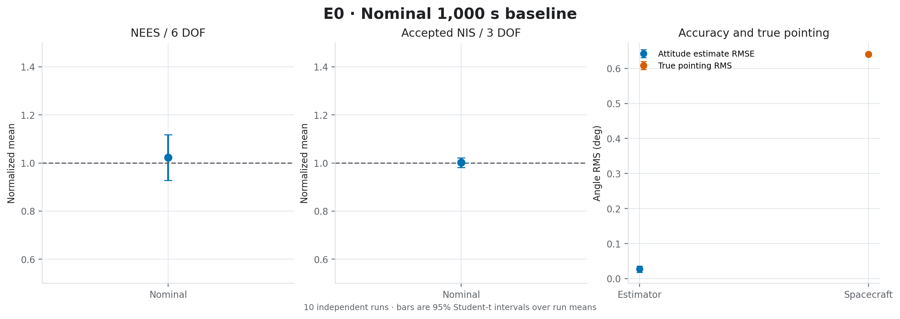
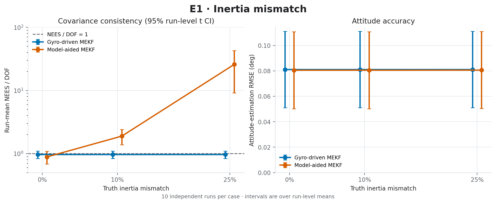

# E0–E7 Statistical Campaign

**Release:** 1.0.0. This page documents the design of the E0–E7 campaign and how to reproduce it. The results and their interpretation are in the [results report](current_evidence.md); the per-case statistics are in the [summary CSV](e0_e7_campaign_summary.csv), and the seeds, environment, and SHA-256 hashes are in the [manifest](e0_e7_campaign_metadata.json).

## Design

| Campaign | Question | Cases | Configuration |
|---|---|---|---|
| E0 | Is the nominal filter consistent over a long run? | Nominal, 1,000 s | `nominal.yaml` |
| E1 | How does inertia mismatch affect each filter? | {gyro-driven, model-aided} × {0, 10, 25}% diagonal mismatch | `model_uncertainty.yaml` |
| E2 | Sensitivity to process-noise mistuning | `Q_scale` ∈ {0.1, 1, 10} | `model_uncertainty.yaml` |
| E3 | Sensitivity to measurement-noise mistuning | `R_scale` ∈ {0.1, 1, 10} | `model_uncertainty.yaml` |
| E4 | Tracker outliers and NIS gating | 5% outliers of {0.1, 0.5, 1} rad × gate {off, on} | `sensor_degradation.yaml` |
| E5 | Tracker outages | Scheduled outage at 5 s of {1, 10, 30} samples | `sensor_degradation.yaml` |
| E6 | Closed-loop stress and actuator authority | Nominal; Q/R × 10; 25% inertia mismatch; zero initial rate; ½× and 2× torque; 1 N·m·s wheel limit; 170° initial attitude | `closed_loop.yaml` |
| E7 | Repeatability | Nominal | `monte_carlo.yaml` |

In total: **33 cases, 330 independent runs, 4.2 million propagation steps** at dt = 0.01 s. E0 runs 1,000 s; all other cases run 100 s. Each sweep changes one assumption at a time from its configuration file.

## Statistical method

- Run `i` of every case uses seed `42 + 1000·i`, `i = 0…9`. Within a run, `SeedSequence` provides independent streams for filter initialization, gyro, and star tracker, so cases that differ only in one sensor's configuration form paired comparisons.
- Each run is reduced to run-level summaries: time-averaged NEES, NIS over accepted updates, RMSE, and performance metrics. 95% intervals are two-sided Student-t over the ten run summaries (9 degrees of freedom). Epochs within a run are never treated as independent replicates.
- NEES is normalized by the state dimension (6 or 15) and NIS by 3. Accepted-update NIS excludes samples rejected by the gate; with the gate off, every delivered sample is accepted.

## Reproduction

```powershell
python -m pip install -r requirements.txt
python scripts/run_research_campaigns.py --campaign all --runs 10 --duration 100 --jobs 8 --output-dir reports/research_campaigns/e0_e7_refresh
python scripts/plot_campaign_figures.py --input reports/research_campaigns/e0_e7_refresh/summary.csv --output-dir docs/figures/refreshed_campaign
python scripts/export_campaign_evidence.py --input-dir reports/research_campaigns/e0_e7_refresh
```

- With `--campaign all`, E0 keeps its 1,000 s duration; `--duration 100` applies to E1–E7.
- `--jobs N` runs cases in parallel processes. Results are independent of `N`.
- `--resume` reuses a completed row only if its signature matches. The signature covers the scenario inputs and a SHA-256 fingerprint of the simulation source, so rows produced by older code are never reused.
- On a 16-core workstation the full campaign takes about 15 minutes with `--jobs 12`.

Raw traces (`*.npz`, about 1 GB) are written under `reports/` and are not version-controlled. The checked-in CSV and manifest are the curated evidence.

## Figures






## Interpretation limits

Ten runs per case provide repeatability evidence for the large effects reported, not a validated operating envelope. The campaign does not randomize full inertia tensors, sensor parameters, disturbances, delays, or actuator faults. The results are simulation characterization only.
