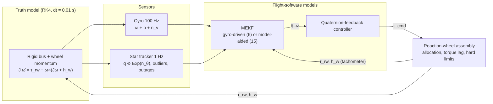

# System Design Description

This document specifies every model and algorithm in the simulation as it is implemented. Each section names the source file that is authoritative for it. Sign and frame conventions are summarized in [conventions.md](conventions.md); verification evidence is in [requirements_traceability.md](requirements_traceability.md).

| Section | Source |
|---|---|
| [1. Simulation architecture and timing](#1-simulation-architecture-and-timing) | `scripts/run_experiment.py` |
| [2. Truth dynamics](#2-truth-dynamics) | `src/dynamics/rigid_body.py`, `src/dynamics/quaternion.py` |
| [3. Reaction-wheel assembly](#3-reaction-wheel-assembly) | `src/actuators/reaction_wheel.py` |
| [4. Sensors](#4-sensors) | `src/sensors/gyro.py`, `src/sensors/star_tracker.py` |
| [5. Attitude estimation (MEKF)](#5-attitude-estimation-mekf) | `src/estimation/mekf.py` |
| [6. Attitude control](#6-attitude-control) | `src/control/attitude_controller.py` |
| [7. Performance and consistency metrics](#7-performance-and-consistency-metrics) | `scripts/run_experiment.py` |
| [8. Random-number management](#8-random-number-management) | `scripts/run_experiment.py`, `src/sensors/` |

Notation: `[v]×` is the cross-product matrix (`skew` in the code), `⊗` the Hamilton quaternion product, `Exp`/`Log` the SO(3) exponential and logarithm on rotation vectors. Quaternions are scalar-last `[x, y, z, w]`.

---

## 1. Simulation architecture and timing



The loop runs on a fixed grid `t_i = i·dt`. At each epoch the operations are executed in this order:

1. Record the truth state `(q, ω)` at `t_i`.
2. Sample the gyro and, if its schedule fires, the star tracker, both at `t_i`.
3. **Measurement updates at `t_i`.** Model-aided only: gyro update (the first sample initializes `ω̂` instead). Then the star-tracker update, if a sample is available.
4. Record the estimate, covariance, NEES, and NIS at `t_i`.
5. Compute the control command from the estimate at `t_i`.
6. Compute the applied wheel torque, held over `[t_i, t_i + dt]`, and advance wheel momentum `h_start → h_end`.
7. Integrate the truth over `[t_i, t_i + dt]` with that torque and the linearly varying wheel momentum.
8. Propagate the filter over the same interval with the same gyro sample (zeroth-order hold), the applied torque, and the interval-mean wheel momentum `(h_start + h_end)/2`.

Measurements are therefore timestamped and applied at the epoch they are generated. Transport latency, timestamp jitter, and out-of-sequence replay are not modeled.

## 2. Truth dynamics

### 2.1 Kinematics

The body-to-inertial attitude obeys

```text
q̇ = ½ q ⊗ [ω, 0]
```

with `ω` the body angular velocity in body axes. The truth integrates `q` and `ω` jointly with classical RK4 and renormalizes `q` after each step.

### 2.2 Rigid bus with reaction-wheel momentum

The spacecraft is a rigid bus carrying reaction wheels. With `J` the bus inertia including the wheels' transverse inertia, `h_w` the total wheel momentum relative to the bus in body axes, and `τ_d` an external disturbance torque:

```text
J ω̇ = τ_rw + τ_d − ω × (J ω + h_w),      τ_rw = −ḣ_w
```

The `ω × h_w` term is the wheel gyroscopic coupling. Without it, total system angular momentum `R(q)(Jω + h_w)` is not conserved during multi-axis wheel activity; `tests/unit/test_rigid_body.py::TestWheelGyroscopicCoupling` demonstrates both cases. Over a step, the wheel torque is held, so `h_w(s) = h_start + ḣ_w s` is exact and is evaluated at each RK4 stage.

The coupling is controlled by `reaction_wheels.gyroscopic_coupling` (default `true`); disabling it is provided only for comparison studies. Nominal disturbance torque is zero in all configurations.

### 2.3 Inertia mismatch

Campaign inertia mismatch scales the truth diagonal: `J_true = J_nom + m·diag(diag(J_nom))` for mismatch fraction `m`. The model-aided filter starts from `J_nom`; the gyro-driven filter does not use inertia.

With `spacecraft.inertia_truth_mode: "sampled_from_prior"` (default `"fixed"`), each run instead draws its own truth inertia from the model-aided filter's prior. The six independent elements `[Jxx, Jyy, Jzz, Jxy, Jxz, Jyz]` are drawn as `J_nom + Σ δ_j s_j E_j` with `δ ~ N(0, σ² I₆)`, where `σ = filter.inertia_relative_sigma` and `s_j` are the filter's own element scales (§5.2). The filter's initial inertia error is therefore a draw from its prior, and the initial 15-state NEES is χ²(15). Draws are rejected and redrawn unless the tensor is symmetric positive definite with principal moments obeying the triangle inequality (`I₁ + I₂ ≥ I₃` and permutations). **Rejection truncates the Gaussian**, so the sampled distribution is narrower than the prior; the rejection rate is reported per run and per campaign (`inertia_sampling`). For the nominal diag(100, 80, 60) it is 0 at σ = 5%, about 2% at 10%, and about 55% at 25%, where the off-diagonal elements (scaled by `√(JᵢᵢJⱼⱼ)`) dominate. The mode cannot be combined with an explicit `true_inertia` argument.

## 3. Reaction-wheel assembly

For `N` wheels with spin axes as the columns of `A` (3×N, body axes):

1. **Allocation:** `τ_w,cmd = −A⁺ τ_cmd` (pseudo-inverse). Three orthogonal wheels give `A = I`; a four-wheel pyramid is available.
2. **Torque saturation:** each wheel is clipped to `±τ_w,max`.
3. **Motor response:** an optional first-order lag with time constant `T_m`, discretized exactly: `τ_w ← τ_w + (1 − e^(−dt/T_m))(τ_w,sat − τ_w)`.
4. **Hard momentum limit:** if `h + τ_w dt` would leave `±h_max`, the wheel torque is reduced so the wheel lands exactly on the limit. Torque is not derated as the limit is approached, so momentum can always be unloaded.
5. **Reaction torque on the bus:** `τ_rw = −A τ_w`. Wheel momentum integrates as `h ← h + τ_w dt`, and its body-axis value is `A h`.

Friction, motor electrical and thermal dynamics, and momentum desaturation are not modeled.

## 4. Sensors

### 4.1 Rate-integrating gyro

```text
ω_m,k = ω_k + b_k + n_v,k,       n_v,k ~ N(0, σ_v²/dt · I)
b_k   = b_(k−1) + n_u,k,         n_u,k ~ N(0, σ_u² dt · I)
```

`σ_v` (rad/√s, angle random walk) and `σ_u` (rad/s^(3/2), rate random walk) are continuous-time spectral-density amplitudes. The initial bias is configured; `σ_b0` applies only when no initial bias is given.

### 4.2 Star tracker

The tracker reports the truth attitude perturbed on the right:

```text
q_ST = q ⊗ Exp(n_θ),   n_θ ~ N(0, σ_θ² I)
```

Sampling keeps fractional phase, so non-integer sensor/simulation rate ratios do not drift. Fault injection:

- **Outliers:** with probability `p_out`, an additional rotation of fixed magnitude `θ_out` about a uniformly random axis is applied. Such samples are flagged invalid in the truth record but delivered to the filter.
- **Outages:** random (probability per sample, fixed duration) or scheduled (start time, duration in samples). No sample is delivered during an outage.

## 5. Attitude estimation (MEKF)

Both variants use a right-multiplicative, body-frame attitude error

```text
q_true = q̂ ⊗ Exp(δθ)
```

so the measurement residual, correction injection, covariance reset, NEES error, and controller all live in the same tangent space.

### 5.1 Variant A: gyro-driven (6 error states)

State `δx = [δθ, δb]`. The gyro is treated as a kinematic input.

| Item | Definition |
|---|---|
| Nominal propagation | `ω̂ = ω_m − b̂`;  `q̂ ← q̂ ⊗ Exp(ω̂ dt)` (exact for the held rate) |
| Error dynamics | `δθ̇ = −[ω̂]× δθ − δb − n_v`,  `δḃ = n_u` |
| `F` | `[[−[ω̂]×, −I], [0, 0]]` |
| `Q_c` | `diag(σ_v² I, σ_u² I) · Q_scale` |

### 5.2 Variant B: model-aided (15 error states)

State `δx = [δθ, δω, δb, δp]`. `δp` holds six dimensionless inertia errors for `[Jxx, Jyy, Jzz, Jxy, Jxz, Jyz]`, each scaled by the nominal magnitude (`Jii` or `√(Jii Jjj)`). The rate is propagated with Euler's equation using the estimated inertia `Ĵ`, the applied wheel torque `τ_rw`, and the measured wheel momentum `h_w`:

```text
f(ω, J) = J⁻¹ (τ_rw − ω × (J ω + h_w))
```

| Item | Definition |
|---|---|
| Nominal propagation | Midpoint (RK2) step of `ω̂` with `f`; `q̂ ← q̂ ⊗ Exp(ω̂_mid dt)` |
| Attitude block | `δθ̇ = −[ω̂]× δθ + δω` |
| Rate block | `∂f/∂ω = Ĵ⁻¹ ([Ĵω̂ + h_w]× − [ω̂]× Ĵ)` |
| Inertia block | `∂f/∂p_j = −s_j Ĵ⁻¹ (E_j f + [ω̂]× E_j ω̂)`, with `E_j` the symmetric basis tensor and `s_j` its scale |
| Bias and inertia | Random walk (`σ_u`) and constant (zero process noise), respectively |
| `Q_c` | `diag(0, σ_ω² I, σ_u² I, 0) · Q_scale` |
| Gyro measurement | `ω_m = ω + b + n_v`:  `H_g = [0, I, I, 0]`, `R_g = σ_v²/dt · I` |

`σ_ω` (`sigma_omega_process`) is the continuous rate-process spectral density that represents unmodeled torque and dynamics. It is a simulation tuning parameter, not a measured value; see risk R-06.

The inertia correction is injected as `Ĵ ← Ĵ + Σ δp_j s_j E_j` only if the result stays positive definite.

### 5.3 Covariance discretization

Both variants discretize with Van Loan's method over each interval:

```text
M = [[−F, G Q_c Gᵀ], [0, Fᵀ]] dt,   e^M = [[·, M₁₂], [0, M₂₂]]
Φ = M₂₂ᵀ,   Q_d = Φ M₁₂,   P ← Φ P Φᵀ + Q_d
```

`tests/unit/test_mekf_linearization.py` verifies `Q_d` against Gauss–Legendre quadrature, and every column of `F` against finite differences, with and without wheel momentum.

### 5.4 Star-tracker update, gating, and reset

```text
ν = Log(q̂⁻¹ ⊗ q_ST),   H = [I, 0, …],   R = σ_θ² I · R_scale
S = H P Hᵀ + R,         NIS = νᵀ S⁻¹ ν
```

- **Gate (optional):** reject the update if `NIS > χ²₃(γ)`. With the default confidence `γ = 0.999999` the threshold is 30.66.
- **Update:** `K = P Hᵀ S⁻¹`, `δx̂ = K ν`, Joseph form `P ← (I − KH) P (I − KH)ᵀ + K R Kᵀ`.
- **Injection:** `q̂ ← q̂ ⊗ Exp(δθ̂)`; the remaining states are additive.
- **Reset:** the attitude block is mapped through the exact SO(3) right Jacobian `J_r(δθ̂)`, which accounts for the re-centering of the error at the corrected estimate.

The model-aided gyro update uses the same Joseph form and reset.

### 5.5 Initialization

The filter is initialized with an error drawn from its own prior, so the initial NEES is χ²-distributed with the state dimension:

```text
δθ₀ ~ N(0, P0_attitude I),  q̂₀ = q₀ ⊗ Exp(−δθ₀)
δb₀ ~ N(0, P0_bias I),      b̂₀ = b₀ − δb₀
```

For the model-aided filter, the first gyro sample initializes `ω̂₀ = ω_m,0 − b̂₀`. The rate prior `P_ω = R_g + P_b` and its cross-covariance `−P_b` with bias follow directly from that initialization. The inertia prior is `inertia_relative_sigma² · I₆`.

## 6. Attitude control

The controller regulates to a desired attitude `q_d` and desired body rate `ω_d`:

```text
q_e = q̂⁻¹ ⊗ q_d   (shortest path: w ≥ 0)
ω_e = ω̂ − R(q_e) ω_d
τ_cmd = sat( k_q · q_e,v − K_ω ω_e ),   k_q = K_q (quaternion_feedback) or 2K_q (pd)
```

`sat` limits the Euclidean norm to `τ_max` and preserves direction. For small angles `q_e,v ≈ θ_e/2`, so the attitude stiffness is `K_q/2` for `quaternion_feedback`. `compute_control_gains` accounts for this when designing gains from a settling time and damping ratio, and the design is verified against a simulated step response.

**State-feedback source.** `controller.state_feedback` selects what the controller receives. `"estimated"` (default, release 1.0.0 behaviour) uses `q̂, ω̂`; `"truth"` uses `q_true, ω_true` and exists only to measure the pointing error the estimator causes. The filter, sensors, and every random stream run identically in both modes, so a given seed gives the same filter-initialization, gyro, and tracker random draws. The realized measurements still differ between modes once the two trajectories diverge, because the tracker perturbs the actual truth attitude.

An optional feedforward adds `ω × (Ĵ ω + h_w)` and cancels an estimated disturbance, saturating the sum once. The campaigns use feedback only. `controller.gyroscopic_feedforward: true` enables it in `run_simulation` (nominal inertia, measured wheel momentum; off by default).

`controller.control_type: "rate_profile"` is a saturation-aware alternative in the family of rate-limited eigenaxis laws (Wie and Lu, "Feedback control logic for spacecraft eigenaxis rotations under slew rate and control constraints", JGCD 1995): the correction rotation vector `φ` (axis `n`) is mapped to a commanded rate `min(√(2 a |φ|), k_p |φ|) n` with `a = f τ_max / (nᵀ J n)`, and `τ = K_ω (ω_cmd − ω)`. It needs a nominal inertia; defaults reproduce the 1.0.0 behaviour unless it is selected.

### 6.1 Feasibility bounds and estimates for rest-to-rest acquisition

The functions in [`src/control/feasibility.py`](../src/control/feasibility.py) separate what is **proven** from what is **estimated**. All assume wheels that start with zero momentum and a body torque limit `τ_max`.

**Momentum lower bound (proven).** The wheel-momentum vector in body axes obeys `ḣ_w = −τ`, where `τ` is the delivered body torque, so `d‖h_w‖/dt = −ĥ_w · τ ≤ ‖τ‖`. The total momentum `H = J ω + h_w` (body components) obeys `Ḣ = −ω × H`; the gyroscopic term is perpendicular to `H`, so `‖H‖` is constant, equal to `‖J ω₀‖` because `h_w(0) = 0`. If the body is at rest at time `T` then `h_w(T) = H(T)`, so `‖h_w(T)‖ = ‖J ω₀‖`, and since `‖h_w‖` grows at most at `‖τ‖`,

```text
T ≥ ‖J ω₀‖ / τ_eff,     and for every t:  ‖J ω(t)‖ ≥ ‖J ω₀‖ − τ_eff t.
```

This is the argument about the wheel momentum, not about `‖J ω‖` directly: `d‖J ω‖/dt` also contains `ω × h_w`, which is not perpendicular to `J ω` once the wheels hold momentum. Two values of `τ_eff`:

- **(a) `τ_eff = τ_max`** (body command norm limit). Valid because the delivered torque cannot exceed the command norm: with orthogonal wheels the allocation is the identity, the per-wheel clip does not reduce a vector whose norm is at most `τ_max`, and the first-order lag returns `m + r (target − m)` with `0 < r < 1`, whose norm is at most `(1 − r)‖m‖ + r‖target‖ ≤ τ_max` by induction from `m = 0`. The momentum hard limit only shrinks a component. Checked in the tests: the largest delivered torque norm is at most `τ_max` to 1e-12.
- **(b) `τ_eff = √3 τ_max`**, the conservative version that uses only the per-wheel clips (each wheel `±τ_max`).

Both are tested against full nonlinear runs, including a controller whose gains keep the command saturated against the rate, which cannot beat either.

**Slew time (approximation).** The rest-to-rest bang-bang time about the correction axis `â` is `2 √(θ J_eff / τ_max)` with `J_eff = âᵀ J â`. It is exact only for a principal axis and ignores gyroscopic coupling and any initial rate.

**Single-axis feasibility estimate (not a bound).** A double integrator `J_eff θ̈ = u`, `|u| ≤ τ_max`, started at the true angle `θ ∈ [0, π]` with the rate component `ω · â` that carries the body away from the desired attitude, driven to either equivalent target (`θ` or `θ − 2π`), has the classical switching-curve minimum time. It ignores the rate perpendicular to `â`, the coupling between axes, the motor lag, and the 2% band, so it can be below what any 3-axis controller achieves (it is not a lower bound; it exceeded the constructive plan below in 2 of the 200 runs).

**Constructive stop-then-slew plan.** In the full rigid-body-plus-wheel model, apply `−τ_max` along the body momentum until `‖ω‖ < 1e-4 rad/s`, then the rest-to-rest slew from the attitude reached. Not optimal, so an achievable time in this idealisation (no estimator, no 2% band), not a bound; its stopping phase is within 2.6% (median) of the momentum bound.

**Linearised closed loop.** Per principal axis `J_i θ̈ + K_ω θ̇ + (K_q/2) θ = 0` for `quaternion_feedback` (`q_e,v ≈ θ/2`, [conventions](conventions.md)); `k = K_q` for `pd`. `compute_control_gains` returns `K_q = 2 J ω_n²` and `K_ω = 2 ζ J ω_n` for `quaternion_feedback`, and a test reproduces the requested damping and frequency for both laws. The linear model has no torque limit; a second model keeps the limit and the `sin(θ/2)` nonlinearity on one axis (`saturated_single_axis_settling_s`).

## 7. Performance and consistency metrics

| Metric | Definition |
|---|---|
| Pointing error | `‖Log(q_d⁻¹ ⊗ q_true)‖` |
| Attitude-estimation error | `‖Log(q̂⁻¹ ⊗ q_true)‖` |
| 2% settling time | First time after which pointing error stays at or below 2% of its initial value for the rest of the run |
| Terminal window | Final 20 s of the run: peak and RMS pointing |
| Wheel utilization | `max |h_i| / h_max` over wheels and time |
| Achieved effort fraction | `Σ‖τ_rw‖² / Σ‖τ_cmd‖²` |
| 3σ coverage | Fraction of component errors inside `±3√P_ii`, using the attitude block and the bias block (indices 3–5 for 6 states, 6–8 for 15 states) |
| NEES | `eᵀ P⁻¹ e` over the full error state; 6 or 15 DOF |
| Marginal NEES | Same, using one state group's covariance block; not additive |
| NIS | `νᵀ S⁻¹ ν`, 3 DOF; reported for all delivered samples and for accepted samples |
| Whiteness | 10-lag multivariate Ljung–Box test on Cholesky-whitened accepted innovations |
| Outage estimator response | Peak attitude-estimation error and peak attitude 3σ from outage start to 30 s after it ends |
| Outage pointing recovery | Time after the outage ends until pointing re-enters and stays within 2% of the pre-outage peak; undefined (not reported) if that never happens within the run |

### 7.1 Pointing-error decomposition and steady-state metrics

Three body-frame rotation vectors are logged per step (`pointing_error_vector`, `control_error_vector`, `attitude_estimation_error_vector`), all in the right-error convention of [conventions.md](conventions.md):

| Rotation | Definition | Meaning |
|---|---|---|
| `δq_p` | `q_d⁻¹ ⊗ q_true` | pointing error (the existing pointing metric) |
| `δq_c` | `q_d⁻¹ ⊗ q̂` | control error: what the controller believes |
| `δq_e` | `q̂⁻¹ ⊗ q_true` | estimation error (the existing attitude-estimation error) |

They satisfy `δq_p = δq_c ⊗ δq_e` exactly, so `θ_p = θ_c + θ_e + ½ θ_c × θ_e + O(θ³)`: the angle vectors add to first order, and the norms do not add exactly. The controller's own `q_e = q̂⁻¹ ⊗ q_d` is `δq_c⁻¹`.

`compute_pointing_decomposition_metrics` evaluates them over a post-acquisition window that starts at the 2% settling time of `‖θ_p‖`, or at `analysis.steady_state_start_s` if the run never settles (or starts with zero error); the source used is reported as `window_source`.

| Metric | Definition |
|---|---|
| APE | RMS and 99th percentile of `‖θ‖` over the window, for `θ_p`, `θ_c`, `θ_e` |
| RPE | RMS and 99th percentile of `‖θ(t+Δt) − θ(t)‖`, both samples inside the window; `Δt = analysis.rpe_window_s` (default 10 s) |
| Rate-feedback noise | RMS of `‖ω̂ − ω_true‖` over the window |
| Fraction within requirement | Share of window samples with `‖θ_p‖ ≤ 0.1°` (project-defined, `analysis.pointing_requirement_deg`) |

**Statistical treatment.** Monte Carlo confidence intervals are two-sided Student-t intervals over independent run-level means. Epochs within a run are correlated, so time fractions inside pointwise χ² bounds are descriptive only. Pointwise ensemble bounds for N runs use `χ²_(N·dof)/N`.

## 8. Random-number management

Each run seed `s` is expanded with `numpy.random.SeedSequence(s).spawn(3)` into three independent child streams:

| Stream | Consumer |
|---|---|
| 0 | Filter initialization error (§5.5) |
| 1 | Gyro: bias random walk, rate noise |
| 2 | Star tracker: noise, outliers, outages |

A fourth child, stream 3, is created only when `spacecraft.inertia_truth_mode` is `"sampled_from_prior"` and drives the truth-inertia draw. `SeedSequence.spawn` gives child `i` the same state whatever the total, so streams 0–2 are identical in both modes and the default path is unchanged.

Sensors hold private `numpy.random.Generator` instances and never read or reseed NumPy's global state. Changing one sensor's configuration, such as the outlier probability, therefore leaves the other streams unchanged. That is what makes paired comparisons between campaign cases meaningful. Monte Carlo run `i` uses seed `s₀ + 1000·i`. The E6 Monte Carlo (`scripts/run_e6_monte_carlo.py`) draws its initial attitude and rate from `SeedSequence(entropy=s_i, spawn_key=(1000,))` and its two children, which cannot collide with the run's own children `spawn_key=(0…3,)`; the truth inertia comes from the run's stream 3 (`inertia_truth_mode: sampled_from_prior`).
