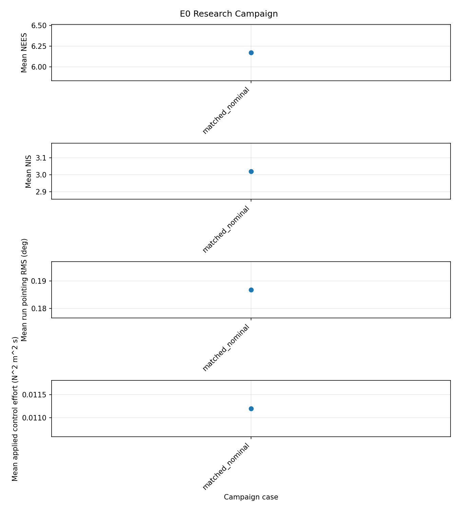

# Prediction-Led Validation of Spacecraft Attitude Estimation and Control

**Technical note · Branch:** `gnc-prediction-validation` · **Baseline:** `v0.1-pilot`

## Abstract

This study evaluates when spacecraft inertia and sensor-model errors make a
multiplicative extended Kalman filter (MEKF) inconsistent and whether that
inconsistency affects closed-loop pointing. The simulator combines nonlinear
rigid-body dynamics, a biased gyroscope, a star tracker, reaction-wheel
actuation, two MEKF architectures, and quaternion feedback. Unlike a
controller-only evaluation, the campaign reports state error, covariance
consistency, true pointing, control effort, gate decisions, and recovery.

The validation plan is prediction-led: quantitative claims and tolerances
were registered before the post-pilot test and simulation campaign. E0 uses an
independently assembled sampled Riccati equation and ensemble χ² consistency
checks. E1 models inertia mismatch as an equivalent torque input and compares
predicted covariance/NEES inflation with nonlinear simulation. Additional
cases probe process-noise bounding, wheel momentum coupling, disturbances,
tracker outliers and outages, large-angle controller behavior, and dispersed
Monte Carlo precision. Results are engineering evidence for this particular
model and configuration; they are not mission requirements or flight
qualification.

## 1. Problem definition and design basis

The project asks two linked questions:

1. Under what operating assumptions does model error cause the reported MEKF
   covariance to understate actual estimation error?
2. When does that estimator degradation produce a measurable change in
   spacecraft pointing or actuator demand?

These questions require distinct measures. Attitude-estimation RMSE measures
state accuracy; NEES and ANIS compare error/innovation statistics with
reported uncertainty; true-pointing error measures control outcome; torque
and wheel-momentum utilization indicate control authority. None is a
substitute for the others. In particular, acceptable pointing over a short
run does not establish estimator consistency or long-term robustness.

The nominal configuration uses diagonal inertia
`I = diag(100, 80, 60) kg m²`, initial body rate
`[0.010, 0.005, 0.002] rad/s`, a 100 Hz gyro, and a 1 Hz star tracker with
10-arcsec small-angle noise. Gyro angle-noise and bias-random-walk amplitudes
are `1e-4 rad/s/√Hz` and `1e-6 rad/s²/√Hz`, respectively. The nominal
quaternion-feedback gains are `K_q = 1` and `K_ω = 10`; the wheel torque limit
is `0.1 N m`. The common comparison window is 60–100 s. Where long dynamics
are required, the full trace is retained and the common window is still used
for comparable steady-state statistics.

The relevant optional model features are configuration-driven and disabled
for the pilot-compatible nominal case: wheel gyroscopic coupling, a constant
disturbance torque, fixed gyro-axis misalignment, scheduled tracker blinding,
and near-180-degree quaternion sign hysteresis.

## 2. Dynamics, sensors, and filters

The body attitude is represented by a scalar-last Hamilton quaternion
`q = [q_x, q_y, q_z, q_w]`, mapping inertial coordinates into body
coordinates. Quaternion kinematics use body angular velocity. The wheel-aware
truth equation is

$$
I\dot{\omega} + \omega \times (I\omega + h_w)
  = \tau_{rw} + \tau_d ,
$$

where `h_w` is wheel momentum expressed in body coordinates, `τ_rw` is
applied wheel torque, and `τ_d` is the external disturbance. The
`ω × h_w` contribution is enabled only for the corresponding cases. Applied
torque is limited and is distinguished from commanded torque in both
performance and effort summaries.

The gyroscope measures `ω_m = ω + b_g + n_g`, with a random-walk bias
`b_dot_g = n_b`. Continuous spectral densities are discretized consistently
with the 100 Hz propagation; the star tracker returns a three-axis
multiplicative attitude observation at its configured rate. Tracker outages
and outliers are separately observable. The innovation gate reports pre-gate
NIS and rejection counts; accepted-only ANIS includes only innovations that
were available, sensor-valid, and accepted. This prevents rejected
large-residual measurements from being interpreted as accepted-sample
consistency.

The gyro-driven MEKF carries attitude and gyro-bias errors (6 covariance
states) and propagates attitude directly from corrected gyro rate. Its
attitude propagation does not depend on inertia. The model-aided MEKF carries
attitude, body-rate, and gyro-bias errors (9 covariance states) and propagates
body rate using Euler dynamics, modeled inertia, and applied wheel torque.
Both use multiplicative attitude updates and covariance reset handling.

For a state error `e` and covariance `P`, NEES is `eᵀP⁻¹e`; the expected
degrees of freedom are 6 and 9 for the two filter variants. For innovation
`ν` and covariance `S`, NIS is `νᵀS⁻¹ν` with 3 degrees of freedom. Ensemble
confidence intervals use the run count, rather than treating the 100 Hz time
history as independent trials. Time-epoch coverage is reported descriptively
because adjacent epochs are correlated.

## 3. Independent analytical references

### 3.1 Matched-noise Riccati covariance (E0)

For small attitude error and a zero-rate reference, the gyro-driven error
state is `x = [δθ, δb_g]ᵀ`. The continuous linear model is discretized at the
actual gyro interval using a Van Loan matrix exponential. The resulting
discrete process model is composed across the integer number of gyro samples
in one tracker period. A discrete algebraic Riccati equation is then solved
for the tracker-cycle prior covariance; the posterior covariance is
calculated with the Joseph form. This reference is assembled separately from
the production MEKF.

The empirical covariance comparison samples the filter covariance at tracker
posterior epochs inside the 60–100 s evaluation window. It compares the
ensemble-average covariance with the periodic DARE posterior using relative
Frobenius error and attitude/bias marginal errors. The registered thresholds
are 10% for relative Frobenius error and 15% for each marginal variance. The
prior/posterior phase matters: averaging every gyro-propagation sample and
comparing it with the tracker posterior would mix two different points in the
periodic covariance cycle.

For `N` independent runs and `n` error degrees of freedom, the two-sided
ensemble confidence interval on mean NEES is

$$
\left[\chi^2_{0.025,Nn}/N,\ \chi^2_{0.975,Nn}/N\right].
$$

The corresponding accepted-only ANIS calculation uses `n = 3` and the
accepted/available mask. E0 uses 100 seeds and checks whether run-level mean
confidence intervals contain the theoretical values (6 for NEES and 3 for
ANIS).

### 3.2 Inertia mismatch as an unmodeled torque (E1)

Let `I_t = I_m + δI`, where `I_t` is truth inertia and `I_m` is the inertia
used in model-aided propagation. Subtracting the two Euler equations and
retaining first-order mismatch terms gives the torque-equivalent residual

$$
\delta\tau = \delta I\,\dot{\omega}
             + \omega \times (\delta I\,\omega).
$$

The rate forcing is approximately `I_m⁻¹δτ`. The analysis propagates the
resulting model-error mean through the linearized state transition and tracker
updates; it separately accumulates the empirical error covariance. Expected
NEES includes the mean and covariance contributions,

$$
E[\epsilon_{NEES}]
 \simeq \mathrm{tr}(P^{-1}P_e)
       + \mu_e^\mathsf{T}P^{-1}\mu_e.
$$

The covariance-only expression is not used to hide a deterministic
systematic bias. The full E1 grid varies signed diagonal inertia error
`{-25,-10,0,+10,+25}%`, process-noise scale `{0.1,1,10}`, and tracker rate
`{0.2,1,5} Hz`. Additional cases compare an inertia-error torque bound,
bounded versus unbounded model-aided filtering, and gyro-noise scales to
locate the first gyro-quality crossover.

The conservative magnitude inequality is

$$
\|\delta\tau\|
 \le \epsilon\|I\|_F
       \left(\|\dot{\omega}\|+\|\omega\|^2\right),
$$

for relative inertia uncertainty `ε`. The bound is mapped through the modeled
inertia inverse into rate process uncertainty and scaled by configured
`Q_scale`. This is a bounded-error approximation, not a claim that a
systematic inertia error is intrinsically white noise. The validity map
identifies the conditions under which first-order mean/covariance prediction
is expected to fail.

### 3.3 Local pointing bound

For small pointing error `θ`, the quaternion-vector term is approximately
`θ/2`. The feedback law linearizes to

$$
\dot{x}=Ax+d,\qquad
x=[\theta,\dot{\theta}]^\mathsf{T},\qquad
A=\begin{bmatrix}
0&I\\
-K_p I^{-1}&-K_d I^{-1}
\end{bmatrix},
$$

where `K_p = K_q/2` for quaternion feedback and `K_d = K_ω`. Bounded
attitude/rate-estimation errors and disturbance torque produce a bounded
forcing `d`. For Hurwitz `A`, choose positive-definite `P` satisfying
`AᵀP + PA = -I`. With `V = xᵀPx`,

$$
\dot V=-\|x\|^2+2x^\mathsf{T}Pd
       \le -\|x\|^2+2\|P\|\|x\|\|d\|.
$$

Thus the local ultimate state-norm radius is at most `2 ||P|| ||d||`;
pointing is no larger than the full state norm. The test case uses a tight
initial pointing condition, a constant disturbance, and a 300 s tracker
blind interval so estimation error is relevant. This is explicitly a local,
unsaturated bound, not a global guarantee for the quaternion double cover.

## 4. Experiment execution and reporting

The pre-registered matrix E0–E7 covers: nominal consistency and disturbance
equilibrium (E0); inertia/Q/tracker-rate and gyro-quality effects (E1);
combined process/measurement-noise tuning sensitivity (E2/E3); gate-edge
innovations with a no-outlier control (E4); 60/300/900 s tracker outages
(E5); 170/179-degree attitudes with three torque limits, both quaternion
signs, and hysteresis on/off (E6); and dispersed Monte Carlo (E7). E7 draws
initial attitude and rate, inertia, gyro bias, and fixed gyro-axis
misalignment from documented distributions. It starts at 100 runs and
increases the sample count until its confidence-interval precision criteria
are met or the cap is reached.

All cases preserve their time histories and masks. CSV/JSON summaries,
campaign figures, and a predicted-versus-measured table are emitted beneath
`reports/prediction_validation/`; binary traces are local generated outputs.
The earlier pilot remains separately archived. Reproduction commands and
file-level equations are given in the README and conventions note.

## 5. Results and prediction ledger

The measured values, registered tolerance, pass/fail state, and an
explanation for every miss are recorded in
[`../reports/prediction_validation/predicted_vs_measured.csv`](../reports/prediction_validation/predicted_vs_measured.csv).
The full case metrics and machine-readable metadata are in
[`../reports/prediction_validation/summary.csv`](../reports/prediction_validation/summary.csv)
and [`../reports/prediction_validation/summary.json`](../reports/prediction_validation/summary.json).
The first E0 batch is 100 independent runs of 100 s each, evaluated over
60–100 s. The run-level mean ANEES is **6.172** (95% CI
**[5.790, 6.553]**) and mean accepted-only ANIS is **3.021** (95% CI
**[2.955, 3.087]**); both intervals contain their theoretical values. The
time-epoch statistic is inside the individual χ² bounds for **96.8%** of
NEES epochs and **100%** of ANIS epochs. These time fractions are descriptive,
not independent-trial pass probabilities.

| E0 metric, 60–100 s | Measurement | Prediction check |
|---|---:|---|
| Mean covariance vs. periodic DARE, relative Frobenius error | 2.87% | Pass (≤10%) |
| Attitude marginal variance relative error | +0.107% | Pass (≤15%) |
| Gyro-bias marginal variance relative error | +54.36% | **Miss** (≤15%) |
| Attitude-estimation RMSE | 0.00833 deg | Descriptive |
| Body-rate-estimation RMSE | 0.0574 deg/s | Descriptive |
| Gyro-bias-estimation RMSE | 0.000704 deg/s | Descriptive |
| True-pointing RMS | 0.187 deg | Descriptive |
| Peak commanded / applied torque | 0.0459 / 0.0435 N m | No saturation in this window |

The bias covariance is still converging through this interval: its
ensemble-average posterior diagonal falls from `1.90e-10` at 60 s to
`1.33e-10 (rad/s)²` at 99 s, versus the periodic DARE value
`1.00e-10 (rad/s)²`. This explains the marginal miss: the nominal 60–100 s
window is not yet steady for the weakly observed gyro-bias mode. The
pre-registered late 600–1,000 s window was not completed, so steady-state
marginal agreement remains unverified. The aggregate Frobenius metric passes
because the attitude block dominates its norm; it must not conceal the
bias-specific miss.

| Prediction | Primary comparison | Engineering decision |
|---|---|---|
| P0/P1: matched baseline | Periodic DARE covariance; run-level NEES/ANIS confidence intervals | State covariance and statistical consistency are evaluated independently |
| P2/P3: model-aided mismatch | Predicted/measured NEES and model-error covariance over the E1 grid | Report the local validity envelope; do not state a universal inertia threshold |
| P4: process-noise bound | Bounded/unbounded NEES, rate coverage, attitude error, and gyro-quality crossover | Select a bound only if coverage gain is not bought with unacceptable nominal accuracy loss |
| P5/P6: physical extensions | Wheel coupling torque, disturbance equilibrium, outage covariance and recovery | Attribute performance changes to physical forcing and authority, not to estimator consistency alone |
| P7/P8: closed-loop stress | Sign-equivalent trajectories and Lyapunov bound in the local regime | Fix the controller only if a reproducible near-180-degree defect is measured |
| P9/P10: gate/outage/Monte Carlo | Gate rejection, outage recovery, percentile bootstrap CIs and target status | Finite-sample misses remain visible; unresolved precision is not called a pass |

Plots are diagnostic, not acceptance evidence by themselves. Numerical pass
criteria and the domain in which each prediction stops applying are listed in
[`predictions.md`](predictions.md) and
[`validity-domain.md`](validity-domain.md).

## 6. Interpretation and limitations

The conclusions apply only to the configured rigid body, sensor schedules,
noise distributions, controller gains, and actuator limits. The model does
not include flexible modes, structural coupling, detailed wheel friction or
jitter, orbit/environment propagation, multiple tracker heads, or a
flight-software fault-management architecture. A fixed-axis sensor
misalignment is included only as a sampled parameter, not as a full
calibration or thermal model.

The Riccati reference assumes local linear error dynamics and a zero-rate
operating point. Inertia-mismatch propagation is first order and trajectory
dependent. Wheel coupling becomes relevant through the actual `ω × h_w`
term, not from wheel momentum magnitude alone. Gate decisions near a χ²
threshold are probabilistic. The PD bound excludes saturation, large-angle
motion, and error excursions outside the local validity region. Monte Carlo
precision describes the declared input distributions and is not a reliability
claim for a real spacecraft population.

## 7. Engineering conclusion

This validation structure makes the principal decision evidence auditable:
analytical reference, independent seeds, explicit update masks, fixed
evaluation windows, physical telemetry, uncertainty intervals, and written
prediction misses. The project should be extended only when the results show
that a new model feature changes an analytical prediction or a measured
operating envelope. Passing software tests verifies implementation behavior;
it does not establish mission-level pointing compliance or flight readiness.

### Campaign closure status

This is a partial validation closeout, not completion of the registered
campaign. The completed E0 batch supports matched-filter ensemble consistency
at the run level, but the bias-marginal Riccati check misses and the long
steady-state follow-up was not completed. E1 produced useful trend and
model-error evidence, but the assumed-Q trend missed at 2 of 30 transitions,
only 36 of 74 predicted-versus-measured NEES comparisons met the registered
20% tolerance, and the expanded inertia-mismatch gyro crossover was
interrupted. No gyro-quality crossover is therefore claimed.

The corrected E6 24-case matrix was run with zero initial rate, matched
controller/wheel torque limits, and a 600 s horizon; its machine-readable
results are retained in
[`../reports/prediction_validation/e6_corrected/summary.csv`](../reports/prediction_validation/e6_corrected/summary.csv).
The E4 no-outlier setup rejected 17.7% of measurements, above its 5% target.
E5 recovery times for 60, 300, and 900 s outages were approximately 103.6,
35.3, and 260.3 s, respectively, so the registered monotonic trend was not
supported. The P8 bound was numerically conservative but not decision-useful
(1.64 rad predicted versus 0.0039 rad measured peak pointing error).

E7 Monte Carlo precision, the interrupted low-noise E1 cases, and the
1,000 s E0 disturbance/steady-state follow-up remain untested or incomplete;
they are not passes. Existing campaign files and tables must be interpreted
with their case-level status and window, rather than as a single completed
validation score. The next campaign should close these evidence gaps before
using the registered crossover, dispersed-performance, or long-outage claims
for a design decision.

## References

1. Lefferts, Markley, and Shuster, “Kalman Filtering for Spacecraft Attitude
   Estimation,” *Journal of Guidance, Control, and Dynamics*, 1982.
2. Markley and Crassidis, *Fundamentals of Spacecraft Attitude Determination
   and Control*, Springer, 2014.
3. Solà, “Quaternion Kinematics for the Error-State Kalman Filter,” 2017.
